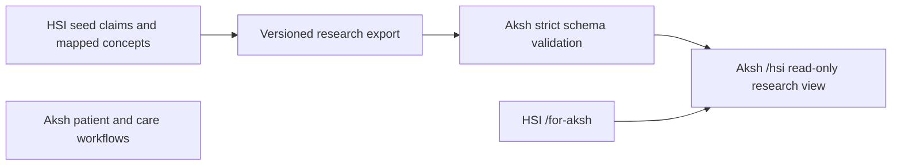

# Aksh platform integration

Implemented locally, 2 November 2026. Aksh checkout: `gnaneshwer23/aksh-health-redesign` at `8f7fba6e84d1a976cd31435cc189aa9ea7a19ac1`, active package `packages/platform-uk`. The legacy `packages/aksh-health` package is not used. Existing research-workbench changes in HSI are preserved.

## Architecture and scope

HSI and Aksh remain separate deployable applications. HSI produces a versioned public research artifact; Aksh validates and displays it as research context. Aksh remains responsible for identity, patient permissions, care records, clinical logic and review decisions. No patient lookup, clinical rule execution, database sharing, SSO or EHR write is implemented by this connection.



This is a snapshot import, not live retrieval. The initial artifact has 22 mapped claims. HSI `src/akshResearchExport.ts` projects only research metadata from the existing mappings. It omits observation values, patient identifiers, action recommendations and clinical eligibility flags. Source notes are retained, including explicit evidence limitations such as “not T2D proof”. A pack review of `source-verified` is not a clinical approval; all exported claims carry `sourceSupport=not_verified_for_clinical_use`.

Aksh `lib/hsi/research-contract.ts` independently validates schema version, producer revision, timestamp, identifiers, grades, review states, source identifiers and all invariant flags. Unknown properties, duplicate IDs and empty/oversized card collections fail validation. Invalid imports are rejected before replacing the existing snapshot. The page also validates at render time and shows an unavailable state instead of unvalidated claims.

Schema validation is not a free-text PHI detector or proof of scientific truth. Only reviewed public HSI artifacts belong in this importer; never use it for arbitrary clinical exports. The new `/hsi` view accepts no patient input and has no write actions. Its capability is registered as `in_validation`, not production.

## Refresh the imported snapshot

With Bun on PATH (cloud instance: `export PATH="/workspace/.hsi-tools/node_modules/.bin:$PATH"`):

```bash
cd /workspace/hsi-core
bun src/cli/export-aksh-research.ts

cd /workspace/aksh-health-redesign/packages/platform-uk
bun scripts/sync-hsi-research.ts /workspace/hsi-core/dist/hsi-aksh-research.json
bun tests/hsi-research-contract.test.ts
```

The sync command validates first, writes a temporary file and atomically replaces `data/hsi/research-bundle.json`. Re-importing the same artifact is idempotent. Review the snapshot diff before release; it is intentionally stored with the consumer so deployment does not depend on a sibling checkout. The producer records the Git revision and whether uncommitted changes were present during export. A clean revision still needs independent scientific and release review.

## Run locally

```bash
cd /workspace/aksh-health-redesign/packages/platform-uk
npm ci --no-audit --no-fund
npm run dev -- --hostname 127.0.0.1 --port 3000
```

In a second shell:

```bash
cd /workspace/hsi-core
VITE_AKSH_APP_URL=http://127.0.0.1:3000 bun run site:dev --host 127.0.0.1 --port 5174
```

HSI `/for-aksh` offers the configured shared research context link. Aksh `/resources` links to `/hsi`. The default HSI “Open Aksh Health” link still goes to the established Aksh homepage; the research link is shown only when a valid `VITE_AKSH_APP_URL` is configured. In production, set it to the Aksh HTTPS origin only after deploying the matching `/hsi` consumer. Vite embeds the value at build time. Localhost HTTP is permitted for local checks; other HTTP and non-web schemes are rejected.

No database credentials are needed for this public research view. Do not copy Aksh environment files or patient databases into HSI. Existing authentication, tenant boundaries and care routes remain owned by Aksh.

## Validation and release limits

- HSI producer tests: mapped data, unchanged grades/source notes, no patient/action objects, invalid revision/timestamp rejection.
- Aksh consumer tests: real 22-card producer snapshot accepted; 11 malformed/unsafe payload variants rejected; known source caveat retained.
- Aksh capability register consistency test passes; both application TypeScript checks pass.
- The broad Aksh `npm run verify` additionally requires its own non-production test database. It currently stops at the patient-spine database test without that configuration; do not substitute HSI's connection.
- Browser smoke checks exercise HSI→Aksh navigation, imported claims, source caveats, resource navigation and mobile page overflow. Evidence is stored locally under `/workspace/vision-audit/`.
- HSI library and Vite builds are checked independently. The known pre-existing HSI homepage source-assertion mismatch remains outside this integration.
- Aksh now self-hosts integrity-pinned Fontsource packages; its complete production build passes without Google font downloads. OFL licence copies are served under `/legal/fonts/`.
- No production deployment, database migration, patient workflow, SSO, or clinical efficacy verification occurred. Release both repos together after reviewing the artifact and configuring the HSI Aksh origin.

## Next integration stages

1. Verify exact claim support and source rights before promoting any research context beyond preview.
2. Publish a reviewed HSI artifact version with immutable content identity; automate validated imports through CI rather than sharing runtime databases.
3. If private cross-product navigation is required, design federated identity and server-side purpose/organisation checks with the Aksh owners. A navigation link is not SSO, and this public snapshot importer is not a clinical gateway.
4. Evaluate any patient-specific evidence use inside Aksh's own safety and authorisation boundary. HSI research ingestion must not receive those records.
