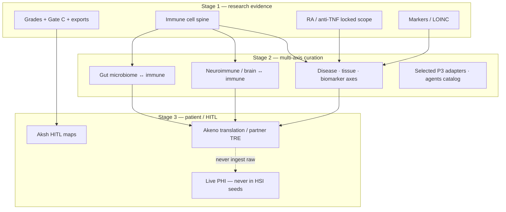

# HSI systems vision map

**Binding user intent:** whole immune + gut microbiome ↔ immune + brain ↔ immune + diseases / cells / tissues / biomarkers + patient-data connections + AI / future technology — a **connected systems graph**, not a forever-narrow single-pathway product.

**Honesty first:** “all” is the **target graph**, not one sprint. Every edge still needs **context + evidence + grades**. Patient data is **gated** (Stage 3+ / HITL / Akeno). This doc + regenerable export `hsi-systems-vision.json` record the map; they do **not** invent deep claim seeds, wipe the RA Stage 1 lock, or set `partnerSigned`.

**Edit target:** `hsi-core` only · Neon **`red-wave` only** · no immunecity edits · no live PHI · no CDS.

**Code anchors:** `src/systemsAxes.ts`, `src/immuneCellSpine.ts`, [`VISION_REPO_ALIGNMENT.md`](./VISION_REPO_ALIGNMENT.md), [`OUTPUTS.md`](./OUTPUTS.md).

---

## One picture



---

## Stage gates

| Stage | Meaning | In hsi-core today |
|-------|---------|-------------------|
| **Stage 1** | Research evidence backbone: graded edges, provenance, Gate C checklists, versioned exports; working pilot scope (RA/anti-TNF); immune-cell spine **vocabulary** | **Mostly done** (Phases 0–8 packs); spine stubs; systems vision stubs **landed** |
| **Stage 2** | Multi-axis curation: gut–immune, neuroimmune, tissue/disease overlays; deepen ontology hints; selected molecular / agent adapters; R2 validation | **Vocabulary stubs only** for gut/neuro; R2 cards exist; adapters **deferred P3** |
| **Stage 3** | Patient / HITL / Akeno: translation handoff, partner governance, clinical surfaces | **Scaffolding only** (`hsi-translation-handoff`, `/akeno`); **no** live PHI / CDS |

---

## Domain → ownership

| Domain | HSI owns | ISI product UX | Aksh / Akeno clinical |
|--------|----------|----------------|------------------------|
| **Immune cell spine** | Class/lineage/subset ids, PRD relation vocab, claim edges + grades | Cell-first explorer, neighbourhood graph | No Stage 1 CDS from spine alone |
| **Gut microbiome ↔ immune** | Entity classes, gut–immune predicates, hypothesis-capable grades | Discovery overlays / Ask–Radar | No microbiome PHI; Stage 3+ HITL only |
| **Neuroimmune / brain ↔ immune** | Brain region / axis entity types, brain–immune predicates | Neuroimmune pathway UX | No neuro CDS from research packs |
| **Diseases, tissues, biomarkers** | Axis placeholders; LOINC on markers; MONDO/UBERON later | Disease overlays, filters, compare | HITL marker cards when `cdsSurfacable` |
| **Patient-data connections** | Observation **shapes**, handoff candidates; explicit never-store rules | Research-only; no identifiable patients first | Stage 3+ partner TRE / Akeno — live PHI out of HSI |
| **AI & future tech** | Adapter registry metadata; ban on grade auto-promotion | Agent workbench runtime (later) | Care agents ≠ generative chem → clinic |

Regenerable detail: `buildSystemsVisionBundle()` → publish artifact `hsi-systems-vision.json`.

---

## Domain detail

### 1. Immune cell spine (started)

- **Code:** `src/immuneCellSpine.ts` — major classes / lineages / subsets; `ISI_CONTROLLED_RELATIONSHIP_TYPES`.
- **Vertical honesty:** **Decision A dual-track** — RA = Stage 1 `scopeLocked` / `activeScope=ra-tnf`; SSc = PRD MVP `prdMvpTarget` with thin seeds (`deepSeedsPresent=true`). Do not wipe RA or invent partner.
- **Alignment:** [`ISI_WHOLE_IMMUNE_CELL_PRD_ALIGNMENT.md`](./ISI_WHOLE_IMMUNE_CELL_PRD_ALIGNMENT.md).

### 2. Gut microbiome ↔ immune

- **Entity classes:** taxon, community, metabolite, barrier_compartment, mucosal_immune_interface (expanded for SCFA/butyrate / mucosal Treg·Th17 / Clostridia class).
- **Predicates (hypothesis-capable where noted):** `modulates_immune`, `produces_metabolite_sensed_by`, `compromises_barrier`, `recruits_to_mucosa`, `cross_reacts_with`, `hypothesized_gut_immune`, …
- **P1.3 deep seeds:** `hsi-gut-immune-pack` — SCFA/butyrate ↔ mucosal Treg/Th17 (+ barrier); verified public PMIDs; `uncertain`/`hypothesized` grades; Th17 promote vs inhibit kept as competing frames. Discovery secondary axis only (does not replace RA ASK).
- **Not yet:** species-level disease claims, microbiome cohort data, first-class `HSI_EDGE_TYPES` promotion for gut predicates (P1.4 optional).

### 3. Neuroimmune / brain ↔ immune

- **Entity types:** brain_region, cns_compartment, neuroimmune_axis, glial_or_barrier_cell, neuro_mediator.
- **Examples:** hypothalamus, BBB, CSF, HPA axis, vagus / inflammatory reflex, α7 nAChR, ChAT+ memory T cells, microglia (stub).
- **Predicates:** `signals_via_axis`, `crosses_bbb`, `activates_glia`, `suppresses_peripheral_inflammation`, `associates_neuroimmune`, `hypothesized_brain_immune`, …
- **P2.1 deep seeds:** `hsi-neuroimmune-pack` — vagus / cholinergic anti-inflammatory reflex (chosen for clearest landmark PMID chain vs microglia or BBB atlases); verified public PMIDs; `uncertain`/`hypothesized` grades; human VNS–RA (Koopman) hypothesized only — **not** a clinical brain–immune cure. Discovery secondary axis only.
- **Not yet:** MS / neurodegeneration disease atlases; microglia–cytokine or BBB cytokine neighbourhood deepen.

### 4. Diseases, tissues, biomarkers / LOINC

- **Layers:** disease · tissue · biomarker placeholders (`DISEASE_TISSUE_BIOMARKER_STUBS`).
- **Concrete LOINC:** continues in `src/markers.ts` + pilot packs — axis stubs do not duplicate codes.
- **Expansion does not force** an SSc seed pivot; RA lock stays authoritative until product writes otherwise.

### 5. Patient-data connections (Stage 3+ / HITL / Akeno)

| HSI **may** store | HSI **never** stores |
|-------------------|----------------------|
| De-id / fixture observation **shapes** (`HsiPatientObservationStub`) | Raw PHI / identifiable records |
| Translation handoff candidates (`deferred_until_hitl`) | Live partner cohort dumps |
| Aksh HITL map snapshots (`cdsSurfacable=false` on seeds) | EHR write-back / auto CDS |
| Policy flags (`notCds`, `clinicalActive=false`) | Invented `partnerSigned` / fake MoUs |

Live patient context stays in **Aksh / Akeno / partner TRE** after governance — export-based consumption, not HSI Neon as a clinical warehouse. See [`AKENO_IN_HSI.md`](./AKENO_IN_HSI.md), [`AKSH_HITL_CONSUMPTION.md`](./AKSH_HITL_CONSUMPTION.md).

### 6. AI & future tech (P3 research adapters)

**Position paper (deep):** [`HSI_AI_NEURAL_FUTURE_HEALTHCARE.md`](./HSI_AI_NEURAL_FUTURE_HEALTHCARE.md) — NN as proposers/scorers; KG as constraint; agent workbench vs HITL care agents; patient plane; near-term schema stubs vs deferred ML stack.

Catalogued in `FUTURE_TECH_ADAPTER_STUBS`, `AI_FUTURE_TECH_CAPABILITIES` / `AI_FUTURE_TECH_HARD_BANS`, and [`VISION_REPO_ALIGNMENT.md`](./VISION_REPO_ALIGNMENT.md):

| Adapter | Role | Rule |
|---------|------|------|
| TDC | Offline ML eval | Not seed authority |
| AlphaFold3 / Boltz | Structure hypotheses | License review; discovery-only |
| ESM | Embeddings / similarity | No clinic PHI sequences |
| OpenMM | MD simulation | Not Gate C evidence |
| RDKit | Cheminformatics | No invented clinical edges |
| REINVENT4 | Generative design sandbox | Never clinic recommendation path |
| ISI 12-agent workbench | Supervised research agents | Runtime = ISI product; Stage 1 out of scope |

**Schema / wired AI contracts (not a model stack):** `MODEL_PROPOSAL_ARTIFACT_SCHEMA` (P1.5 Gate C) · `EDGE_EMBEDDING_SLOT_SCHEMA` + `hsi-embedding-sidecars.json` (P2.2 hash/ref) · `MODEL_EVAL_HARNESS_STUB` (P2.3 next).

**Invariant:** model output **never** auto-flips `hsiGrade` or Gate C (`autoApproveIntoKg=false`; embedding `doesNotSetHsiGrade=true`).

---

## What regenerates

```bash
bun run outputs   # writes dist/outputs/.../hsi-systems-vision.json (+ MANIFEST pointer)
```

| Artifact | Role |
|----------|------|
| `docs/HSI_SYSTEMS_VISION_MAP.md` | Durable prose map (this file) |
| `src/systemsAxes.ts` | Entity / predicate / ownership / adapter registries |
| `hsi-systems-vision.json` | Regenerable JSON snapshot for consumers |

---

## Recommended next build slice (one axis)

**SSc deepen (P1.1) + model→Gate C (P1.5) + gut–immune P1.3 + neuroimmune P2.1 + embedding sidecars P2.2 landed.** **Next recommended science slice:** P2.3 offline eval harness stubs against public packs (no PHI); leave RA lock untouched. Partner outreach (P0.2) remains the parallel critical path.

---

## Cross-links

- AI / NN / future healthcare position: [`HSI_AI_NEURAL_FUTURE_HEALTHCARE.md`](./HSI_AI_NEURAL_FUTURE_HEALTHCARE.md)  
- Outputs checklist: [`OUTPUTS.md`](./OUTPUTS.md)  
- Whole-immune-cell PRD: [`ISI_WHOLE_IMMUNE_CELL_PRD_ALIGNMENT.md`](./ISI_WHOLE_IMMUNE_CELL_PRD_ALIGNMENT.md)  
- Technical blueprint: [`ISI_TECHNICAL_BLUEPRINT_ALIGNMENT.md`](./ISI_TECHNICAL_BLUEPRINT_ALIGNMENT.md)  
- Bio-stack / P3: [`VISION_REPO_ALIGNMENT.md`](./VISION_REPO_ALIGNMENT.md)  
- Target-state stages: [`ISI_TARGET_STATE_PRD_ALIGNMENT.md`](./ISI_TARGET_STATE_PRD_ALIGNMENT.md)  
- Neon isolation: [`NEON_PROJECT_MAP.md`](./NEON_PROJECT_MAP.md)
