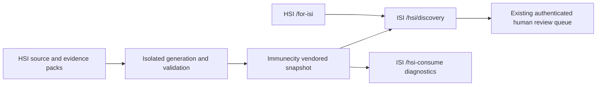

# Immune Super Intelligence integration

Implemented locally on 2 November 2026 against `gnaneshwer23/immunecity` revision `faf746b68f57be0446dee6b82b249e9d4e6a0aa1`. This uses the live repository's existing HSI bridge; the frozen `hsi-sources/vendor/immunecity` tree is untouched.

## What connects

HSI remains the research substrate and pack producer. Immunecity remains the ISI application: atlas, Ask, evidence surfaces and human curation. Aksh remains a separate care application. Integration shares published, versioned JSON and concept pointers; it does not merge databases, clinical records, authentication or deployment histories.



Existing HSI-consume code, graph views, Gate C authentication and ISI relation identifiers are reused. No new chatbot, evidence approval mechanism, database migration or shared database was added.

## Corrected stale partner truth

The original Immunecity vendored pilot claimed `lockedPilot=true` with a named Apolo partner. Current HSI had revoked that path and restored the hypothetical fixture. The snapshot refresh now carries `lockedPilot=false`, `legalBinding=false` and `agreementKind=hypothetical_test_only`. `partnerSigned=true` is a fixture path-testing field, not production partnership evidence; the UI reports `partnerSignedProduction=false`.

The legacy `index.json` catalogue alias is refreshed with `catalogue.json`, preventing different entry points from retaining different partner claims. Two existing tests that asserted the revoked partner were updated to assert the current fixture and absence of a legal pilot. Separate tests still exercise legitimate named-partner and invalid-partner contract shapes; those tests do not establish a real agreement.

## Runtime behavior

`src/lib/hsi/vendoredDiscovery.ts` bundles the selected JSON files and uses the existing consume validator through an injected artifact reader. Both product and diagnostic route loaders use this path during SSR and client navigation. They no longer require a localhost self-fetch or runtime access to a private GitHub repository.

An invalid bundled release fails closed rather than silently switching to an unrelated remote release. The pilot pack must match the validated partner lock's `partnerSigned` and `lockedPilot` fields. Required pilot/Gate C honesty flags are checked. Individual optional packs remain optional under the existing contract.

HSI `/for-isi` offers a direct research-workspace link when `VITE_ISI_APP_URL` is configured. Only HTTPS origins and localhost HTTP origins are accepted. The default public product link remains the established ISI homepage. Set the production origin only when the matching consumer release is deployed.

## Refresh artifacts

With Bun on PATH:

```bash
export PATH="/workspace/.hsi-tools/node_modules/.bin:$PATH"
cd /workspace/immunecity
HSI_CORE_PATH=/workspace/hsi-core bun run hsi:sync-export
```

The sync script now defaults to a sibling `hsi-core` checkout instead of a personal absolute path. It copies source into a temporary directory, excluding Git metadata, dependency/build directories and environment files. Export and publish run there, so HSI's tracked site JSON and existing user changes are not rewritten. The stage is removed on process exit. Generated core artifacts are checked before copying to the consumer.

Refresh changes are intentional snapshot updates: review `public/hsi-discovery/`, `src/data/hsi-isi-export.json` and `src/data/hsi-substrate-pin.json` together. The current pin contains 88 seed edges. A sync timestamp is ignored local metadata. HSI safety labels and source locators are preserved; a source locator is not proof of exact claim support.

## Dependencies and local startup

The original frozen Bun lock references a package mirror denied by the cloud proxy. The pinned public packages were installed successfully by changing only that mirror prefix in a disposable lock copy under `/workspace/.immunecity-install`; package versions and integrity hashes are preserved. The repository manifest and lockfile remain unchanged. `/workspace/install-immunecity.sh` reproduces this tested installation, with the checkout's `node_modules` linked to that isolated install. The environment draft includes these steps.

```bash
cd /workspace/immunecity
bun run dev --host 127.0.0.1 --port 4175
```

In another process, start HSI with both connected application origins:

```bash
cd /workspace/hsi-core
VITE_ISI_APP_URL=http://127.0.0.1:4175 \
VITE_AKSH_APP_URL=http://127.0.0.1:3000 \
bun run site:dev --host 127.0.0.1 --port 5176
```

The read-only HSI research view needs no database credentials. Signed-in human review continues to use Immunecity's existing role checks and ISI-owned database. No review writes were exercised or authorised by this smoke test. HSI migrations must never target the ISI database.

## Verification and limits

- 40 targeted tests across six files pass: bridge axes, Discovery consume, product-loop shaping, bundled offline loader, Gate C queue and curator status.
- New loader tests prove zero network calls, invalid-bundle rejection without remote fallback, partner-lock consistency and caller-mutation isolation.
- Immunecity client/server production build passes. HSI site checks are run separately.
- Full Immunecity TypeScript check remains blocked by 136 existing diagnostics. A clean archive of the original commit reports the same diagnostic set after ignoring line shifts. Examples include missing `Link` imports in an existing curation panel and server-function serialization typing. This is not a clean type-check claim and does not make those defects harmless; they remain follow-up work outside this integration.
- Browser checks exercise the configured HSI→ISI link, rendered packs, fixture labels, MAP source rows, REVIEW navigation, diagnostics and mobile layout without performing review writes. The existing HSI grid/table min-content overflow was corrected, with keyboard focus added to the evidence scroll region.
- No deployment, publication, shared login, live database validation, scientific efficacy claim or clinical integration occurred. Production release requires review and deployment of both repositories plus the configured ISI origin.

Recommended next step: verify the evidence-support contract across HSI, ISI and Aksh before enabling more automated retrieval. Keep authentication federation separate from this public research snapshot integration.
