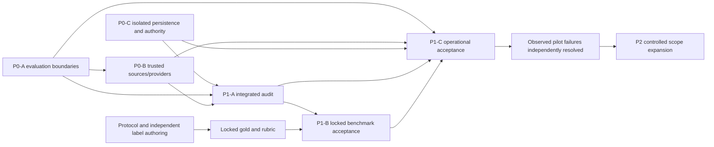

# P2 — Broaden only after reliable pilot evidence

**Status: preparation only; P2 is disabled.** Merged P0/P1 engineering and green tests are not P1-C acceptance. The current operating profile still lacks accepted live prerequisites, a verified 14-day soak, full restore/rollback evidence, signed release keys and real on-call delivery. No source pack, reviewer grant, planner, community feature, trial eligibility decision or clinical/PHI integration is activated here. Dr. Gnaneshwer Jadav's scientific-release-owner designation is not universal immunology reviewer authority.

## Dependency and human critical path

P0-C runs alongside source/provider preparation. Protocol/label authoring runs alongside both. Human source-policy, independent SME and security/operations availability remain critical-path dependencies. More coding agents cannot supply source rights, scientific adjudication, active scoped grants, a 14-day history or independent release signatures. Keep the three core logical responsibilities—bounded orchestration, evidence/context investigation and scientific verification. Optional planning is a measured candidate, not a reason to create a larger agent fleet.

`src/expansion/controlledExpansion.ts` requires an actual accepted P1-C receipt and complete observed pilot failure ledger. Every observed failure must have an independently verified resolution. A merged PR hash or operator JSON cannot substitute. Each requested disease/domain needs a versioned source-pack manifest and a current independently verified reviewer grant for that domain/tenant. Do not infer SLE, IBD, MS, asthma, dermatitis, atherosclerosis or core/cross-domain authority from the existing SSc role. The existing Neon reviewer-scope implementation remains unchanged; unsupported scope activation requires its separate security/schema/HTTP acceptance.

The preparation function returns a hashed candidate, never turns on production or expands agents. Actual source-pack and authority adapters must verify current rights, retraction/correction/identity status, source versions, permitted uses, reviewer expertise, conflicts, session revocation and non-self review. All deployment/release controls remain in the P1-C chain. The existing independent-evaluation registry remains canonical; new disease profiles and rotating unseen holdouts need explicit versioning and independent approval, not relabelled SSc cases.

## Source refresh and versioned re-review

`src/expansion/sourceRereview.ts` extends the existing P1-C durable coordinator rather than creating another review platform. Dependencies bind source ID/version, exact artifact hash/version, investigation, organization, domain and clearance reference. Authenticated source-change records declare an immutable authority revision and explicit affected versions. Unknown, expired, corrected, retracted, withdrawn, identifier-conflicting and revoked states all block normal assumptions and can create a re-review task. “Cleared” is not a re-review event that silently reapproves old work.

SQLite transactions deduplicate the same source revision/dependency across connections. A changed payload under the same authority revision is rejected; a new revision produces a new task even if its textual status is again “corrected.” Late artifact registration receives existing relevant invalidations. An unrelated version is not silently included or excluded; the trusted source-policy service must enumerate the actual affected versions, including all publication/preprint/companion versions when the notice applies to them.

The P0-B source adapter has an optional invalidation observer. It supplies a notification, **not** independent source-policy evidence or a new grant. The observer must resolve the real authority decision/revision/affected-version receipt, verify it independently and call the durable queue adapter. Do not invent revision IDs from a local timestamp. Persistence/observer failure leaves source access denied; it never enables egress. Active source use must still pass current P0-B cryptographic clearance checks and per-action policy at dispatch/read/export, regardless of queue or review state. `authorizeCurrentArtifactUse` additionally refuses an original invalidated artifact even after acknowledgement/supersession, and otherwise requires independent ownership/source/action verification. `rereviewOutcomeGuard.ts` composes this check with the existing independently loaded saved-attachment authority and independently registered artifact hashes; tests exercise denial through the actual saved-outcome service. Wire this protected composition and the corresponding model-dispatch guard into the approved staging runtime before live P2 acceptance; its absence is a release blocker, not permission to serve stale material as current.

Re-review verifies active exact-domain and tenant scope, non-self review, source and artifact versions and the immutable decision receipt. Old artifacts and decisions remain historical. A superseding artifact needs a **different** hash plus independently cleared source packs and fresh review; never overwrite the old brief, carry its approval to a new version or resolve a newer notice with an older decision. A “reviewed with limitations” result does not authorize reuse of a retracted or unlicensed passage. The queue always returns `sourceUseReauthorized:false` and `graphPromotable:false`. Graph/source grant decisions remain separate.

This is durable local staging engineering, not proof of deployed multi-tenant review acceptance. It inherits P1-C's one authenticated coordinator, private volume, restore/reconciliation and access controls. No Neon migration holds or reviewer-role grants are changed. Source-policy and scoped reviewer services still need real independent human operation.

## Governed trial metadata

Reuse O-04 `translationalEvidenceAttach` and the saved-outcome attachment authority. `prepareGovernedTrialContext` binds the registry snapshot to the same investigation/source release and accepted expansion candidate through independent authorization. A fixture/unverified origin remains labelled as such. The projection preserves separate trial registration, intervention/target metadata, registry-reported results, publication locators and missing evidence.

Registered status is not efficacy; missing results are not treatment failure; association metadata is not a causal bridge. Eligibility and confirmed eligibility remain false. Do not add patient-specific recommendations, clinical measurements, EHR inputs or eligibility decisions. Source/API terms, cutoff/version, refresh/retraction propagation, display/export rights and current provenance remain required. Saved outcomes must still use the protected server-owned attachment resolver; a browser payload or self-declared snapshot hash is not authority.

## Optional planner: preregistered comparison only

The default remains existing deterministic falsification fields in `researchOutcome.ts`. `plannerComparison.ts` is a bounded analysis/adoption-preparation utility over the existing canonical benchmark case model. It does not execute a planner, add an agent or change a runtime switch. There is no real planner study, invented expert score, scientific floor or adoption decision in this change.

Before final tuning/execution, lock:

- Exact canonical heldout inventory and family groups; baseline/planner configuration and prompt/model versions; signed preregistration time and minimum execution time; independently verified unseen-holdout/exposure receipt. Do not reuse a disclosed holdout as unseen evidence after tuning. Apply the existing development/holdout publication-, claim- and near-duplicate-question grouping rules.
- Identical retrieval policy, per-case retrieval result snapshot and evidence snapshot. Both arms use the **same total token/cost cap**, including planner overhead and all retries/verification. More retrieval, unreported evidence, a larger budget or a hidden extra model call invalidates the comparison. P0-B transport/operations receipts must prove actual execution and caps; hashes requested by a client do not prove completion.
- Independently approved minimum case count and independent-family count, required usefulness gain, allowed extra latency/cost and confidence method/resample count. The function supplies no scientific defaults. Named scientific/methodology owners must approve the appropriateness of counts and bounds before observing results.
- Blinded, independent expert ratings of **research-decision usefulness**, source/provenance and safety failure annotations, and context-field correctness. Raters must declare expertise/conflicts and resolve disputes through the established independent review service. Model self-ratings or synthetic regression rows are not acceptance evidence.

Use a paired study/claim/question-family cluster bootstrap for the usefulness gain; require its 95% lower bound to exceed the preregistered gain floor. Report case/family counts, missing cases, domain results, failures and uncertainty limits. Sparse/degenerate bootstrap intervals can be unstable or zero-width and require independent methodology review. Overall improvement does not establish benefit in a small or unmeasured subgroup; adoption must be scoped to the domains actually supported by the preregistered study. Preserve failures and exposure history for later unseen rotation.

Provenance and safety are hard gates, never multiplied into an average. The candidate cannot introduce either type of failure. Context applicability/denominators must match; a previously preserved context field cannot be lost even if another field improves. Additional latency/cost and both arms' total caps are checked per case, so an average cannot hide an expensive or slow case. Trial metadata never supplies patient eligibility evidence to the planner.

`assessOptionalPlanner` reports criteria and keeps `plannerEnabled:false` even when the arithmetic passes. A separate independently verified adoption decision must bind the report, registered policy and accepted P2 scope. `preparePlannerAdoption` remains an explicit-activation candidate, not a deployment. Without complete positive preregistered evidence and independent review, retain deterministic falsification fields. No runtime planner is enabled by this PR or by a green test.

## Community and clinical boundaries

Community is optional. Before requesting launch, prove an actual staffed moderation destination, accountable response ownership/coverage, abuse/escalation handling, delivery and response tests, tenant/privacy controls and data retention. A queue schema, mock notification, role string or unused mailbox is insufficient. The expansion gate rejects a community request without independently verified operations evidence and never launches community automatically.

Clinical/PHI integration belongs to its separately governed product programme. It remains rejected in this research expansion path. Do not put PHI in source packs, planner prompts, operational traces, reviewer examples or the research graph. No new CDS, clinical eligibility or automatic graph promotion is introduced.

## Measurable phases after actual P1-C acceptance

1. **Pilot learning closure:** independently verify the accepted exact-artifact release and a complete observed failure ledger. Resolve every safety, provenance, access, charge/replay and material scientific-quality incident; preserve evidence and negative outcomes. Re-run affected gates before expansion.
2. **One versioned domain/source increment:** independently clear source packs and explicit domain/tenant reviewer grants. Reproduce refresh/retraction/correction/withdrawal/identity-conflict and late-dependency propagation, versioned re-review and revoked/wrong-scope denials through the real protected HTTP journey. No unrelated batch scope or migration activation.
3. **Research-only trial context, if needed:** same-investigation/source-release binding, current metadata and rights, no eligibility/efficacy inference, versioned brief review/export. Empty/failed searches do not establish absence or consensus.
4. **Planner comparison, optionally:** preregister and independently review the equal-evidence/equal-cap study. Clear usefulness confidence floor and every provenance/safety/context/latency/cost gate. Otherwise keep deterministic planning. Community remains parked until its real moderation gate passes.

Release owner signatures and domain-specific expertise are separate responsibilities. More coding capacity can implement adapters and tests, but cannot replace human source-policy, SME, security and operational availability. The public status artifact remains blocked and records zero actual scope expansions, source packs, reviewer grants or planner experiments from this implementation.
