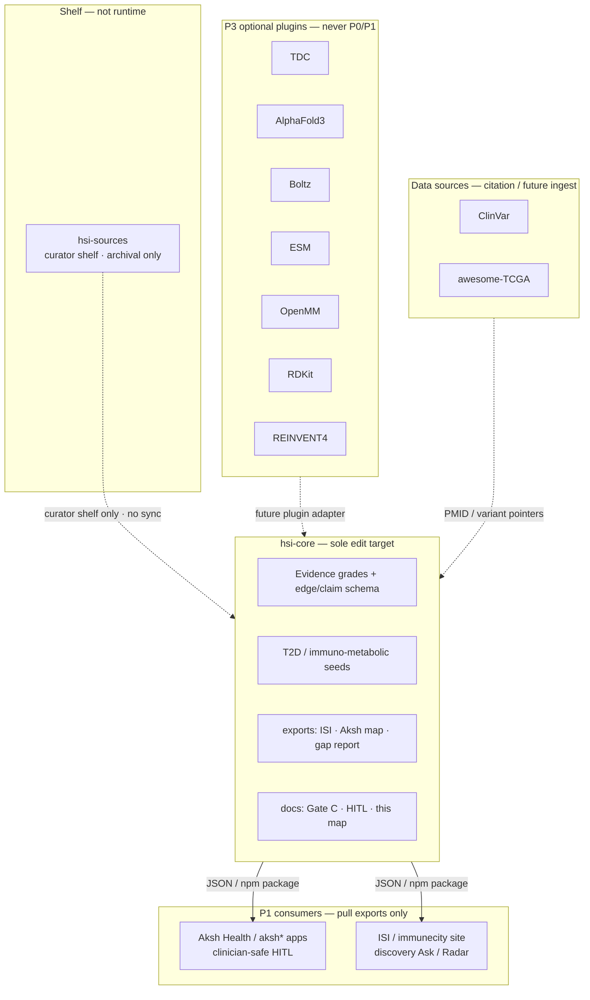

# Vision ↔ repo alignment

**Human Systems Intelligence (HSI)** is the shared evidence layer: graded edges
(`established` / `uncertain` / `unexplored`), claim → marker (LOINC) → observation →
action stubs, Gate C human-only curation, graph before agents, T2D / immuno-metabolic
bridge first. **Aksh** = clinician-safe half (HITL CDS). **ISI** = discovery half
(Ask / Radar). No unsupported diagnosis. No PHI → LLM in production.

**Pilot-first (now):** do **not** broaden the platform before proving one immune-disease
**research intelligence** workflow with a real partner. See
[`ISI_PILOT_BRIEF.md`](./ISI_PILOT_BRIEF.md),
[`ISI_PILOT_PRD_ALIGNMENT.md`](./ISI_PILOT_PRD_ALIGNMENT.md),
[`ISI_TARGET_STATE_PRD_ALIGNMENT.md`](./ISI_TARGET_STATE_PRD_ALIGNMENT.md), and
[`ISI_PILOT_PARTNER_SHORTLIST.md`](./ISI_PILOT_PARTNER_SHORTLIST.md). Disease + question
are TBD until outreach; keep Aksh/Akeno out of patient-level decisions until data access +
HCP eval + governance. Do not pull target-state R2–R5 breadth into Stage 1.

| Phase | Status | Focus |
|-------|--------|--------|
| **P0** | **DONE** | Schema, seeds, grades, ISI/Aksh exports, validation, gap report |
| **P1** | **ACTIVE** | **ISI research pilot** (one disease + one question) + durable `aksh:` maps, HITL stubs, Gate C checklists — pilot before more platform |
| **P2** | Planned | Richer exports / curator UX inside hsi-core *after* pilot learning; product apps bind published artifacts |
| **P3** | Deferred | Optional bio-stack plugins (structure, docking, generative chem) behind explicit licenses |

**Hard edit rule:** only [`gnaneshwer23/hsi-core`](https://github.com/gnaneshwer23/hsi-core)
(`~/Projects/hsi-core`) is edited for HSI. Product and bio repos **consume** or stay
reference-only — they are never HSI edit targets.

**Alignment statuses**

| Status | Meaning |
|--------|---------|
| `core` | Sole substrate; edit here |
| `consumer` | Pulls published hsi-core export/API; do not edit for HSI |
| `data-source` | Public evidence / assay corpus; ingest pointers only (no PHI) |
| `deferred` | Useful later; not wired until P3+ and license review |
| `reference-only` | Shelf or bookmark surface; never a dependency of the evidence core |
| `ignore` | Out of scope for HSI — do not sync, wire, or treat as pattern reference |

---

## Architecture (hub and spokes)

**Ignored (not a spoke):** [`gnaneshwer23/swift-deliveries`](https://github.com/gnaneshwer23/swift-deliveries) / DeliverX — logistics product unrelated to HSI. Do not use as HITL pattern reference, do not plan future wire-up, do not sync.

**Deferred clinical (Akeno Stage 3 — not Stage 1):** Akeno surfaces are founder-lineage clinical / marketing work, distinct from the live Aksh diabetes HITL product at [akshhealth.com](https://akshhealth.com). Catalogued so they are not mistaken for the ISI pilot or the hsi-core hub:

| Surface | What it is | HSI status |
|---------|------------|------------|
| [`gnaneshwer23/akenohealth`](https://github.com/gnaneshwer23/akenohealth) | Python L0–L10 multi-AMC scaffolding + Next.js Neon dashboard (`akenohealth.vercel.app`) | **deferred** — engineering starter kit; not edit target |
| [`gnaneshwer23/akeno-health-ai`](https://github.com/gnaneshwer23/akeno-health-ai) | Lovable Vite/React marketing + dashboard prototype | **deferred** — not edit target |
| [akeno-health-ai.lovable.app](https://akeno-health-ai.lovable.app/) | Live marketing site (digital twins, quantum, RWE, CDS claims) | **deferred** — reference-only claims surface; not pilot deliverable |

**Do not build now (Stage 1):** Akeno digital-twin / quantum / RWE / federated / patient CDS / trial-matching / multi-AMC platform work. Pilot = ISI research intelligence only.

---

## Portfolio map

### User / product repos

| Repo / surface | Role in vision | Status | Plugs into hsi-core | Phase | Constraints |
|----------------|----------------|--------|---------------------|-------|-------------|
| **[gnaneshwer23/hsi-core](https://github.com/gnaneshwer23/hsi-core)** | Shared HSI substrate: grades, seeds, validation, ISI + Aksh exports, Gate C docs | **core** | *is* the hub | P0–P1 | Sole edit target; no PHI; no invented PMIDs |
| **[gnaneshwer23/immunecity](https://github.com/gnaneshwer23/immunecity)** | ISI product app / discovery UI (REL graph, Ask, Radar) | **consumer** | Import `buildIsiExportBundle` / `exports/`; Gate C approve (if any) stays human in **ISI Neon `autumn-snow` only** — never HSI `red-wave`; no shared evidence DB | P1 | **Do not edit for HSI**; consume published artifacts only |
| **ISI site** (product surface on immunecity / related deploy) | Public discovery face of HSI grades — never CDS | **consumer** | Same ISI export path | P1 | Honest grades; no diagnosis; no PHI→LLM in prod |
| **Aksh Health** ([akshhealth.com](https://akshhealth.com) + any `aksh*` repos) | Clinician-safe half: HITL suggestion cards when `isCdsSurfacable` | **consumer** | `export:aksh-map`, HITL stub, `aksh:` ids | P1 | No EHR write-back from map alone; CDS closed until Gate C + `established` |
| **Akeno Health** ([gnaneshwer23/akenohealth](https://github.com/gnaneshwer23/akenohealth), [gnaneshwer23/akeno-health-ai](https://github.com/gnaneshwer23/akeno-health-ai), [akeno-health-ai.lovable.app](https://akeno-health-ai.lovable.app/)) | Broader clinical / multi-AMC / marketing AI surfaces (same founder lineage as Aksh; brand alias historically) | **deferred** (Akeno Stage 3) | Not wired until data access + HCP eval + governance after ISI Stage 1 | Stage 3 | **Do not edit** from hsi-core; not Stage 1 pilot scope; marketing claims ≠ production CDS |
| **[gnaneshwer23/hsi-sources](https://github.com/gnaneshwer23/hsi-sources)** | Curator bookmark / raw-source shelf; may retain a historical DeliverX vendor snapshot | **reference-only** (shelf · **archival**) | Never a runtime dep; humans promote claims into hsi-core seeds | P1 | **Archival only** — do not sync or use vendor snapshots for HSI; no auto-ingest; no secrets/PHI |
| **[gnaneshwer23/swift-deliveries](https://github.com/gnaneshwer23/swift-deliveries)** (DeliverX) | Unrelated logistics product | **ignore** | **never** | — | **Out of scope** — not an HSI spoke, not a HITL pattern reference, not a future wire-up target; do not edit or sync |

### External bio / data stack

| Repo | Role in vision | Status | Plugs into hsi-core | Phase | Constraints |
|------|----------------|--------|---------------------|-------|-------------|
| **[mims-harvard/TDC](https://github.com/mims-harvard/TDC)** | Therapeutics Data Commons — benchmarks / datasets for ML eval | **deferred** | Future plugin: offline eval against graded claims; not seed authority | P3 | Dataset licenses vary per task; cite TDC + underlying sets |
| **[google-deepmind/alphafold3](https://github.com/google-deepmind/alphafold3)** | Structure prediction for mechanism hypotheses | **deferred** | Future ISI plugin only; never auto-promotes `hsiGrade` | P3 | **Non-commercial / restricted terms** — review AF3 license before any adapter; not for clinic CDS |
| **[jwohlwend/boltz](https://github.com/jwohlwend/boltz)** | Open structure / complex prediction alternative | **deferred** | Future ISI plugin (prefer when AF3 license blocks) | P3 | Check Apache/model weights terms; discovery-only |
| **[facebookresearch/esm](https://github.com/facebookresearch/esm)** | Protein language models / embeddings | **deferred** | Future similarity / annotation helpers for discovery edges | P3 | Model card + weight license; no PHI sequences from clinic |
| **[openmm/openmm](https://github.com/openmm/openmm)** | Molecular dynamics | **deferred** | Future simulation plugin behind ISI lab lane | P3 | LGPL/OpenMM license; compute cost; not Gate C evidence |
| **[rdkit/rdkit](https://github.com/rdkit/rdkit)** | Cheminformatics toolkit | **deferred** | Future small-molecule descriptors for research claims | P3 | BSD-style; still never invents clinical edges |
| **[MolecularAI/REINVENT4](https://github.com/MolecularAI/REINVENT4)** | Generative molecular design | **deferred** | Future ISI design sandbox only | P3 | Apache-2.0 typical; **never** clinic recommendation path |
| **[ncbi/clinvar](https://github.com/ncbi/clinvar)** | Variant ↔ clinical significance catalog | **data-source** | Future claim/evidence pointers (variant → phenotype); curation still Gate C | P2–P3 | Public data; cite ClinVar; no silent promotion to `established` |
| **[IARCbioinfo/awesome-TCGA](https://github.com/IARCbioinfo/awesome-TCGA)** | Curated TCGA resource index | **data-source** / **reference-only** | Pointer shelf for immuno-oncology discovery literature & data portals | P2–P3 | Respect TCGA / dbGaP access rules; no PHI in hsi-core |

---

## How the portfolio aligns (one picture)

hsi-core owns the graded graph and publishes read-only exports. Aksh and ISI (immunecity + site) are **consumers**: clinician-safe HITL vs discovery, both forbidden from inventing grades or writing PHI into LLMs. Akeno repos / Lovable marketing (akenohealth, akeno-health-ai, akeno-health-ai.lovable.app) are **deferred Stage 3** — same clinical gate as the proposal, not Stage 1 work. hsi-sources is a curator shelf (**archival only** — any historical DeliverX vendor snapshot must not be synced or used for HSI). DeliverX / swift-deliveries is **ignored** — out of scope, not a spoke. ClinVar / TCGA indexes may later ground citations; AF3, Boltz, ESM, OpenMM, RDKit, REINVENT4, and TDC stay **P3 plugins** — useful for theory→practical discovery, never for unsupported diagnosis or automatic Gate C.

---

## Non-negotiables (every spoke)

1. Graph and Gate C before agents.
2. `hsiGrade=established` requires `curationReview=approved` (human).
3. No unsupported diagnosis; ISI ≠ CDS.
4. No PHI in seeds/exports; no PHI → LLM in production paths that touch this substrate.
5. Bio-structure / generative tools do **not** flip evidence grades.
6. Edit only hsi-core for HSI; never immunecity or Aksh product repos for substrate work. Ignore DeliverX / swift-deliveries entirely.

---

## Next actions (stay inside hsi-core)

1. **Pilot-first:** run outreach from [`ISI_PILOT_PARTNER_SHORTLIST.md`](./ISI_PILOT_PARTNER_SHORTLIST.md); lock one disease + one question with a partner; feed evidence via `bun run outputs` per [`ISI_PILOT_BRIEF.md`](./ISI_PILOT_BRIEF.md).
2. Keep substrate honest: expand seeds + verified PMID Gate C checklists only as the pilot needs them — not platform sprawl.
3. Harden Aksh HITL stub + maps without opening CDS on seeds (Aksh/Akeno stay out of patient-level decisions this phase).
4. Grow ISI export / REL suggestion maps for the pilot question; never auto-approve into a product KG.
5. Document any future ClinVar/TCGA **pointer** fields as optional claim metadata — still Gate C.
6. Do **not** vendor AF3/Boltz/etc. until a written P3 plugin RFC + license sign-off lands in this repo.
7. Leave immunecity, Aksh apps, Akeno repos (`akenohealth`, `akeno-health-ai`), and hsi-sources untouched from this workspace. **Ignore** DeliverX / swift-deliveries (not a next step, not a wire-up).

See also: [ISI_PILOT_BRIEF.md](./ISI_PILOT_BRIEF.md), [ISI_PILOT_PARTNER_SHORTLIST.md](./ISI_PILOT_PARTNER_SHORTLIST.md), [AKSH_HITL_CONSUMPTION.md](./AKSH_HITL_CONSUMPTION.md), [IMMUNECITY_GATE_C_COMMIT_MANUAL.md](./IMMUNECITY_GATE_C_COMMIT_MANUAL.md), [NEON_PROJECT_MAP.md](./NEON_PROJECT_MAP.md) (Neon IDs / host→role, no secrets), README “Pilot” + “Active codebase”.
