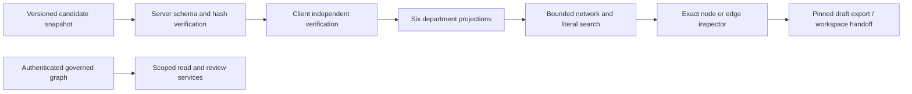

# Technical requirements

Authoritative requirement IDs and implementation status: [product matrix A01–A12](01_PRODUCT_REQUIREMENTS.md). This document specifies implementation boundaries, not a new parallel runtime.

## Current data flow

The candidate snapshot and governed graph have different authority. No arrow from public export into approval exists. `site/src/lib/claimGraphClient.ts` and `publicGraphSnapshotService.ts` enforce exact snapshot identity. `atlasDepartments.ts` returns original records; `networkExplorer.ts` applies department/context facets before traversal. Search considers entity labels/aliases/IDs, exact recorded condition text and source metadata; it is not external discovery or ontology equivalence.

## Reuse and constraints

- A01/A02/A06: registry is version-controlled code; department→recorded-domain mapping is navigation taxonomy. `gut` is used for the existing microbiome entry; it is not a declaration that every gut record is a microbial mechanism. No tag inference for unrepresented Genomics or Physiology edges. No node duplication, new scientific predicates or source imports.
- A04: network supports global or one/two/three-hop undirected navigation, not causal traversal. `domainPaths` separately bounds directed candidate paths (up to six hops, eight paths, 2,500 expansions). Do not conflate these semantics. Invalid depth/department/scope/query fails closed.
- A05/A08: original parallel claims, negative results, gaps and source versions stay separate. Comparison is descriptive; context differences do not establish contradiction or pooled effect.
- A07: existing `hsiAgentOrchestrator.ts` remains permission-envelope execution, not persisted completion evidence. Reuse `collectivePipeline.ts`, `nexusJobs.ts`, live-run trust boundaries; do not create a second orchestrator or thirteen LLM services. Exact server-side permitted selection binding remains a subsequent PR.
- A10/A11: public GET has no identity/write/provider dependency. Governed reads/writes require independently verified server identity; private context never enters public snapshot.
- A12: current parser caps 450 concepts, 500 connections, 200 sources; server caps two MB. No unbounded expansion, network search or arbitrary endpoint input. Pagination and multi-host worker acceptance remain pending. Existing layout/accessible text view reused; no new graph engine or dependency.

## Acceptance

`test/atlasDepartments.test.ts` covers department overlap without identity duplication, zero coverage, unknown IDs, arbitrary represented condition search, bibliographic lookup, traversal bounds and pinned context. Existing graph, ontology, server snapshot and scientific-boundary tests remain required. [Runbook](08_DEPLOYMENT_TESTING_RUNBOOK.md) separates offline tests from live acceptance. Benchmark timings from small synthetic graphs do not certify large-graph usability.
