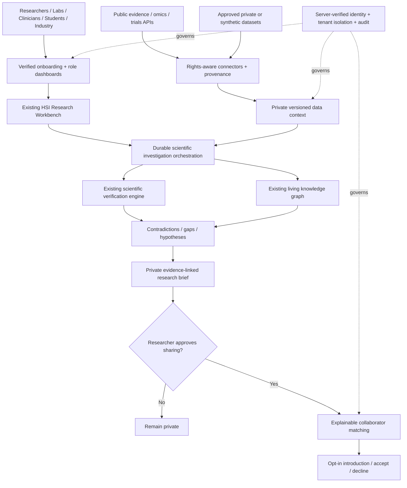
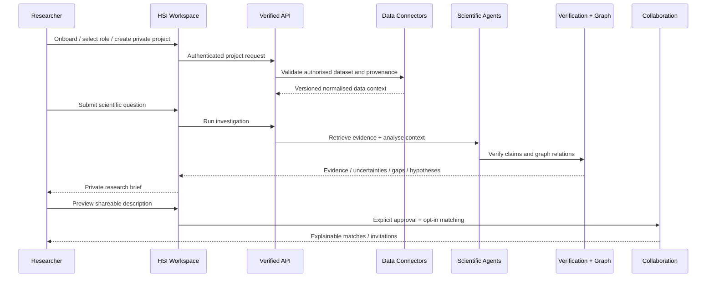
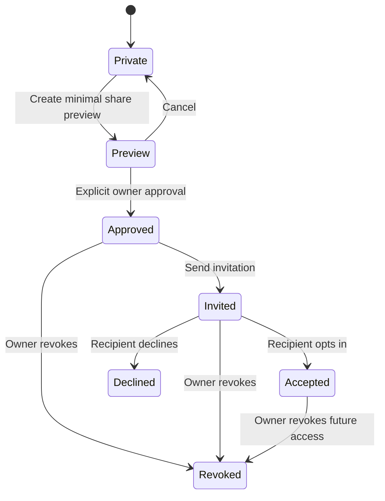

# HSI Prototype Architecture and Mermaid Diagrams

## System

## Researcher journey

## Permission state machine

## Dataset integrity
Every dataset and derived claim has: source, licence, access scope, synthetic flag, schema version, provenance, transformation, QC and timestamp. Never merge unpaired source records into real patient identities. Every private-to-network transition requires explicit review and audit.
