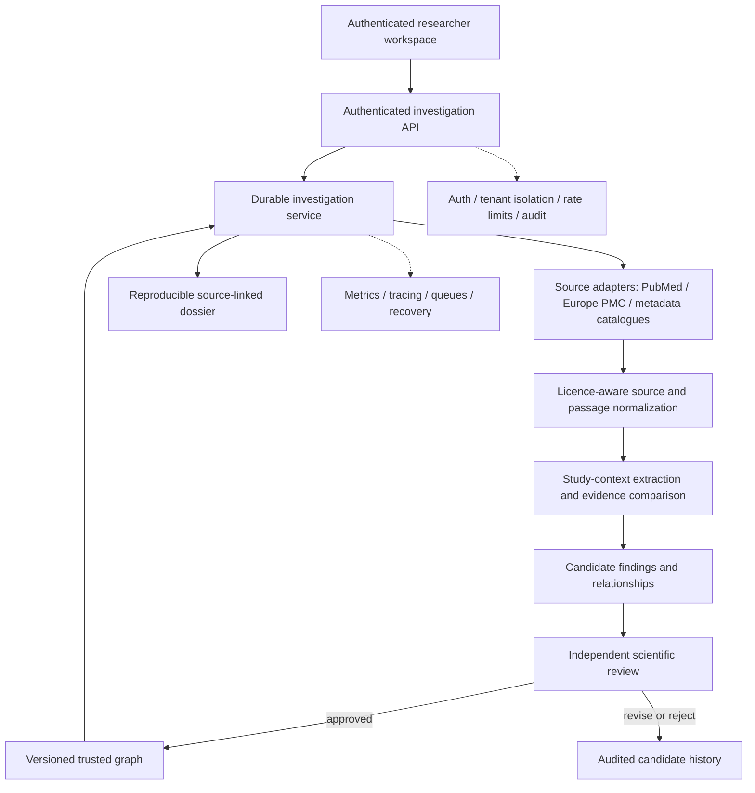

# HSI production architecture — target and current integration boundaries

**Status:** Target integration architecture grounded in existing code. It does not assert deployed services.

## Non-negotiable invariants
1. One disease-agnostic research reasoning workflow for any supported biomedical question.
2. Agents propose; researchers inspect; independent curators review; only approved context-conditioned relationships enter trusted graph.
3. Bibliography, author-reported text, extracted candidate, model inference, researcher hypothesis and approved relationship remain distinct states.
4. Research-only data plane never silently imports PHI, writes EHR records or provides clinical decision support.
5. HSI substrate uses its HSI-owned database; other products integrate via governed interfaces, not shared databases.

## Runtime flow

## Integration contract
- **Question**: normalized research question, requested domains, explicit context, investigator and project scope.
- **Source**: stable identifiers, URL, version/retrieval timestamp, licence and access status.
- **Passage**: exact source text, source offset/locator, hash, data class and rights.
- **Finding**: verbatim supporting passage, author-reported claim, population/species, tissue, assay, intervention/comparator, outcome, direction, limitations, negation, uncertainty and evidence tier.
- **Comparison**: claim group with contextual comparability checks, support/opposition and unknowns; no contradiction without comparable context.
- **Proposal**: draft mechanism, gap or hypothesis with falsification plan and source links.
- **Review**: independent reviewer identity, rationale, decision, immutable timestamp, version and audit record.
- **Graph**: immutable relationship version and reversible supersession; candidates cannot mutate approved facts.
- **Dossier**: question, source snapshot, methods/model versions, outputs, disagreements, limitations, reviewer state and reproducible export.

## Data source boundary
- PubMed/Europe PMC: literature metadata and available text subject to source terms.
- Health Data Research Gateway: catalogue discovery only initially — dataset/biosample metadata, custodians and access routes, **not patient-level ingestion**. Verify API terms before implementation.
- Public omics/ontology/trials: licensed and provenance-preserving adapters.
- Partner/restricted data: isolated approved access plane with purpose restrictions; not a shortcut into the public research graph.

## Current code seams to connect
`site/src/pages/ScientificDiscoveryExperience.tsx` → `src/investigationService.ts` / `src/investigationBackend.ts` → `src/researchContracts.ts` → evidence corpus and governed graph interfaces. Existing PubMed/Europe PMC endpoints should become providers, not competing independent investigation systems.

## Deployment and governance verification
Verify staging/production environment separation, secret ownership, database migration ledger, RLS and tenant isolation, queue idempotency, recovery, audit immutability, operational alerts, access reviews and rollback. Never infer deployed readiness from contracts or committed migrations.
