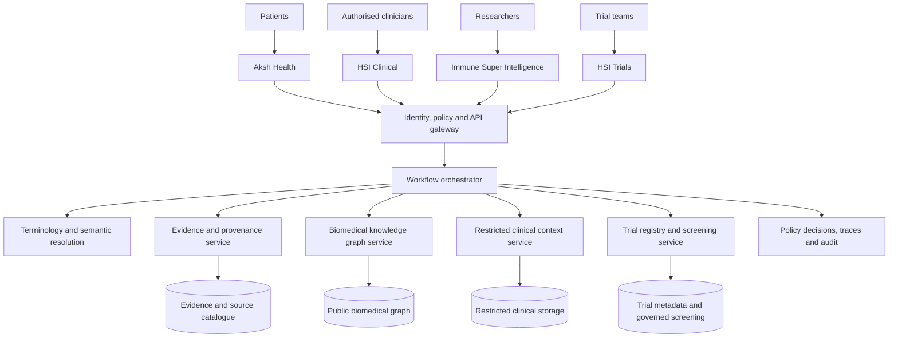
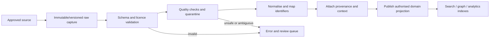
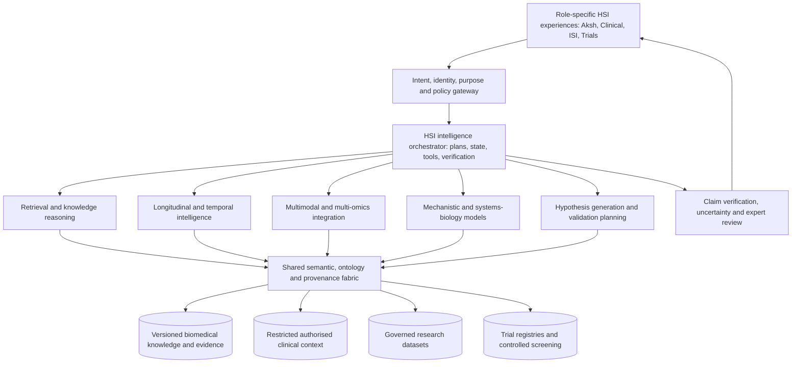

# Document 02 — HSI Architecture and Data Design

**Health Super Intelligence (HSI) | Version 1.1 | 2 November 2026**  
**Status:** Proposed / pending founder approval — target architecture; current implementation unverified.  
**Canonical path:** [`docs/strategy/HSI_ARCHITECTURE_AND_DATA.md`](./HSI_ARCHITECTURE_AND_DATA.md)  
**Governing document:** [`HSI_MASTER_PRD_v1.md`](./HSI_MASTER_PRD_v1.md) (HSI-FR-001–054).  
**Products:** HSI Core, Immune Super Intelligence (ISI), Aksh Health, HSI Clinical, HSI Trials.  
**Decision gate:** Audit and architecture approval before modifying code, schema, integrations or deployments.

### Reconciliation (strategy pack)

**Role:** Authoritative product architecture / data companion (Master PRD §18 Document 02). Ingested from founder source `02_HSI_ARCHITECTURE_AND_DATA.md` without rewriting author intent.

**How it relates to existing strategy docs:**

| Existing pack | Relation |
|---------------|----------|
| [`HSI_FOUR_PRODUCT_ECOSYSTEM.md`](./HSI_FOUR_PRODUCT_ECOSYSTEM.md) | Ownership, exchanges, anti-duplication — remains definitive for product boundaries |
| [`HSI_LIVING_HEALTH_KNOWLEDGE_GRAPH.md`](./HSI_LIVING_HEALTH_KNOWLEDGE_GRAPH.md) | LHK-G audit + ADRs — remains definitive for graph evidence |
| [`HSI_TARGET_ARCHITECTURE.md`](./HSI_TARGET_ARCHITECTURE.md) | Earlier logical architecture sketch — subordinate to this Document 02 |
| **§5–§6** intelligence / reasoning packs | Elaboration + Phase 0 audits; orchestration detail lives in Document 03 |
| **§7** interoperability pack | Elaboration of sources/FHIR/PGHD/trials maturity L0–L5 |

Detailed packs remain for audits, ADRs, and FR evidence. **Do not** treat Proposed north-star sections (§22) as Verified capabilities. Conflicts vs Phase 0 audits: [`HSI_DOC02_03_RECONCILIATION.md`](./HSI_DOC02_03_RECONCILIATION.md) (Documents 02 / 03 / 04).

---

## 1. Executive architectural decision

HSI is a **governed federation of health and biomedical intelligence services**, not a single all-access graph, an EHR replacement, or a fleet of independent chatbots. Its differentiator is connecting authorised longitudinal observations to biomedical concepts, evidence and trials while preserving source, purpose, time, uncertainty and permissions.

**Architectural invariants**

1. Clinical-identifiable, patient-generated, public biomedical and governed research data remain separate security and processing domains.
2. A shared semantic layer links concepts; it does **not** grant access to underlying records.
3. Every substantive relationship and claim carries provenance, epistemic classification, temporal scope and review state.
4. Source records are immutable or version-preserved where permitted; normalised projections are reproducible.
5. Authorisation is enforced at APIs, queries and tools, never solely through LLM instructions.
6. Agents operate on least-privilege tools and cannot autonomously diagnose, prescribe, change clinical records or enrol trial participants.
7. Technology selection follows a repository audit and measured use cases. Neo4j, LangGraph and GraphRAG are candidates, not pre-approved migrations.
8. No external integration is labelled working until demonstrated against a real permitted endpoint with tested failure behaviour.

## 2. Current estate and audit obligations

| Existing estate | Reference | Audit questions |
|---|---|---|
| HSI Core | https://github.com/gnaneshwer23/hsi-core | Frontend/backend architecture, API contracts, authentication, data model, deployment, tests, genuine workflows |
| ISI | https://github.com/gnaneshwer23/immunecity | Existing knowledge graph, concept IDs, edges, literature provenance, search, ingestion, graph UI |
| Aksh Health | https://github.com/gnaneshwer23/aksh-health-redesign | Patient data model, monitoring, existing named agents, identity, API endpoints, consent/access controls |

**Audit method:** inspect source code, environment configuration without disclosing secrets, schema migrations, CI, dependencies, deployment settings and tests; run controlled local checks where possible. Produce a per-capability evidence ledger: **verified working / implemented-unverified / partial / mocked / broken / missing / not assessed**. Record file paths, endpoint evidence, tests and limitations. Do not infer implementation from website appearance or agent names.

## 3. System context and trust boundaries



This is a **logical** diagram. Data stores, cloud providers and runtime boundaries must be validated against existing code and hosting arrangements. Research and clinical processing must not be co-located in a way that bypasses isolation requirements.

### Trust zones

- **Zone P — Public:** marketing, public scientific content and public trial registry data; no identifiable patient records.
- **Zone R — Research:** approved research datasets, project-specific policies, disclosure controls and separate credentials.
- **Zone A — Patient:** Aksh user-owned observations and approved sharing permissions.
- **Zone C — Clinical:** organisation-scoped identifiable records, verified patient matching, clinician permissions, clinical audit.
- **Zone O — Operations:** model telemetry, system configuration and audit, minimising sensitive payloads.

Cross-zone communication occurs only through authenticated, authorised, purpose-bound APIs. Pseudonymised records remain personal data where re-identification remains possible.

## 4. Component responsibilities

| Component | Responsibility | Contract | Failure response |
|---|---|---|---|
| Web experiences | Role-specific workflows | Typed API client | Display partial/empty/permission states |
| Identity service | Authentication, organisation membership, identity assurance | OIDC/approved identity mechanisms | Deny access safely |
| Policy decision/enforcement | RBAC + ABAC, purpose, care relationship, project approval | `authorize(actor, action, resource, context)` | Default deny, audit |
| Clinical connector gateway | FHIR/SMART/HL7 v2 and approved source retrieval | Source adapters, canonical clinical resources | Quarantine malformed data; no silent substitution |
| Patient data service | Aksh observations and device provenance | Versioned observation APIs | Report unavailable/stale data |
| Terminology service | Entity resolution, code-system versions, mappings | Resolve/map/search APIs | Preserve unmapped original and uncertainty |
| Biomedical ingestion | Curated scientific source ingestion | Source-specific ETL + manifests | Quarantine and retry with backoff |
| Knowledge graph service | Typed nodes, edges, paths, contextual traversal | Graph query API | Limit traversal and expose gaps |
| Evidence service | Claims, citations, study context, contradictions | Evidence retrieval/verification API | Withhold unsupported claims |
| Trial service | Registry ingestion, criteria extraction and reviewable screening | Registry and criteria APIs | Unknown when evidence insufficient |
| Orchestrator | Deterministic workflow coordination and guarded reasoning | Typed workflow state, tool registry | Timeout, safe degradation, escalation |
| Audit/observability | Access decisions, workflow traces, quality monitoring | Append-only or tamper-evident records | Alert and restrict risky operations |

## 5. Data architecture: fit-for-purpose polyglot storage

**Do not select a database by trend.** Assess the current stack, operations cost, isolation, query shapes and migration risks.

| Data class | Recommended pattern | Rationale |
|---|---|---|
| Accounts, organisations, permissions | Relational transactional database | Integrity, constraints, policy joins |
| Clinical FHIR resources | Restricted clinical store with original resource + indexed projection | Source fidelity and provenance |
| Patient observations and longitudinal metrics | Relational/time-series model as appropriate | Temporal queries, units, quality |
| Biomedical concepts and relationships | Graph store or proven graph abstraction | Typed multi-hop exploration |
| Scientific articles, source snapshots, raw datasets | Governed object storage and metadata catalogue | Reproducibility, versioning |
| Search and semantic retrieval | Search index and optional vector index | Hybrid retrieval, citations |
| Trial registries and eligibility | Relational canonical model plus semantic links | Criteria structure, versioning |
| Async ingestion and workflows | Queue/job store | Retry, idempotency, backpressure |
| Audit | Protected append-only/tamper-evident event store | Traceability and investigation |

**Graph DB choice:** evaluate Neo4j property graph against existing ISI storage, RDF/SPARQL options and relational graph projections. Select on competency queries, ontology support, provenance representation, query latency, licensing, operational burden, data export and migration safety. A graph database is **not** a substitute for FHIR persistence or access-control services.

## 6. Canonical domain models

### 6.1 Shared identifiers

Every concept has `canonical_id`, `namespace`, `label`, `aliases`, `source_ids`, `mapping_status`, `ontology_version`. Preserve original identifiers; do not collapse near-synonyms without reviewed equivalence.

### 6.2 Clinical observation

```json
{
  "id": "observation-id",
  "subject_ref": "restricted-patient-ref",
  "source_system": "approved-source",
  "source_resource_id": "source-id",
  "code": {"system": "LOINC-or-source-system", "code": "source-code"},
  "value": {"number": null, "unit": null, "ucum_code": null},
  "effective_at": null,
  "recorded_at": null,
  "status": "final|preliminary|corrected|cancelled|unknown",
  "quality_flags": [],
  "provenance_id": "prov-id",
  "access_domain": "clinical"
}
```

Do not infer that a prescription was dispensed, administered or taken. Separate those medication states. Maintain source-specific reference intervals and measurement methods.

### 6.3 Biomedical entity and edge

```json
{
  "subject_id": "HGNC:example",
  "predicate": "participates_in",
  "object_id": "Reactome:example",
  "context": {"species": "Homo sapiens", "tissue": null, "cell_type": null},
  "assertion_type": "curated_evidence",
  "evidence_ids": ["claim-123"],
  "validity": {"from": null, "to": null},
  "review_status": "unreviewed|reviewed|disputed|deprecated",
  "source_version": "release-id"
}
```

Graph edge types must have declared semantics. A disease–gene association is not a causal mechanism. An ontology parent-child edge is not experimental evidence.

### 6.4 Evidence claim

Minimum fields: `claim_id`, subject–predicate–object, epistemic class, evidence type, source document/identifier, source excerpt location when permitted, study design, species, population, tissue, method, effect direction, limitations, contradicting evidence, extraction method, confidence calibration if validated, review state, timestamps, versions.

Five mandatory epistemic classes:

1. Observed patient fact.
2. Established scientific evidence.
3. Statistical association.
4. Computational inference.
5. Unvalidated hypothesis.

These are not interchangeable and should be visible in API responses and UI.

### 6.5 Trial and eligibility criterion

Trial canonical record: official registry ID, registry, title, condition, intervention, phase, status, sites, last registry update, last retrieved, source URL, version.

Criterion: criterion ID, original text, inclusion/exclusion, structured concept, comparator, threshold, unit, time window, extraction confidence/limitations, human review state. Screening outcome: **satisfied / not satisfied / unknown / ambiguous / human review required**, with source-level rationale; never autonomous final eligibility.

## 7. Terminology and ontology strategy

Evaluate SNOMED CT, UK dm+d, LOINC, UCUM, ICD, HPO, MONDO, GO, Cell Ontology, Uberon, HGNC, UniProt, Ensembl, ChEBI, Reactome and appropriate trial IDs. Licensing, jurisdictional restrictions and release versions must be documented before use.

**Resolution pipeline:** preserve raw term → normalise formatting → search authoritative vocabulary → rank candidates → validate context (species/tissue/unit/meaning) → return accepted mapping or unresolved ambiguity → version mapping. Never let an LLM silently rewrite a clinical code. Human curation is required for high-risk or ambiguous mappings.

## 8. Source integration catalogue and evaluation

| Source group | Candidate systems | Access and quality checks | Initial priority |
|---|---|---|---|
| Clinical | FHIR R4, SMART-on-FHIR, HL7 v2, EHR, LIS, pharmacy, DICOM | Partner permissions, profiles, source identity, corrected records, units, patient matching | Evaluation design; no assumed live access |
| Biomedical | Open Targets, HCA, PubMed, Europe PMC, UniProt, Reactome, GO, omics repositories | APIs/dumps, reuse rights, release versions, sample/study context, evidence scope | Scientific MVP |
| Trials | ClinicalTrials.gov, WHO ICTRP and official registries | Access terms, record IDs, status freshness, duplicates, criteria completeness | Scientific-to-trial extension |
| Patient-generated | Aksh, approved wearables, home monitoring | Device provenance, patient permissions, measurement validity, timestamps | After current Aksh audit |

Every connector requires a **source dossier**: endpoint/documentation, ownership, licence, authentication, permitted purpose, fields, schema, frequency, incremental update strategy, source version, quality tests, failure modes, costs, access approval, and demonstrated integration maturity. No dossier = no production claim.

### Connector interface (conceptual)

```typescript
interface SourceConnector<T> {
  sourceId: string;
  capabilities(): Promise<SourceCapabilities>;
  verifyAccess(context: AccessContext): Promise<AccessDecision>;
  fetch(request: SourceRequest, context: AccessContext): AsyncIterable<SourceEnvelope<T>>;
  validate(record: T): ValidationResult;
  normalize(record: T): CanonicalRecord[];
  health(): Promise<ConnectorHealth>;
}
```

`SourceEnvelope` includes source identifier, original ID, source version, retrieved time, licence, checksum and permitted-use metadata. Real implementations must support rate limits, pagination, cancellation, retries, backoff, circuit breakers and idempotent upserts.

## 9. Ingestion, validation and provenance pipeline



**Data quality dimensions:** completeness, validity, uniqueness, consistency, timeliness, source fidelity, terminology accuracy, fitness for purpose. Maintain source and transformation versions to enable reprocessing and rollback. Corrections should supersede projections without erasing provenance. Scientific contradictions remain explicit claims, not ingestion errors.

## 10. Cross-domain semantic federation

Use **concept-level federation**. Example: an authorised clinician views a documented condition; HSI resolves its approved disease identifier; the public graph returns general pathways, papers and trials; the clinical workspace receives evidence-linked results. The public graph never receives the patient's name, NHS number or entire clinical record.

**Required security boundary:** each cross-domain request carries a purpose-bound context and passes policy checks at the data-owning service. De-identification or aggregation must be evaluated against re-identification risk and permitted research purpose; pseudonymisation alone does not remove UK GDPR obligations.

## 11. GraphRAG and agent orchestration

The MedGraph article describes a platform connecting drug labels, adverse-event information, terminology and trials with Neo4j, LangGraph and GraphRAG. HSI can learn from this combination, but the architecture decision remains conditional on evidence from the existing repositories and benchmarks. Reference: https://medium.com/@aiwithakashgoyal/building-medgraph-a-medical-intelligence-platform-using-neo4j-langgraph-and-graphrag-67dbbf29c194?sk=02451190a667d07541358e49c4d6bc33

### Reference workflow

1. Authenticate actor and determine purpose.
2. Classify query (research / patient / clinical / trial).
3. Resolve scientific or clinical concepts using controlled terminology.
4. Authorise data and tool scopes.
5. Retrieve graph paths, primary evidence and relevant structured records.
6. Apply deterministic computations where possible.
7. Use an LLM only for bounded synthesis or question decomposition.
8. Verify material claims against retrieved evidence and graph semantics.
9. Preserve disagreements, missing data and uncertainty.
10. Render structured role-specific output with inspectable sources.
11. Record safe execution metadata and review decisions.

### Retrieval modes

- Exact structured lookup for identifiers and numerical data.
- Graph traversal for typed multi-hop relationships.
- Lexical/semantic literature search for contextual evidence.
- Hybrid reranking with source- and method-aware filtering.
- Explicit contradiction retrieval, not only top-ranked supportive passages.

**GraphRAG constraint:** a retrieved path demonstrates a represented relationship, not clinical causality. Generated narratives must cite underlying assertions, not merely the path or the model.

### Orchestration choice

Evaluate LangGraph, existing workflow code and simpler deterministic state machines. Choose the least complex design satisfying retry, durable state, human approval, audit and failure recovery. Named agents are capabilities to audit, not proof of operational autonomous workers.

## 12. API and service contracts

Suggested versioned interfaces, subject to existing route audit:

| Endpoint | Purpose | Security domain |
|---|---|---|
| `POST /v1/concepts/resolve` | Map term to candidate ontology concepts | Public/restricted by payload |
| `POST /v1/graph/query` | Typed, bounded graph traversal | Public biomedical or governed research |
| `GET /v1/evidence/claims/{id}` | Retrieve claim provenance and limitations | Source-dependent |
| `POST /v1/research/investigations` | Start authorised scientific workflow | Research |
| `GET /v1/research/investigations/{id}` | Retrieve state, outputs and review | Research |
| `GET /v1/clinical/patients/{id}/timeline` | Authorised longitudinal context | Clinical only |
| `POST /v1/trials/search` | Official study discovery | Public/authorised |
| `POST /v1/trials/screenings` | Reviewable candidate screening | Restricted clinical/trials |
| `GET /v1/sources/{id}/status` | Integration freshness and verified maturity | Appropriate metadata visibility |

All responses include request ID, data version, freshness, source references, partial-result flags and access-appropriate errors. Use cursor pagination and strict server-side filtering. No unrestricted generic Cypher/SQL endpoints exposed to clients or agents.

## 13. Example output contract for intelligence

```json
{
  "investigation_id": "inv-123",
  "question": "Which immune mechanisms are associated with a disease?",
  "status": "completed_with_limitations",
  "findings": [
    {
      "claim_id": "claim-123",
      "text": "Illustrative claim; not a scientific finding",
      "epistemic_class": "statistical_association",
      "evidence_ids": ["evidence-456"],
      "limitations": ["Requires review of study context"],
      "review_state": "unreviewed"
    }
  ],
  "missing_evidence": [],
  "source_versions": {},
  "review_required": true
}
```

The example is a **schema illustration**, not a real study result.

## 14. Clinical interoperability and safety

FHIR R4 resource handling should include Patient, Encounter, Condition, Observation, DiagnosticReport, MedicationRequest, MedicationStatement, MedicationDispense, MedicationAdministration, AllergyIntolerance, Procedure, DocumentReference, ImagingStudy and Provenance as needed. Evaluate UK Core and relevant NHS profiles. SMART-on-FHIR must use approved OAuth scopes and partner configuration; it does not confer universal EHR access. HL7 v2 adapters require acknowledgement, ordering and duplicate controls. DICOM integration initially prioritises authorised metadata/reports; diagnostic imaging AI is separately assessed.

**Patient matching:** use approved identifiers, verified identity workflows, explicit match states and human review of ambiguity. Never ask an LLM to merge patient records. Clinical records should preserve source completeness/freshness limitations, and all medical-device/clinical safety implications require separate assessment before clinical use.

## 15. Security, privacy and governance architecture

- UK GDPR: determine purpose, Article 6 basis, Article 9 condition, confidentiality obligations, controller/processor responsibilities and DPIA needs.
- Identity: OIDC or approved provider identity; MFA where appropriate; organisation-scoped sessions.
- Authorisation: RBAC + ABAC with patient relationship, purpose, resource, project approval and source restrictions; default deny.
- Secrets: managed secret storage, rotation, no credentials in frontend bundles or logs.
- Transport/storage: TLS and appropriate encryption at rest; keys scoped by environment/domain.
- AI providers: no identifiable clinical data transfer absent approved contracts, processing terms, residency/transfer review and minimisation.
- Audit: who accessed what, when, purpose, decision, workflow ID; no unnecessary raw health content in traces.
- Clinical governance: assess DCB0129/DCB0160, DSPT and MHRA software medical device applicability by intended function and deployment.
- Research: project-specific data access, ethical approvals and disclosure controls as required.
- Retention: domain-specific schedules, rights handling, legal holds and deletion/backup procedures.
- Threat modelling: cross-tenant leakage, patient mismatch, prompt injection, connector compromise, unsafe tool invocation and trial candidate disclosure.

## 16. Deployment, reliability and operations

**Deployment model:** retain current hosting until assessed. Separate frontend, APIs, worker execution, stores, secrets and environments. Never expose clinical data to public preview deployments. Require protected CI/CD, migrations with rollback, source licences and backups.

**Environments:** local development (synthetic/approved test data), CI, scientific staging, clinical evaluation environment (only if authorised), production for approved functions.

**Reliability controls:** health checks, connector circuit breakers, idempotent jobs, dead-letter queues, bounded retries, observability, SLOs derived from workload baselines, incident playbooks, recovery tests and feature-level kill switches.

**Observability:** OpenTelemetry or existing equivalent; track request IDs, source freshness, mapping failure, claim verification failure, query latency, graph expansion limits, model versions, human review outcomes and security denials. Minimise payload logging.

## 17. Architecture decisions requiring evidence

| ADR | Options | Evaluation basis | Current decision |
|---|---|---|---|
| ADR-001 Graph persistence | Existing graph, Neo4j, RDF, relational projection | Existing code, query benchmarks, licensing, migration | Pending audit |
| ADR-002 Orchestration | Existing implementation, LangGraph, state machine | Durable execution, guardrails, operations | Pending audit |
| ADR-003 Search | Existing search, lexical + vector hybrid | Recall, precision, provenance, cost | Pending audit |
| ADR-004 Clinical storage | Existing model, FHIR server, FHIR-aligned store | Fidelity, permissions, versioning | Pending audit |
| ADR-005 Messaging | Existing queue, managed queue, event bus | Throughput, idempotency, cost | Pending audit |
| ADR-006 Hosting | Current Vercel/other infrastructure, hybrid/on-prem for partners | Security, residency, integration, cost | Pending audit |
| ADR-007 Ontology mapping | Existing mappings, dedicated terminology service | Accuracy, versioning, governance | Pending audit |

## 18. End-to-end reference workflows and acceptance

### WF-01 — Research mechanism exploration (initial MVP)

Question → concept resolution → graph retrieval → evidence retrieval → contradiction comparison → claim verification → cited brief. **Pass:** every material claim inspectable; unsupported claims withheld; entity and source versions recorded; no fabricated execution.

### WF-02 — Clinical longitudinal review (partner evaluation only)

Verified clinician → authorised patient match → approved FHIR/clinical source retrieval → event timeline → medication/lab chronology → missing data → source-linked summary. **Pass:** no cross-patient access; units/status preserved; corrections handled; incomplete data visible; clinician can review originals.

### WF-03 — Mechanism-to-trial discovery

Disease/pathway → evidence-supported mechanisms → official trial search → source freshness → criteria view. **Pass:** trial status traceable to registry; no inferred eligibility.

### WF-04 — Candidate trial screening (governed)

Approved clinical context → structured criteria → criterion-by-criterion evidence → unknown/ambiguous flags → investigator review. **Pass:** no autonomous eligibility or enrolment; no unauthorised identifiable export.

### WF-05 — Patient trend explanation

Aksh observations → timestamp/unit validation → deterministic trend calculation → plain-language explanation → limitations. **Pass:** patient-generated data labelled, no unsupported diagnosis/treatment action.

## 19. Quality and testing strategy

- **Unit:** code/ontology mapping, units, status handling, policy evaluation, claim schemas.
- **Contract:** FHIR profiles, connector pagination, rate limits, registry response versions, API backward compatibility.
- **Integration:** source-to-projection lineage, graph traversal, evidence retrieval, source freshness.
- **Security:** cross-tenant denial, purpose restrictions, token expiry/revocation, prompt injection, data exfiltration, audit integrity.
- **Scientific:** expert-reviewed reference questions, citation precision, contradictory evidence recall, hallucination rate, uncertainty calibration.
- **Clinical:** identity matching, medication status, lab units, missing records, clinician review; only under appropriate evaluation governance.
- **Operations:** load, timeouts, retries, failure injection, restore and rollback.

Do not invent pass rates. Define benchmarks, collect baselines and obtain expert approval for thresholds.

## 20. Phased implementation roadmap

**Phase 0 — Audit and decision records:** verify all three repositories, existing data/agents/graph, security and deployments. Deliver capability inventory and ADR proposals.

**Phase 1 — Semantic and evidence foundation:** stable identifiers, ontology resolution, provenance and evidence claim model, source catalogue, initial API contracts.

**Phase 2 — Scientific intelligence MVP:** validate existing ISI graph; implement real question → graph → papers → verified research brief; improve researcher UX and public HSI narrative.

**Phase 3 — Trial discovery:** official registry integration, source freshness, mechanism-linked search, structured criteria, no patient-specific screening initially.

**Phase 4 — Aksh federation:** approved patient observations, explicit permissions, safe trends, separation from public graph.

**Phase 5 — Clinical evaluation:** partner-approved identity, FHIR/HL7 workflows, longitudinal timeline, DCB/regulatory/security review.

**Phase 6 — Governed cross-domain and screening:** clinician-reviewed biological context and trial assessment with purpose-limited data flows.

**Phase 7 — Institutional scale:** measured reliability, multi-organisation governance, disaster recovery and additional source coverage.

Each phase requires demonstrated acceptance and a separate founder decision. Dates and budgets are not assumed.

## 21. Required audit outputs and implementation artefacts

1. `HSI_CURRENT_STATE_ARCHITECTURE_AUDIT.md`
2. `HSI_COMPONENT_AND_DEPENDENCY_INVENTORY.md`
3. `HSI_DATA_DOMAIN_AND_TRUST_BOUNDARIES.md`
4. `HSI_CANONICAL_MODELS_AND_API_CONTRACTS.md`
5. `HSI_KNOWLEDGE_GRAPH_AND_ONTOLOGY_DESIGN.md`
6. `HSI_EVIDENCE_PROVENANCE_SPECIFICATION.md`
7. `HSI_SOURCE_CONNECTOR_CATALOGUE.md`
8. `HSI_CLINICAL_INTEROPERABILITY_PLAN.md`
9. `HSI_SECURITY_AND_GOVERNANCE_ARCHITECTURE.md`
10. `HSI_GRAPH_RAG_AND_ORCHESTRATION_ADRS.md`
11. `HSI_TEST_EVALUATION_AND_OBSERVABILITY_PLAN.md`
12. `HSI_PHASED_ARCHITECTURE_ROADMAP.md`
13. `HSI_REQUIREMENTS_TRACEABILITY_MATRIX.md`

Trace each proposed component and test to `HSI-FR-001`–`HSI-FR-054`. Document owner, status, evidence and approval dependency.

## 22. Future-state intelligence architecture — stable north star

The following capabilities are **architectural extension points and research objectives**, not claims of current implementation, clinical validity, or regulatory clearance. New external diagrams and articles are evaluated against this north star; they must not redirect the ecosystem into an isolated GraphRAG product.

### 22.1 Layered intelligence model



This diagram is logical: policy enforcement is mandatory at each tool and data boundary; no shared graph or orchestrator receives unrestricted access. Components may be modular services rather than separately deployed microservices until scale justifies separation.

### 22.2 Longitudinal and temporal intelligence

Represent **event time, record time, ingestion time, source revision and validity interval** independently. Support clinical events, changing treatment exposures, lab trajectories, immune-cell states and evolving research claims. Use temporal joins and change-point analysis only with correct units, measurement context and confounder annotations. Chronology is not proof of causation. Proposed interfaces: `get_timeline(scope, interval, source_filters)`, `compare_periods(context, windows, measures)`, `trace_claim_evolution(claim_id, as_of)`; each requires typed inputs, permission enforcement, provenance and explicit missingness.

### 22.3 Multimodal biological intelligence

Support structured observations, clinical narratives, imaging reports/metadata, biosignals, genomic and transcriptomic assays, proteomics, metabolomics, microbiome profiles and published experimental datasets **when appropriately licensed, authorised and technically validated**. Store modality-specific source objects and metadata; publish only governed semantic projections. Preserve specimen, assay, tissue, cell type, batch, platform, QC, reference genome and population context. Avoid premature fusion of heterogeneous measurements into a single patient score. Imaging pixels, raw sequences and other high-volume data remain in specialised controlled stores.

### 22.4 Mechanistic and systems-biology reasoning

Distinguish **observed edges**, **curated mechanistic relationships**, **statistical associations**, **model-predicted links** and **hypotheses**. Future model services may evaluate pathways, cell–cell signalling, immune–metabolic interactions, perturbation experiments and disease-state transitions. Every simulation must disclose model version, parameters, assumptions, calibration dataset, validation domain, uncertainty and out-of-distribution limits. Mechanistic plausibility must not be represented as patient-specific causal proof.

### 22.5 Computational disease models and digital-twin research

Provide an optional research-only `ModelRegistry` and `SimulationRun` domain for computational representations of disease processes. A model must specify its biological scope, measured inputs, unknown parameters, validation cohorts, sensitivity analysis and intended use. Begin with offline research models and synthetic or approved datasets. **Do not market a patient digital twin as clinically predictive or use simulations to recommend treatment without separate validation and regulatory assessment.**

### 22.6 Causal hypothesis evaluation

A future causal-analysis service should require an explicit causal question, target estimand, proposed DAG/assumptions, confounder assessment, temporal eligibility, data suitability and sensitivity analyses. Graph paths and LLM narratives are hypothesis inputs, never causal estimates. Where causal identification is not defensible, return `not_identifiable` with reasons. Experimental proposals require scientific review and, where relevant, ethics approval.

### 22.7 Continuously evolving evidence graph

Support versioned source snapshots, event-driven re-ingestion, claim supersession, contradictory evidence, ontology migrations, reviewer decisions and reproducible **as-of** queries. A new publication should create candidate claims for verification, not silently overwrite established relationships. Record evidence freshness, retraction/correction status where available, and downstream dependency invalidation. Provide a review queue for high-impact updates.

### 22.8 Federated learning and privacy-preserving analysis

Treat federated analytics, secure aggregation, differential privacy and privacy-preserving computation as optional techniques requiring a concrete threat model and institutional agreements. Do not equate federation with anonymity or automatic legal compliance. Define data-controller roles, site participation, disclosure budgets, attack evaluation and output review before any pilot.

### 22.9 Self-improving intelligence with strict change control

HSI may improve retrieval, ranking, terminology mapping and agent performance through offline evaluation and approved feedback. Do **not** permit autonomous production prompt, model, policy, ontology or clinical-rule changes. Changes require versioning, regression tests, safety evaluation, approval and rollback. Preserve model lineage and evaluation evidence.

### 22.10 Scientific discovery loop

`Question → Concept resolution → Evidence graph → Mechanism exploration → Contradiction analysis → Gap assessment → Candidate hypothesis → Proposed validation → Expert review → New evidence ingestion`.

A research gap is provisional until search coverage and source limitations are assessed. A hypothesis remains unvalidated until appropriate experiments or evidence support it. Separate research recommendations from clinical advice.

### 22.11 Future-state data contracts

Minimum conceptual entities: `BiologicalEntity`, `ContextualRelationship`, `EvidenceClaim`, `SourceArtifact`, `AssayObservation`, `TemporalEvent`, `ResearchQuestion`, `Hypothesis`, `SimulationModel`, `SimulationRun`, `ReviewDecision`, `TrialCriterion`, `PolicyDecision`. Each must carry stable identifiers, schema version, ownership, source lineage, time, access classification and epistemic/review state where relevant. Avoid forcing every modality into graph nodes; use graph links to authoritative stores.

### 22.12 Research-to-clinic translation gates

A candidate capability progresses through: **concept → research prototype → retrospective technical evaluation → expert scientific review → clinical safety and intended-purpose assessment → authorised prospective evaluation → approved defined deployment**. Each stage has evidence requirements and a responsible decision owner. No scientific result automatically becomes a patient-specific clinical feature.

### 22.13 Architectural evaluation of external references

For every shared article, diagram or competitor, document: (1) concept and evidence, (2) existing HSI equivalent, (3) unique contribution, (4) interoperability impact, (5) privacy and safety impact, (6) maturity and validation needs, (7) reuse/build/defer decision. **Preserve the master architecture unless a documented architecture decision demonstrates a compelling reason to change it.** MedGraph-style hybrid GraphRAG is one retrieval pattern inside HSI, not the definition of HSI.

### 22.14 Future-state validation benchmarks

Create reference tasks for temporal chronology, cell–pathway–disease traversal, multimodal evidence reconciliation, contradiction detection, trial-mechanism linkage, source retraction propagation, model reproducibility and denial of cross-domain access. Measure accuracy, coverage, provenance completeness, unsupported claims, calibration where applicable, privacy leakage, reviewer agreement, latency and cost. Baselines and acceptance thresholds must be established empirically, not fabricated.

### 22.15 Required companion outputs

Add `HSI_FUTURE_INTELLIGENCE_CAPABILITY_MAP.md`, `HSI_TEMPORAL_AND_MULTIMODAL_DATA_CONTRACTS.md`, `HSI_MECHANISTIC_MODEL_GOVERNANCE.md`, `HSI_EVIDENCE_GRAPH_EVOLUTION.md`, `HSI_RESEARCH_TO_CLINIC_GATES.md` and `HSI_EXTERNAL_REFERENCE_DECISION_LOG.md` to the architecture planning outputs. For each capability, mark **existing verified / partial / proposed / research-only / dependent on approval** and map to relevant PRD requirements or a proposed PRD change request.

---

## 23. Cursor execution directive — STOP BEFORE CODING

1. Read the master PRD and this architecture document.
2. Audit the actual repositories and current deployments; record evidence, not guesses.
3. Compare the existing graph and agent frameworks with Neo4j, LangGraph and GraphRAG patterns using real reference queries.
4. Identify what to **reuse, improve, isolate, retire or build**.
5. Produce the diagrams, interface specifications, source dossiers, security boundaries, ADRs and phased plan above.
6. Explicitly flag unavailable access, missing source licences, unverified integrations and unresolved clinical governance.
7. Propose the **smallest working scientific intelligence vertical slice** with testable evidence and a professional researcher experience.
8. **Do not** alter code, database schemas, secrets, deployment settings or production data. Do not commit, merge, push or deploy.
9. Stop and request founder approval of the architecture and implementation scope.

**Architectural north star:** HSI should connect information without collapsing evidence categories, violating trust boundaries or claiming unverified clinical intelligence.
