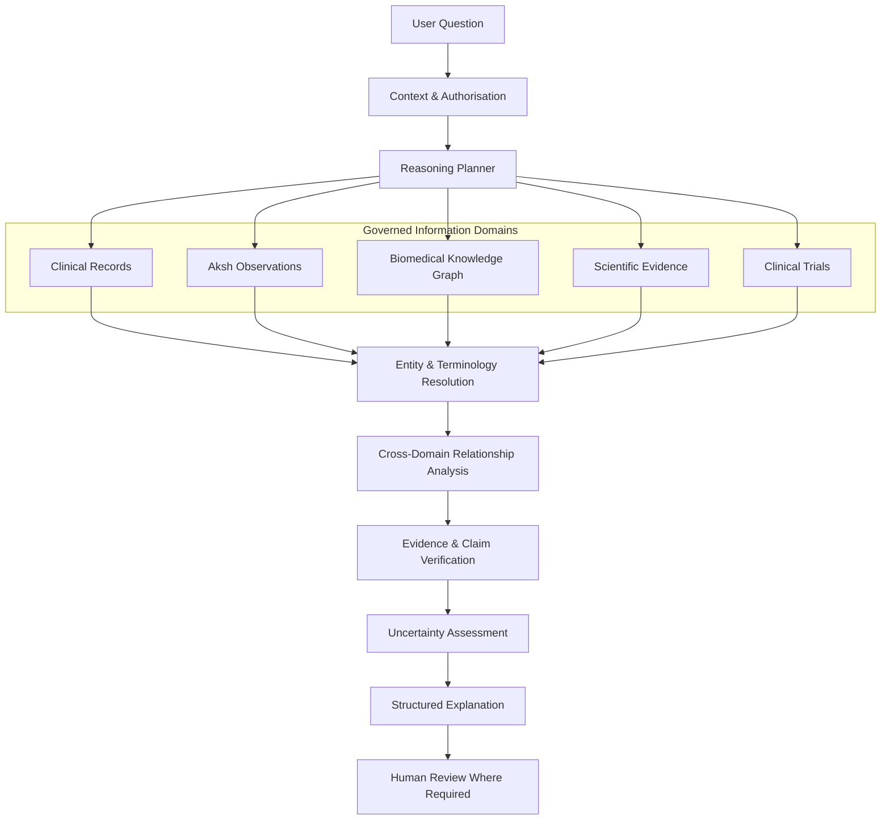

# HSI Cross-Domain Reasoning Architecture (§6.1–6.4)

**Document status:** Definitive CDR architecture (§6 elaboration)  
**PRD companion:** [`HSI_INTELLIGENCE_ENGINE_SPEC.md`](./HSI_INTELLIGENCE_ENGINE_SPEC.md) (Document 03 §16) — this pack elaborates pipeline, Cats 1–5, twelve capabilities.  
**Adopted:** 2 November 2026  
**Instruction:** Strategy only — **no implementation** until founder approval.  
**Binding:** [`HSI_MASTER_VISION.md`](./HSI_MASTER_VISION.md) · [`HSI_FOUR_PRODUCT_ECOSYSTEM.md`](./HSI_FOUR_PRODUCT_ECOSYSTEM.md) · [`HSI_LIVING_HEALTH_KNOWLEDGE_GRAPH.md`](./HSI_LIVING_HEALTH_KNOWLEDGE_GRAPH.md) · [`HSI_INTELLIGENCE_ENGINE_ARCHITECTURE.md`](./HSI_INTELLIGENCE_ENGINE_ARCHITECTURE.md) · [`HSI_ARCHITECTURE_AND_DATA.md`](./HSI_ARCHITECTURE_AND_DATA.md)  
**Evidence model:** [`HSI_EVIDENCE_CATEGORY_SPECIFICATION.md`](./HSI_EVIDENCE_CATEGORY_SPECIFICATION.md) · Pipeline: [`HSI_REASONING_PIPELINE.md`](./HSI_REASONING_PIPELINE.md)

**Legend:** **Verified** · **Partial** · **Proposed** · **Missing**

---

## 6.1 Mission

Cross-domain reasoning (CDR) is the central intelligence capability that differentiates Human Super Intelligence from EHRs, biomedical databases, literature search tools, and general-purpose AI chatbots.

HSI must investigate questions spanning patient history, encounters, labs, medications, physiology, immune-cell biology, signalling, gut–microbiome–metabolism, disease mechanisms, biomedical evidence, therapeutic targets, clinical trials, research gaps, and scientific hypotheses.

**Objective:** connect relevant information, evaluate relationships, preserve evidence boundaries, identify uncertainty, and produce a coherent explanation that supports human investigation or decision-making — **not** multi-database retrieval alone.

CDR must remain evidence-grounded, reproducible, and governed by the permissions of the requesting user.

**Binding directive (§6.24):** Do not reduce CDR to a generic RAG chatbot. Do not treat multi-hop graph paths as causal proof. Temporal sequence ≠ causation. Population association ≠ patient-specific finding. Never claim confirmed trial eligibility from incomplete data. Never promote AI hypotheses into approved knowledge without review.

---

## 6.2 What CDR means (and does not)

### Illustrative clinician scenario (aspirational)

A clinician investigating diabetes, chronic inflammation, and renal-function change may see diagnoses, HbA1c, CRP, kidney labs, and meds in a clinical dashboard; pathways and mechanisms in a research DB; and diabetes/kidney/anti-inflammatory studies in a registry — **separately**.

HSI should connect those sources through a **structured reasoning workflow**: documented changes → observations → medication chronology → relevant mechanisms → published support → remaining uncertainty → related trials → evaluable criteria → missing information.

The result is an **integrated, evidence-linked investigation**, not several unrelated summaries.

**A plausible biological explanation is not proof that it explains this patient's condition.**

### Status honesty

| Journey | Status |
|---------|--------|
| Research disease→mechanism brief (Workflow B / product **M1**) | **Partial** today (Ask + ISI engine **Verified**; formal brief **Proposed**) |
| Clinical→biology→trials integrated product journey (§6.18) | **Proposed** / aspirational — **do not claim it works** |
| Shared claimType enum across products | **Proposed** (Phase 1) |

---

## 6.3 Binding evidence categories

Every substantive HSI output must distinguish (never collapse):

1. **Observed Patient Fact**  
2. **Established Scientific or Clinical Evidence**  
3. **Statistical Association**  
4. **Computational Inference**  
5. **Unvalidated Hypothesis**  

Authoritative detail: [`HSI_EVIDENCE_CATEGORY_SPECIFICATION.md`](./HSI_EVIDENCE_CATEGORY_SPECIFICATION.md). Aligns with LHK-G “never collapse” list and master vision §2.7 graph design principle.

---

## 6.4 Logical architecture

Design reasoning as a **controlled workflow**. This is logical architecture — **not** a requirement to query every source for every question. The orchestrator selects only **relevant and authorised** sources.

### Source selection rules

| Rule | Implication |
|------|-------------|
| Intent-driven | L1 intent/role/purpose determine domains (§5 L1) |
| Plane ACL | P2 clinical never leaks into P0/P1 research tools without abstraction (X-B1 concepts-only) |
| Minimal necessary | Prefer graph+approved cites for research questions; clinical APIs only when authorised |
| Fail closed | Unavailable source → gap/limitation, never fabrication |
| Prefer simple | Type A/B/C tools before Type D agents ([§5 architecture](./HSI_INTELLIGENCE_ENGINE_ARCHITECTURE.md)) |

---

## Relationship to LHK-G domains

| CDR source | LHK-G domain | Plane | Near-term home |
|------------|--------------|-------|----------------|
| Clinical Records | 1 Patient Context | P2 | Aksh / future HSI Clinical |
| Aksh Observations | 1 (PGHD subset) | P2 | Aksh |
| Biomedical KG | 2 Physiology · 3 GIM | P0 | ISI `kg.json` + packs |
| Scientific Evidence | 4 Biomedical Evidence | P0/P1 | hsi-core grades + ISI cites / Gate C |
| Clinical Trials | 5 Clinical Trials | P0/P3 | Registries + ISI TRIAL seed; Trials product **Missing** |
| Gaps / hypotheses (outputs) | 6 Research Discovery | P1 draft | Ask informal today; objects **Proposed** |

Governed cross-domain queries sit on LHK-G semantic & evidence services — see LHK-G Deliverable 2 / Deliverable 8 tools.

---

## Relationship to Intelligence Engine layers

| CDR stage (logical) | §5 layer | Notes |
|---------------------|----------|-------|
| Context & Authorisation | L1 Intent & Context | Role, purpose, ACL, risk |
| Reasoning Planner | L2 Orchestrator | Dual-home: clinical→Aksh CONDUCTOR; research→ISI tool router |
| Domain retrieval / tools | L3 Caps + L4 Tools | Caps 1–20; typed tools only |
| Evidence & Claim Verification | L5 Verification | Cite Check, Gate C, SHIELD; second LLM ≠ verify |
| Human Review | L5 / HITL | Risk-tier gates ([safety model](./HSI_AGENT_SAFETY_MODEL.md)) |

CDR is **not** a fifth product runtime. It is the reasoning contract executed by product-home orchestrators over shared claimTypes, planes, and verification services.

---

## Current vs target

| Element | Current | Target |
|---------|---------|--------|
| Research Ask + KG traversal | **Verified** / **Partial** | Formal Workflow B brief with claimTypes |
| hsi-core grades + Gate C | **Verified** patterns | Mapped to five evidence categories |
| Clinical longitudinal reconstruction | **Partial** synthetic Aksh | HSI Clinical product journey |
| X-B1 Clinical→ISI concepts | **Proposed** | Abstracted mechanism lookup |
| Trials criterion state machine | **Missing** / educational **Partial** | Five states; never confirmed eligible |
| Unified CDR planner | **Missing** | Shared planning schema; product-local execution |
| End-to-end clinical→biology→trials UX | **Missing** | Aspirational after M1 + Clinical + Trials foundations |

**First product milestone remains Workflow B / M1 Biomedical Discovery (research).** Clinical→biology→trials is aspirational.

---

## Pack index (§6)

| Doc | Covers |
|-----|--------|
| This file | Mission, meaning, architecture, domain/layer maps |
| [`HSI_REASONING_PIPELINE.md`](./HSI_REASONING_PIPELINE.md) | Stages 1–10 |
| [`HSI_EVIDENCE_CATEGORY_SPECIFICATION.md`](./HSI_EVIDENCE_CATEGORY_SPECIFICATION.md) | Categories 1–5 |
| [`HSI_CLAIM_PROVENANCE_SCHEMA.md`](./HSI_CLAIM_PROVENANCE_SCHEMA.md) | Claim fields §6.19 |
| [`HSI_REFERENCE_REASONING_QUERIES.md`](./HSI_REFERENCE_REASONING_QUERIES.md) | Caps 1–12 |
| Workflow + safety + eval docs | §6.18–6.22 |

**Stop.** Founder approval required before implementation.
