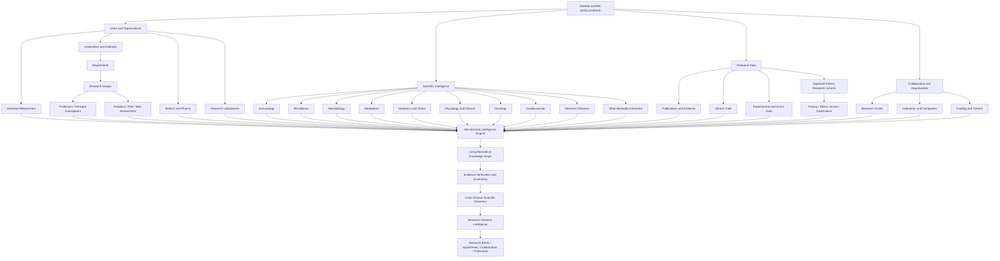
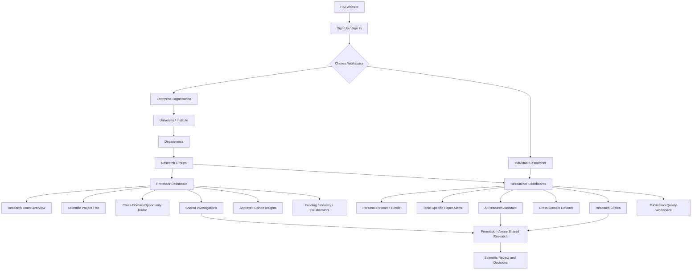
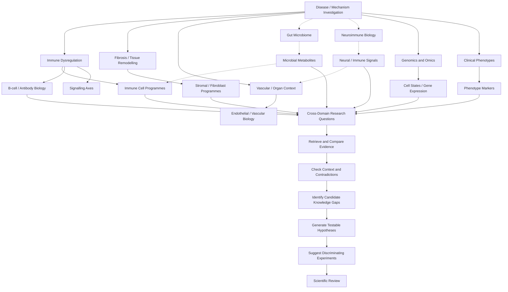
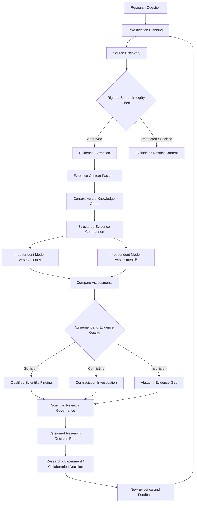
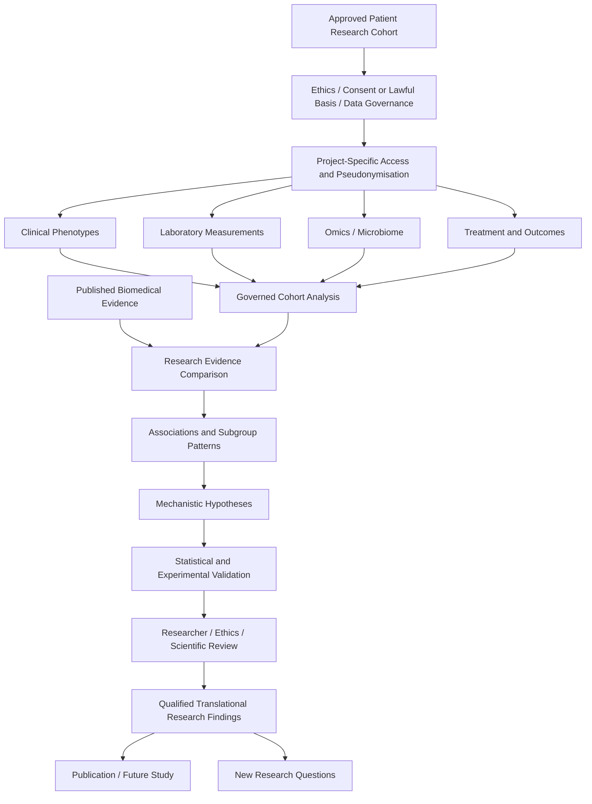
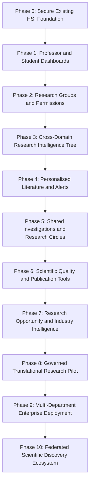
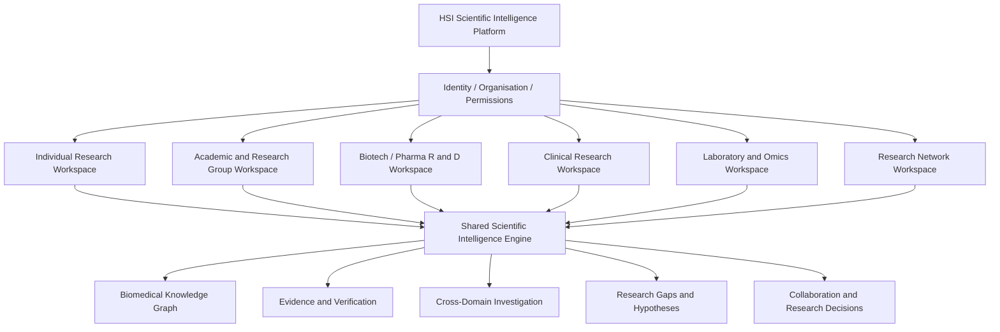

# HSI — End-to-End Vision & Technology Architecture

**Status:** Ambition doctrine + proposed delivery sequence (19 November 2026, Europe/London).  
**Does not claim** that every capability is production-ready, that patient data is live, or that dual-provider verification / source-rights / scientific benchmarking gates are closed.  
**Binding companions:** [`HSI_VISION.md`](./HSI_VISION.md) · [`HSI_DEFINITIVE_PRODUCT_VISION.md`](./HSI_DEFINITIVE_PRODUCT_VISION.md) · [`../CDS_PHI_BOUNDARY.md`](../CDS_PHI_BOUNDARY.md) · capability register / `docs/STATUS.md`.

## Definitive positioning

**HSI is a connected scientific intelligence ecosystem that brings together researchers, biological systems, biomedical evidence and governed research data to accelerate cross-disciplinary discovery, collaboration and evidence-grounded scientific decisions.**

Central principle (unchanged):

> Understand the mechanism. Preserve the evidence. Explain the uncertainty. Inform the next decision.

### Disease-agnostic (binding correction)

Systemic sclerosis (SSc), CD4+ T-cell examples, and the illustrative professor laboratory are **demonstration scenarios only**. They are **not** the scientific scope, product boundary, architecture limit or roadmap focus of HSI.

HSI must support researchers across the spectrum of human biology and biomedical science (immunology, neuroscience, microbiome, metabolism, genomics/omics, physiology, oncology, cardiovascular biology, infectious diseases, and other biomedical domains). A researcher in Alzheimer’s, diabetes, cancer, SSc or cardiovascular disease should receive the same depth of scientific intelligence. Cross-domain investigation must not be restricted by department.

Validation may remain incremental (selected use cases first) without hardcoding the platform around those diseases.

Public positioning remains **one scientific intelligence technology** (Living Knowledge Graph, evidence, experimental context, scientific investigation) — not a marketed multi-product portfolio. Historical ownership planes stay for governance only.

---

## 1. Master vision — end-to-end ecosystem

Organisational, scientific and research-data systems stay connected while permissions and evidence standards remain distinct. Private PHI must not auto-enter the research graph; no live CDS in `hsi-core`.

---

## 2. University enterprise — professor and student journey

**Demonstration scenario (not product boundary):** A professor leads a research group with postdocs, PhD and master’s researchers. Each researcher owns a personalised profile; the professor inspects only authorised shared projects, overlaps and candidate gaps — never private notes or unpublished restricted work by default.

Engineering preview shells (PR1): `/enterprise`, `/enterprise/professor`, `/enterprise/student` — demonstration-labelled; see [`../engineering/ENTERPRISE_DASHBOARD_GAP_MATRIX.md`](../engineering/ENTERPRISE_DASHBOARD_GAP_MATRIX.md).

---

## 3. Scientific discovery — cross-domain opportunities

HSI does not stop at retrieving papers about one mechanism. It helps investigators compare candidate relationships **across** biological domains.

Dashed edges are **exploratory**, not established causation. Every connection must carry provenance, experimental context (Context Passport), uncertainty and review status (candidate vs reviewed).

---

## 4. AI research engine — question to verified brief

**Honesty:** This is the intended scientific workflow. Existing HSI components cover parts of it. Production provider verification, source-rights approval, scientific benchmarking and durable end-to-end acceptance remain **gates** — soft-land catalogs must not invent credentials, independence proofs or gate pass.

---

## 5. Translational research — approved patient data (future governed)

**Not authorised live patient integration.** First implementations use synthetic or appropriately licensed public research datasets until ethics, security and access controls are approved. No identifiable uploads or PHI→LLM in `hsi-core`.

---

## 6. Proposed implementation roadmap

Proposed delivery sequence — **not** a claim that each phase is complete or that all phases are required before a pilot. Reuse existing substrate, investigation workspace, graph, passport, dual-model harness and fail-closed gates. Do not lift held migrations or invent MoUs from green PRs.

| Phase | Near-term engineering note |
| --- | --- |
| 0 | Soft-lands, isolation, clearance, rate limits — in flight / merged catalogs |
| 1 | Enterprise shells `#513` (demo-labelled; human merge) |
| 2+ | Profiles, membership UI, live tree/feed — still no unapproved persistence |

---

## 7. Multi-stakeholder workspaces (one engine, many shells)

HSI is **not** only for professors, PhD students or universities. It should serve the wider biomedical research ecosystem. The **scientific intelligence engine stays shared**; dashboards, permissions and workflows vary by stakeholder.

### Proposed workspace architecture

| Workspace | Primary users | Focus (proposed) | Status |
| --- | --- | --- | --- |
| Individual research | Independent / early researchers | Profile, investigations, alerts | Demo shell `/workspaces/researcher` + `/research/*` |
| Academic & research group | PI, postdocs, PhD, MSc | Team tree, supervision, shared projects | Demo `/workspaces/professor` · `/workspaces/student` (+ PR1 `/enterprise/*`) |
| Biotech / pharma R&D | Discovery, translational, medical affairs | Targets, mechanisms, landscape, portfolio | Demo shell `/workspaces/biotech` |
| Clinical research | Clinician-scientists, CROs | Approved cohorts, phenotypes, trials research | Demo `/workspaces/clinical` — cohorts **disabled**; not CDS; PHI gated |
| Laboratory & omics | Core facilities, bioinformaticians | Assays, omics interpretation, reproducibility | Demo shell `/workspaces/laboratory` |
| Research network | Societies, consortia | Circles, shared reviews, challenges | Demo shell `/workspaces/community` |
| University / enterprise admin | Research administrators | Departments, roles, subscriptions | Demo shell `/workspaces/enterprise` (roles ≠ seats) |
| Patients / participants | Research participants | Consent, contribution, updates | **Future separate governed experience** — not the scientific dashboard |

Interactive concept hub: `/workspaces` (shared navigation, domain map, evidence cards, AI panels).

### Roles vs subscriptions

- **Role** = what a user is authorised to do (server-side grants, tenant membership, project sharing).
- **Subscription** = commercial capability / usage limits.

An institutional subscription must **not** automatically unlock confidential scientific data for every university administrator. Patient/PHI paths remain separately governed (`CDS_PHI_BOUNDARY`).

### Market sequence (proposed, not domain restriction)

1. Individual researchers and small academic groups  
2. Biotech discovery / translational teams  
3. University departments / institutes  
4. Laboratory and omics teams  
5. Clinical research organisations  
6. Patients / research participants (separate regulated path)

Collaboration across organisations must stay permission-aware: no automatic exposure of confidential company data, unpublished university results or patient records.

---

## One-sentence vision

HSI connects people, biological mechanisms, scientific evidence and governed research data into one collaborative intelligence system that helps scientists discover opportunities, evaluate uncertainty, design better investigations and produce more rigorous research.

**Strongest early demonstration (scenario, not scope):** a research group collaboratively investigating immune, stromal and cross-domain mechanisms with evidence-linked AI investigations and permission-aware workspaces — using whatever disease focus the group actually studies.
