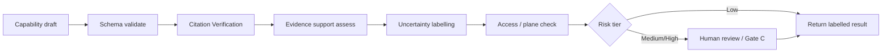

# HSI Evidence Verification Design (§5.10)

**Document status:** Independent verification architecture for the Intelligence Engine  
**Binding rule:** Verification services operate **independently** of the agent that generated the draft.  
**A second LLM is not verification.**

---

## 1. Principles

| Principle | Meaning |
|-----------|---------|
| Separation | Generator ≠ verifier |
| Deterministic first | Identifier resolve, schema validate, ACL check before narrative critique |
| Human for consequential | Gate C / HITL for promotion and clinical acts |
| Provenance | Every claim carries source + retrieval time + review status |
| Honesty | Check ≠ supports ≠ Approve ≠ CDS |

---

## 2. Service inventory

| Service | Function | Status | Code / map |
|---------|----------|--------|------------|
| **Citation Verification** | PMID/DOI resolve in PubMed/Crossref | **Verified** Check path | ISI cite Check script; Ask `validateAnswerCitations` |
| **Evidence Verification** | Claim supported by retrieved source? | **Partial** | Human `claim_support`; not auto |
| **Scientific Uncertainty** | Flag unsupported causal / extrapolation | **Partial** | Grades, Ask honesty, claimType (**Proposed** enum formalisation) |
| **Clinical Safety Checks** | High-risk clinical act/interpretation | **Verified** (sim) | GUARDIAN, guardian-gateway, human gates |
| **Access Control** | Plane + role + purpose | **Partial** | Separate product auth; shared IAM **Missing** |
| **Output Validation** | Schema / contract | **Partial** | Agent contracts, consume honesty asserts |
| **Human Review** | Gate C / HITL | **Verified** patterns | Curation queue; Aksh review queue |
| **Audit Logging** | Immutable execution + decisions | **Verified** Aksh SHIELD; research **Partial** | |

---

## 3. Citation check pipeline (current → target)

**Current (Fact):**

1. HSI pack / candidate emits identifier  
2. Cite Check → metadata status (`verified` / `not_found` / …)  
3. Human sets `claim_support`  
4. Approve maps to REL-* for public cite  
5. Ask validates answer citations against allowed set  

**Target:** Same steps as **mandatory L5 hooks** on Caps 12–15 and Workflow B/E outputs before user-facing “supported” language.



---

## 4. Uncertainty representation

Align with master vision categories — do not invent confidence % without validation:

| Label | Use |
|-------|-----|
| Known / observed | Authenticated clinical or verified fact |
| Uncertain / conflict | Competing sources |
| Missing | Required field absent |
| Associated | Published association |
| Hypothesised | Cap 15 only |
| Not established | Insufficient evidence |

Map ISI evidence statuses and hsi-core grades into shared `claimType` (**Proposed** Phase 1).

---

## 5. Gate C / HITL integration

| Path | Verification role |
|------|-------------------|
| Research publish | Citation Verification → human supports → Approve; `autoApprove` forever false |
| Clinical draft | Clinical Safety Checks → HITL item → SHIELD |
| Trial screen | Criteria schema + freshness → investigator review; no auto eligible |
| Cross-product X-B1 | Concepts + cites only; strip identifiers |

---

## 6. Schemas (illustrative)

```yaml
VerificationResult:
  draftId: string
  schemaValid: boolean
  citations:
    - id: string
      status: verified|not_found|unavailable|mismatch
  evidenceSupport: supports|partial|contradicts|unassessed
  uncertaintyLabels: string[]
  safetyFlags: string[]
  accessDecision: allow|deny
  humanReviewRequired: boolean
  humanReviewStatus: pending|approved|rejected|n_a
  verifierVersions:
    citationCheck: string
    schema: string
  notes: string
```

```yaml
EvidenceStatement:
  text: string
  claimType: observed|evidence|association|inference|hypothesis
  sources: [{ system: string, value: string, retrievedAt: datetime }]
  reviewStatus: draft|pending_gate_c|approved|rejected
  verification: VerificationResult
```

---

## 7. Anti-patterns (forbidden)

- “Verify with another model” as sole check  
- Treating identifier Check as claim support  
- Promoting Gate C pending rows to public cites  
- Filling failed retrievals with parametric model knowledge presented as cited  
- Collapsing hypothesis into established mechanism in UX  

---

## 8. Evaluation hooks

Feed [`HSI_AGENT_EVALUATION_FRAMEWORK.md`](./HSI_AGENT_EVALUATION_FRAMEWORK.md): citation precision, unsupported-claim rate, false-eligible rate (=0), Gate C auto-approve attempts (=0).

**Status:** Design **Proposed** as unified L5; components **Verified**/Partial as table above. No code changes in this pack.
