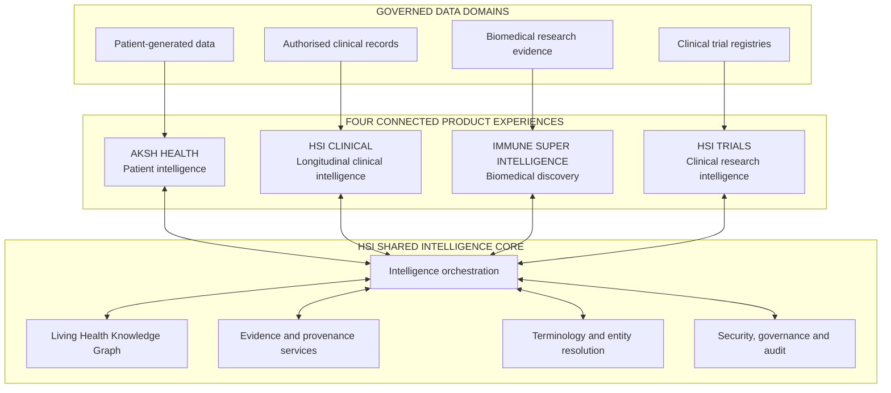
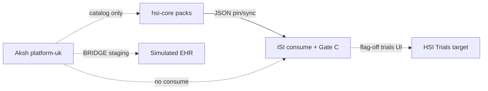

# One Ecosystem, Four Connected Products

**Document status:** Definitive product strategy specification (§3)  
**Adopted:** 2 November 2026  
**Instruction:** Establishes product boundaries, ownership, shared services, integration contracts and end-to-end workflows. **No implementation** until founder approval.  
**Depends on:** [`HSI_MASTER_VISION.md`](./HSI_MASTER_VISION.md) · audit in [`HSI_CURRENT_STATE_INTELLIGENCE_REPORT.md`](./HSI_CURRENT_STATE_INTELLIGENCE_REPORT.md)

---

## 3.1 Fundamental product architecture

Health Super Intelligence is **one connected intelligence ecosystem with four specialised product experiences**, not four unrelated apps and not one monolith.

| # | Product | Role |
|---|---------|------|
| A | **Aksh Health** | Patient intelligence, engagement, patient-generated observations |
| B | **HSI Clinical** | Authorised clinical records, encounters, longitudinal clinical intelligence |
| C | **Immune Super Intelligence (ISI)** | Mechanisms, immune knowledge, biomedical evidence, scientific discovery |
| D | **HSI Trials** | Trial intelligence, explainable eligibility screening, research opportunities |

Connected through the **HSI Shared Intelligence Core** (logical services — may span `hsi-core`, ISI, Aksh, and future services).

**Logical only:** not one DB, deploy, or physical graph. Patient-identifiable data and research evidence stay under separate governance.

### Current maturity (Fact — Phase 0 audit)

| Product | Status |
|---------|--------|
| Aksh Health | Exists (`platform-uk`); synthetic clinical proof; `LIVE_ORGANISATIONS=0` |
| HSI Clinical | **Target product** — fragments only (Aksh BRIDGE/spine) |
| ISI | Exists (`immunecity`); strongest research surface |
| HSI Trials | **Target product** — partial melanoma/flag-off in ISI |
| Shared Core | Partial: evidence/Gate C in hsi-core; Ask/KG in ISI; HITL/SHIELD in Aksh — **not yet one contracted core** |

---

## 3.2–3.6 Product summaries (binding)

Full mission, users, must-nots and success criteria for each product are authoritative as stated in the founder §3 brief. Condensed ownership and boundaries:

### A — Aksh Health
- **Owns:** onboarding, PGHD, wearables, diabetes/metabolic engagement, patient UX, existing clinical agents (reuse).  
- **Must not:** impersonate clinician; auto-write EHR; treat self-report as verified diagnosis; dump PHI into ISI; determine trial eligibility; duplicate HSI Clinical reconciliation.  
- **Standalone:** users need not open Clinical/ISI/Trials to benefit.

### B — HSI Clinical
- **Owns:** identity workflows, record discovery, longitudinal timeline, med/lab reconciliation support, clinical context summaries, clinician UX.  
- **Must not:** replace EHRs; assume universal access; LLM-guess identity; auto-order/prescribe/enrol.  
- **Links:** abstracted concepts → ISI; min-necessary attributes → Trials.

### C — ISI
- **Owns:** immune/molecular/systems/microbiome/therapeutic knowledge, graph exploration, evidence standards, research briefs, scientific discovery loop.  
- **Must not:** require identifiable PHI by default; treat predictions as validated; discard KG without evidence.  
- **Preserve:** existing `kg.json` / REL-* / Ask grounding.

### D — HSI Trials
- **Owns:** registry ingest, eligibility model, explainable matching (5 states), mechanism→trial discovery, screening reports.  
- **Must not:** auto-enrol or confirm eligibility; stale recruitment without freshness stamps.

---

# DELIVERABLES (§3.16)

---

## D1. HSI Product Ownership Matrix

| Capability | Primary owner | Shared through |
|------------|---------------|----------------|
| Patient onboarding | Aksh | Patient identity/profile APIs |
| Symptoms / home monitoring | Aksh | Governed observation services |
| Wearables / PGHD | Aksh | Data integration services |
| Diabetes / metabolic engagement | Aksh | Patient intelligence APIs |
| Hospital encounter reconstruction | HSI Clinical | Longitudinal context services |
| Clinical record reconciliation | HSI Clinical | Clinical data services |
| Medication reconciliation support | HSI Clinical | Medication context services |
| Laboratory history / trends | HSI Clinical | Observation & analytics APIs |
| Immune-cell / pathway knowledge | ISI | Biomedical graph APIs |
| Mechanism exploration | ISI | Scientific investigation services |
| Scientific literature synthesis | ISI | Evidence services |
| Research-gap identification | ISI | Research intelligence services |
| Clinical trial registry ingestion | HSI Trials | Trial data services |
| Trial eligibility screening | HSI Trials | Eligibility evaluation services |
| Cross-domain reasoning | Intelligence Core | Orchestration + graph |
| Identity, authorisation, audit | Shared foundation | Security & governance |
| Terminology / ontology alignment | Shared foundation | Terminology services |
| Evidence provenance / Gate C grades | Shared foundation (hsi-core + ISI ops) | Evidence services |
| Graded edge publish (packs) | hsi-core substrate | Export / consume contracts |
| Clinical HITL / agent orchestration | Aksh | Future Integration Gateway |
| Public approved citations | ISI | Citations APIs |

**Rule:** Product owns domain logic; shared foundation owns reusable tech without absorbing product business logic.

---

## D2. Current-State Integration Map

| Integration | Exists? | Classification | Evidence |
|-------------|---------|----------------|----------|
| hsi-core → ISI Discovery JSON consume | Yes | Verified / Partial ops | `isiConsumeContract.ts`, ISI `discoveryConsume.ts`, `public/hsi-discovery/` |
| ISI Gate C on autumn-snow | Yes | Partial (live DB not re-run) | `gateCQueue.ts`, host assert |
| Cite Check / human supports | Yes | Partial | `check-cite-candidates-from-gate-c.ts` |
| Aksh → hsi-core agent runtime | No | Catalog only | `akshAgents.ts` |
| Aksh → ISI research | No | Missing | — |
| Aksh → HSI Clinical (as product) | N/A | Clinical not separate | BRIDGE inside Aksh |
| HSI Clinical → ISI mechanism lookup | No | Proposed | — |
| HSI Clinical → Trials screening | No | Proposed | — |
| ISI → Trials mechanism→study | Partial | Melanoma / flag-off | `TrialIntelligence.tsx` |
| Trials → Aksh patient info | No | Proposed | — |
| ISI → Aksh education | No | Proposed | — |
| Live FHIR / EMIS / hospital | No | Simulated / staging | Aksh `liveEmis:false` |
| Shared IAM across four products | No | Separate (Neon Auth ISI; Aksh auth) | — |
| Shared terminology service | No | Ad hoc LOINC/SNOMED fragments | — |

Solid = exists. Dashed = missing or non-product.

---

## D3. Target-State Ecosystem Architecture

### Products & stores

| Product / service | Primary UX | Primary data | Plane |
|-------------------|------------|--------------|-------|
| Aksh Health | Patient / clinic HITL | Aksh Neon + proof stores | P2 (+ PGHD) |
| HSI Clinical | Clinician workspace | FHIR repo / MPI (future) | P2 |
| ISI | Researcher workspace | `kg.json` + autumn-snow evidence | P0/P1 |
| HSI Trials | Trial workspace | Registry cache + screening decisions | P3 (+ P0) |
| hsi-core | Substrate / exports | red-wave + pack JSON | P1 |
| Shared Core | APIs/events | Contracts, not a mega-DB | Cross-cutting |

### Shared Intelligence Core (logical services)

1. Identity & Access Management  
2. Clinical Data Interoperability  
3. Living Health Knowledge Graph (logical; see vision §2.7 / KG plan)  
4. Biomedical Evidence Services (hsi-core grades + ISI citations + Gate C)  
5. Intelligence Orchestration (clinical→Aksh CONDUCTOR; research→ISI tool router)  
6. Terminology & Entity Resolution  
7. Temporal Intelligence  
8. Governance & Safety  

### Security boundaries

- P2 never lands on red-wave or autumn-snow research stores.  
- Exchange B (Clinical→ISI) uses **abstracted concepts**, not identifiers.  
- Graph must not bypass access control.  
- AI outputs retain inputs, sources, uncertainty, review status.

Detail: [`HSI_TARGET_ARCHITECTURE.md`](./HSI_TARGET_ARCHITECTURE.md).

---

## D4. Cross-Product API Catalogue (proposed contracts)

Contracts are **proposed** until implemented. Each must eventually specify all §3.13 fields.

| ID | Service | Owner | Consumer | Purpose | PHI? | Status |
|----|---------|-------|----------|---------|------|--------|
| **X-A1** | PatientObservationExport | Aksh | HSI Clinical | Authorised PGHD with source/time/quality | Yes (scoped) | Proposed |
| **X-A2** | HealthContextSummary | Aksh | HSI Clinical | Appointment prep / trends summary | Yes (scoped) | Proposed |
| **X-B1** | BiomedicalMechanismLookup | ISI | HSI Clinical | Disease/phenotype → mechanisms + cites + uncertainty | **No** (concepts only) | Proposed |
| **X-B2** | BiomarkerEvidenceLookup | ISI | HSI Clinical / Trials | Biomarker ↔ disease/therapy evidence | No | Proposed |
| **X-C1** | MechanismToTrials | HSI Trials | ISI | Pathway/target → registered studies | No | Proposed |
| **X-D1** | TrialScreeningEvaluate | HSI Trials | HSI Clinical | Criterion-level match report (5 states) | Min necessary | Proposed |
| **X-E1** | PatientFacingTrialInfo | HSI Trials | Aksh | General study info / interest — no eligibility claim | No PHI leakage | Proposed |
| **X-F1** | EducationalBiologyExplain | ISI | Aksh | Patient-friendly general biology | No PHI | Proposed |
| **X-G1** | HsiEvidenceConsume | hsi-core | ISI | Graded packs + Gate C checklist | No | **Exists** |
| **X-G2** | GateCDecisionApply | ISI | Curators | Human approve/reject evidence | No | **Partial** |
| **X-H1** | AkshAgentCatalog | Aksh / hsi-core | Docs/ops | Directory only | No | **Exists** (not runtime) |
| **X-H2** | ClinicalSpineGateway | Aksh | HSI Core/Clinical | Validated HITL outputs (future) | Scoped | Proposed Phase 5 |

### Example contract (canonical pattern)

**Service:** Biomedical Mechanism Lookup (**X-B1**)  
**Owner:** ISI · **Consumer:** HSI Clinical  
**Input:** Disease identifier, optional phenotype concepts, scientific context.  
**Output:** Evidence-supported mechanisms, entities, citations, uncertainty, review status.  
**Restriction:** Identifiable patient information not required.  
**Failure:** Explicit insufficient-evidence / unavailable-source — never invent a mechanism.  
**Audit:** Request id, purpose, org, role, timestamp.

---

## D5. Shared Knowledge Graph Integration Plan

1. **Preserve** ISI `kg.json` + REL-* as Immune + Evidence seed (Domains 3, 6, 7).  
2. **hsi-core packs** remain authoritative graded L4 publish path → ISI consume after Gate C.  
3. **Logical domains 1–8** map to planes/stores (Patient/Clinical ≠ research DB).  
4. Add shared metadata: `claimType`, provenance, temporal fields, review status — without breaking Atlas IDs.  
5. HSI Trials consumes mechanism/target edges via **X-C1**, does not fork a second biology graph.  
6. HSI Clinical links timeline events to concept IDs for **X-B1**, not full patient subgraph in ISI.  
7. Defer physical graph-DB consolidation until query SLOs demand it.

Detail: [`HSI_KNOWLEDGE_GRAPH_MASTER_PLAN.md`](./HSI_KNOWLEDGE_GRAPH_MASTER_PLAN.md).

---

## D6. Existing Agent Reuse Plan

| Agent / capability | Home | Disposition |
|--------------------|------|-------------|
| CONDUCTOR, CANVAS, SYNTHESIS, DrASSIST, GUARDIAN, HORIZON, NEXUS, PATHWAY, BRIDGE, SHIELD, COMPASS | Aksh | **Preserve** — clinical orchestration; expose later via X-H2 |
| VOICE | Aksh | Improve; not on all CONDUCTOR paths |
| PRISM, ATLAS (Aksh) | Aksh | Scaffold — do not market live; rename ATLAS vs ISI Atlas (D8) |
| Diabetes agent-intel / coaching | Aksh | Preserve in Aksh; do not clone into hsi-core |
| Ask grounding / AskAtlas | ISI | **Preserve** — research gateway for Workflow A |
| Discovery Intel scaffolding | ISI | Improve as tools, not fake multi-agent autonomy |
| Gate C / Cite Check | ISI + hsi-core | **Preserve** — verification layer |
| hsi-core Aksh catalog / P3 stubs | hsi-core | Catalog OK; stubs stay proposals until eval |
| Named vision investigators (Immune Cell, Mechanism, …) | Future ISI pipelines | Build as **tool pipelines** after M1; promote to agents only with metrics |

**Retire / avoid:** Reimplementing CONDUCTOR in hsi-core; agent-per-noun without tools.

Detail: [`HSI_AGENT_ORCHESTRATION_STRATEGY.md`](./HSI_AGENT_ORCHESTRATION_STRATEGY.md).

---

## D7. End-to-End Workflow Specifications

### Journey 1 — Patient with diabetes + inflammatory condition (cross-product)

| Stage | Product | Behaviour | Today |
|-------|---------|-----------|-------|
| 1 | Aksh | PGHD with source/time | Synthetic demo |
| 2 | HSI Clinical | Verified identity + timeline + labelled Aksh observations | Missing as product |
| 3–4 | ISI | Mechanism/evidence for documented conditions (concepts) | Ask/KG exist; Clinical link missing |
| 5 | Trials | Screening + missing criteria | Flag-off / partial |
| 6 | Clinician | Human decision | HITL patterns in Aksh only |
| 7 | Aksh | Follow-up education / monitoring | Partial |

**Future:** reference architecture + e2e integration test. **Not** first build.

### Journey 2 — Researcher treatment resistance (ISI-led)

| Stage | Behaviour | Today |
|-------|-----------|-------|
| 1–4 | Question → graph → compare → gaps | Ask + KG Partial; brief not formalised |
| 5 | Trials mechanism→studies | Proposed / melanoma partial |
| 6 | Governed cohort (if approved) | Missing |
| 7 | Traceable research brief | **First milestone M1** |

### Journey 3 — Hospital entry (vision §2.4)

Identity → discovery → timeline → context → biology → trials → clinician decision → continuity.  
**Entirely future** except biology (ISI) and synthetic clinical fragments (Aksh).

---

## D8. Data Governance and Access Matrix

| Data class | Controller / home | Who may access | Purpose examples | Must not |
|------------|-------------------|----------------|------------------|----------|
| PGHD | Aksh / patient policies | Patient; authorised clinicians via X-A1 | Monitoring, timeline enrichment | Enter ISI general graph |
| Identifiable clinical records | Healthcare orgs / HSI Clinical | Role + purpose scoped clinicians | Care, screening | Unrestricted research dump |
| De-id / aggregated clinical research | Separate research governance | Approved researchers | Cohort analysis | Bypass ethics |
| Graded HSI packs / Gate C | hsi-core / ISI curators | Curators; public after Approve | Evidence promotion | Auto-approve; PHI |
| ISI KG + public cites | ISI | Researchers / public (approved cites) | Discovery | Clinical orders |
| Trial registry public data | Trials service | Broad | Discovery | Fake eligibility |
| Screening decisions | Trials + Clinical | Trial team / referring clinician | Recruitment workflow | Patient-facing “you are eligible” |
| AI outputs | Producer service | Same as purpose scope | Decision support | Silent promotion to clinical fact |

Planes P0–P3 remain binding ([`HSI_TARGET_ARCHITECTURE.md`](./HSI_TARGET_ARCHITECTURE.md)).

---

## D9. Integration Testing Strategy

| Layer | What | When |
|-------|------|------|
| Contract unit | Schema + honesty asserts (exist for X-G1) | Every PR on contract |
| Plane firewall | Reject PHI flags / wrong Neon host | CI (exist neonGuard / Gate C host) |
| Product e2e | Journey 2 brief golden set | M1 |
| Synthetic clinical | Journey 1 with fixtures — no real PHI | Phase 3+ |
| Trial criterion gold | Five-state matching vs labelled criteria | Phase 4 |
| Gateway red-team | PHI leakage Aksh→research | Phase 5 |
| Partner eval | Supervised usefulness | Phase 6 |

Do not mark a cross-product journey “done” without contract tests + honesty asserts + role checks.

---

## D10. Implementation Dependency Roadmap

Aligns with §3.15 and [`HSI_PRODUCT_ROADMAP.md`](./HSI_PRODUCT_ROADMAP.md):

| Priority | Focus | Gate |
|----------|-------|------|
| **P0** | Asset assessment | Done (this pack) |
| **P1** | Shared architecture: ownership, contracts catalogue, claimTypes, planes | Founder D1–D6 |
| **P2** | ISI scientific intelligence (M1 brief + graph metadata) | D2/D3/D5 |
| **P3** | HSI Clinical foundation (synthetic FHIR timeline) | D2 option B or later |
| **P4** | HSI Trials (registry + eligibility states) | After disease context from P2 |
| **P5** | Cross-product integration (X-A/B/C/D/E/F) | Working contracts + DPIA as needed |
| **P6** | Partner evaluation | Real MoU (D9) |

**Minimum shared foundations before four-experience integration:**

1. Ownership matrix (this doc) accepted.  
2. Planes + Neon isolation unchanged.  
3. X-G1 honesty consume stable.  
4. claimType / provenance enum agreed.  
5. X-B1 and X-D1 draft OpenAPI before Clinical/Trials UI.  
6. No duplicate symptom monitor, biology graph, or terminology service.

---

## 3.11 Workspaces (UX binding)

| Workspace | Primary product | Primary nav |
|-----------|-----------------|-------------|
| Public HSI | Ecosystem site | Vision, four products, available vs in-dev, collaboration — **not** engineering roadmaps |
| Patient | Aksh | My Health, Timeline, Measurements, Medications, Symptoms, Care, Insights |
| Clinician | HSI Clinical | Search, Overview, Timeline, Labs, Meds, Evidence, Trial Screening |
| Researcher | ISI | Questions, Graph, Mechanisms, Evidence, Compare, Gaps, Briefs |
| Trial | HSI Trials | Studies, Criteria, Screening, Review, Recruitment, Evidence |

Contextual handoffs, not manual app hopping.

---

## 3.14 Anti-duplication checklist (mandatory before new builds)

- Does Aksh already implement it?  
- Does ISI already implement it?  
- Does hsi-core already export it?  
- Can it be an API?  
- Does it need refactor vs rewrite?  
- Shared service vs product module?  
- Would duplication create inconsistent behaviour?

---

## Final directive (accepted)

HSI = specialised experiences + shared services + governed domains + interoperable knowledge — **success = accurate, secure, evidence-clear cross-product workflows**, not four logos or one mega-app.

**Stop:** Architecture, contracts, ownership and strategy documented. **Await founder approval** before application changes.
