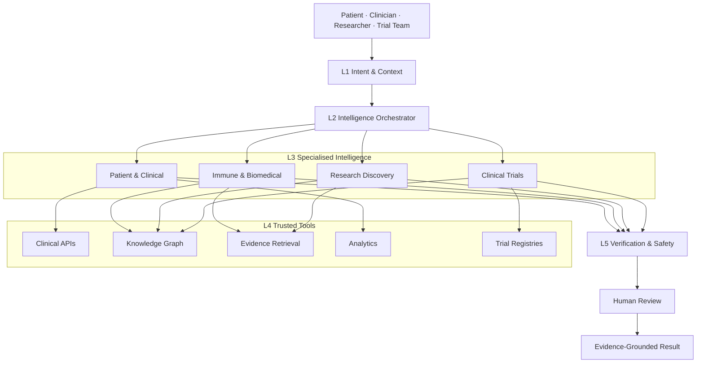

# HSI Intelligence Engine Architecture (§5.1–5.3)

**Document status:** Definitive §5 elaboration of target-state intelligence architecture  
**PRD companion (canonical Document 03):** [`HSI_INTELLIGENCE_ENGINE_SPEC.md`](./HSI_INTELLIGENCE_ENGINE_SPEC.md) — Proposed / pending founder approval; this file elaborates layers/planes with audit Current vs Target.  
**Binding:** [`HSI_MASTER_VISION.md`](./HSI_MASTER_VISION.md) · [`HSI_FOUR_PRODUCT_ECOSYSTEM.md`](./HSI_FOUR_PRODUCT_ECOSYSTEM.md) · [`HSI_LIVING_HEALTH_KNOWLEDGE_GRAPH.md`](./HSI_LIVING_HEALTH_KNOWLEDGE_GRAPH.md) · [`HSI_ARCHITECTURE_AND_DATA.md`](./HSI_ARCHITECTURE_AND_DATA.md) (Document 02) · [`HSI_TARGET_ARCHITECTURE.md`](./HSI_TARGET_ARCHITECTURE.md)  
**Audit grounding:** [`HSI_EXISTING_AGENT_AUDIT.md`](./HSI_EXISTING_AGENT_AUDIT.md) · honesty [`HSI_DOC02_03_RECONCILIATION.md`](./HSI_DOC02_03_RECONCILIATION.md) (Documents 02 / 03 / 04)  
**Rule:** Interoperable services — **not** a monolithic AI agent. Agent-assisted, not agent-dependent. Prefer Type A/B/C over Type D.  
**Cross-domain reasoning (§6):** definitive pack starts at [`HSI_CROSS_DOMAIN_REASONING_ARCHITECTURE.md`](./HSI_CROSS_DOMAIN_REASONING_ARCHITECTURE.md) (pipeline, claimTypes, twelve capabilities).

**Legend:** **Current** = exists today · **Target** = proposed after founder approval

---

## 1. Central vision (§5.1)

The Intelligence Engine coordinates clinical context, PGHD, biomedical graphs, immune/molecular biology, microbiome/metabolic evidence, literature, therapeutics, trials, analytics, and human review.

It must **not** send a user question to an LLM and present the answer as intelligence. It must determine: intent → required information → available sources → permissions → capabilities → methods → graph edges → evidence → uncertainty → human gates.

---

## 2. Five layers (§5.2)

| Layer | Role | Current | Target |
|-------|------|---------|--------|
| **L1 Intent & Context** | Role, purpose, context, ACL, risk, output shape | ISI `askGrounding` intent classes (**Partial**); Aksh case_run context (**Partial**, synthetic); no shared IAM | Shared intent schema per product entry |
| **L2 Orchestrator** | Decompose, route, state, HITL, assemble | Aksh **CONDUCTOR** clinical (**Verified** simulation); ISI single Ask path (**Partial**); hsi-core **Missing** | Dual-home: clinical→Aksh CONDUCTOR; research→ISI tool router; shared contracts |
| **L3 Capabilities** | Caps 1–20 specialised workers | Aksh Caps 1–6 peers (**Partial**/Verified sim); ISI Caps 7–15 fragments (**Partial**); Trials Caps 16–20 (**Partial**/Mocked) | Typed capabilities with contracts |
| **L4 Tools & data** | Graph, evidence, terminology, clinical, trials, analytics | ISI engine + packs + Cite Check (**Partial**/Verified); Aksh FHIR staging (**Partial**); registries educational | Typed tools only (no raw DB) |
| **L5 Verification & governance** | ACL, evidence, uncertainty, safety, schema, HITL, audit | Gate C / Cite Check / SHIELD / cdsPhiBoundary (**Verified** patterns) | Independent verification services |



---

## 3. Non-monolith design

| Principle | Implication |
|-----------|-------------|
| Product homes | Clinical orchestration stays in **Aksh**; research routing in **ISI**; evidence substrate in **hsi-core**; Trials as future product |
| Shared core | Contracts, claimTypes, planes, terminology, verification — not a mega-runtime |
| Deployables | Independent; integrate via X-* APIs |
| No unrestricted DB | Agents call typed tools only ([LHK-G Deliverable 8](./HSI_LIVING_HEALTH_KNOWLEDGE_GRAPH.md)) |
| Prefer simple | Type A → B → C → D escalation |

---

## 4. Data planes (P0–P3)

| Plane | Contents | Store home | Orchestrator access |
|-------|----------|------------|---------------------|
| **P0** Public biomedical | Ontologies, public literature, ISI KG | ISI + caches | Research workflows freely (rate-limited) |
| **P1** Governed evidence | Graded edges, Gate C | hsi-core red-wave + ISI evidence | Research publish/consume; no PHI |
| **P2** Identifiable clinical | Encounters, labs, meds, PGHD | Aksh / future HSI Clinical | Clinical workflows only; never dump to P0/P1 |
| **P3** Trial operations | Screening decisions | Future Trials service | Trial team + referring clinician scopes |

**Hard firewall:** P2 must not land on red-wave or autumn-snow research Neon. Exchange Clinical→ISI uses concepts only (X-B1).

---

## 5. Orchestrator responsibilities (§5.3)

| Responsibility | Current | Target behaviour |
|----------------|---------|------------------|
| Intent classification | ISI Ask classes; Aksh case_run | Shared taxonomy (monitor / history / mechanism / literature / trial / gap…) |
| Context assembly | Aksh patient view; ISI graphContext | Role + purpose scoped packs |
| Task planning | Fixed CONDUCTOR order; Ask linear | Workflow templates A–E + dynamic tool plans |
| Capability selection | Register inclusion flags | Catalogue Caps 1–20 with Type A–D |
| Dependency management | Parallel then DrASSIST | Explicit prerequisite edges |
| Execution coordination | Timeouts 8s/30s (Aksh) | Parallel/seq with durable metadata where needed |
| Evidence collection | Traces / cites | Provenance on every claim |
| Verification | SHIELD, Gate C, citation validate | Independent L5 services |
| Result synthesis | SOAP / Ask narrative | Structured briefs + claimTypes |
| Escalation | HITL gates | Risk-tiered (§5.13) |

### Example (research — near-term)

Question: *“What immune mechanisms are associated with RA treatment resistance, and which trials investigate relevant targets?”*

**Target sequence:** resolve concepts → graph mechanisms → retrieve evidence → compare → contradictions/limits → map targets → retrieve trials → verify freshness → cited brief + uncertainties.  
**Current:** Ask + KG (**Partial**); trials link **Partial**/flag-off; formal brief **Proposed** (Workflow B / product M1).

---

## 6. Risk-based HITL

| Risk | Examples | Gate |
|------|----------|------|
| **Low** | Entity lookup, approved graph browse, public pubs | No mandatory human per query |
| **Medium** | Evidence synthesis, gaps, hypotheses | Uncertainty labels; expert review before knowledge promotion |
| **High** | Patient recommendations, Rx change, eligibility, record write, PHI research use | Authz + validation + human oversight (Aksh gates / Gate C) |

---

## 7. Current vs target topology

**Current (Fact):**

```
Aksh CONDUCTOR (sim) ──► agents ──► HITL ──► SHIELD
ISI Ask ──► askGrounding ──► KG/engine ──► (optional LLM)
hsi-core ──► packs/Gate C export ──► ISI consume
```

**Target (Recommendation):**

```
Product UX ──► L1 Intent ──► L2 Orchestrator (dual-home)
                 │
                 ├── Clinical home: Aksh CONDUCTOR + Caps 1–6
                 ├── Research home: ISI tool router + Caps 7–15
                 └── Trials home: future Caps 16–20
                 │
                 └── L4 tools (typed) ──► L5 verify ──► risk HITL ──► output
```

---

## 8. Acceptance for this architecture doc

- Layers 1–5 named with current/target.  
- Planes P0–P3 bind orchestration ACL.  
- Explicit refusal of monolith and of CONDUCTOR-in-hsi-core.  
- First coherent foundation: research tool router (Workflow B / M1) + preserved Aksh clinical spine — **stop for founder approval** before implementation.
