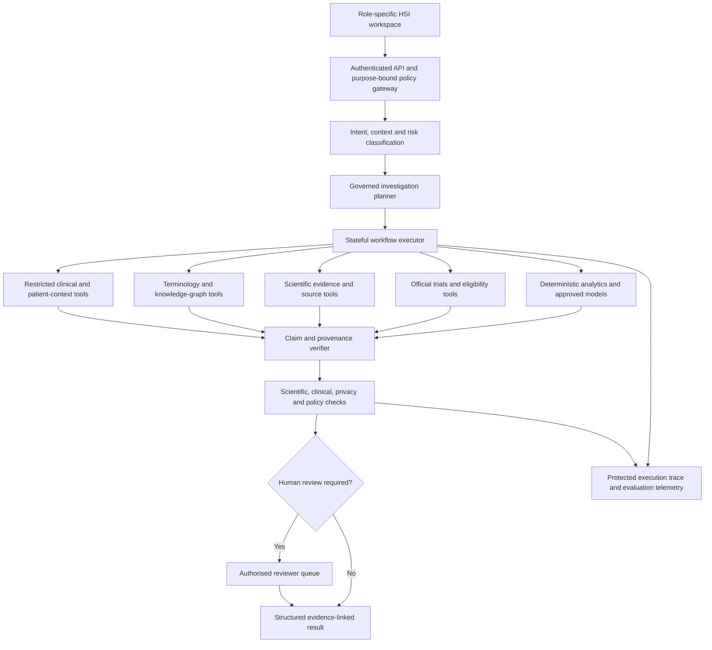

# Document 03 — HSI Intelligence Engine and Agent Specifications

**Health Super Intelligence (HSI) | Version 1.0 | 2 November 2026**  
**Status:** Proposed / pending founder approval — target-state design; existing implementation unverified.  
**Canonical path:** [`docs/strategy/HSI_INTELLIGENCE_ENGINE_SPEC.md`](./HSI_INTELLIGENCE_ENGINE_SPEC.md)  
**Governing documents:** [`HSI_MASTER_PRD_v1.md`](./HSI_MASTER_PRD_v1.md) (HSI-FR-001–054) and [`HSI_ARCHITECTURE_AND_DATA.md`](./HSI_ARCHITECTURE_AND_DATA.md) (Document 02 v1.1).  
**Applies to:** HSI Core, Immune Super Intelligence (ISI), Aksh Health, HSI Clinical, HSI Trials.  
**Decision gate:** Audit, specify, evaluate, and request founder approval **before code, schema, integration or deployment changes**.

### Reconciliation (strategy pack)

**Role:** Authoritative product intelligence companion (Master PRD §18 Document 03). Ingested from founder source `03_HSI_INTELLIGENCE_ENGINE.md` as the consolidated Spec. Fuller than any single §5 file; §5 / §6 packs remain elaboration + Phase 0 audit detail.

**How it relates to existing strategy docs:**

| Existing pack | Relation |
|---------------|----------|
| **§5** pack ([`HSI_INTELLIGENCE_ENGINE_ARCHITECTURE.md`](./HSI_INTELLIGENCE_ENGINE_ARCHITECTURE.md) et al.) | Detailed layers, Caps 1–20, workflows A–E, tool contracts, safety/eval — point here as PRD companion |
| **§6** pack ([`HSI_CROSS_DOMAIN_REASONING_ARCHITECTURE.md`](./HSI_CROSS_DOMAIN_REASONING_ARCHITECTURE.md) et al.) | Evidence categories, pipeline stages, twelve capabilities — elaborates Spec §§10–16, 21 |
| [`HSI_FOUR_PRODUCT_ECOSYSTEM.md`](./HSI_FOUR_PRODUCT_ECOSYSTEM.md) · [`HSI_LIVING_HEALTH_KNOWLEDGE_GRAPH.md`](./HSI_LIVING_HEALTH_KNOWLEDGE_GRAPH.md) | Product homes + graph constraints unchanged |
| Document 02 | Architecture / data / trust zones; this Spec covers engine, agents, verification |

Detailed packs remain for audits/ADRs. **Do not** claim Spec target capabilities as Verified if audits mark Missing/Mocked/Partial. Conflicts: [`HSI_DOC02_03_RECONCILIATION.md`](./HSI_DOC02_03_RECONCILIATION.md) (Documents 02 / 03 / 04).

---

## 1. Executive decision

HSI requires **one governed intelligence engine** serving four role-specific products, not a catalogue of independent chatbots. The engine coordinates deterministic services, structured clinical queries, knowledge graph traversal, literature retrieval, analytics, scientific models and narrowly bounded AI agents. It must connect *observations → biological mechanisms → evidence → research and clinical opportunities* without collapsing different levels of evidence or permissions.

**Permanent architectural rules**

1. Reuse verified ISI and Aksh functionality; do not assume a named agent is working without code and test evidence.
2. Authorisation is checked before retrieval and at every tool/data boundary, not inferred from a prompt.
3. Public biomedical knowledge, identifiable clinical data, patient-generated data and governed research datasets remain separated.
4. Every substantive claim carries source, time, context, epistemic class, uncertainty and review state.
5. GraphRAG, LangGraph, Neo4j, vector search and LLMs are implementation options—not the product vision or automatic migrations.
6. Use deterministic calculations and rules for tasks that do not need an LLM.
7. Agent autonomy is proportional to risk; no autonomous diagnosis, prescribing, dose changes, clinical record amendments, patient contact or trial enrolment.
8. Futuristic capabilities—multimodal understanding, mechanistic models, temporal reasoning and hypothesis testing—are explicitly staged research and engineering goals, not already-validated features.
9. Failure must degrade safely: withhold unsupported conclusions, preserve evidence, expose uncertainty and offer human review.
10. The system must be observable, testable, versioned and auditable.

## 2. Product purpose and user outcomes

| Product | User request | Engine's responsibility | Prohibited inference/action |
|---|---|---|---|
| Aksh Health | “How has my glucose changed?” | Retrieve authorised readings, validate units, compute trends, explain in accessible language | Diagnose or change treatment |
| HSI Clinical | “What changed in the last five encounters?” | Resolve verified patient, reconstruct timeline, compare source-linked events, identify gaps | Treat incomplete records as complete or alter EHR |
| ISI | “Which immune-cell states relate to treatment resistance?” | Resolve entities, traverse graph, retrieve studies, compare evidence, explain gaps | Present unvalidated mechanisms as established |
| HSI Trials | “Which studies warrant screening?” | Retrieve official trials, extract criteria, compare authorised attributes, show unknowns | Declare definitive eligibility or enrol |

**Success means:** a user completes a real task with correct, inspectable, permission-appropriate evidence. It does not mean an impressive agent animation, a large number of agents or an unsupported confidence score.

## 3. Intelligence engine: logical architecture



This diagram is logical; physical components, frameworks and databases must be chosen after the current-repository audit. Sensitive clinical inputs must not be routed through public research services.

### 3.1 Engine layers

1. **Experience layer:** role-specific task surfaces, question intake, evidence drawers and review queues.
2. **Identity/policy layer:** authenticated user, organisation, purpose, resource and permitted actions.
3. **Intent and context layer:** classify task, risk, modalities, missing requirements and user intent.
4. **Planning/orchestration layer:** construct bounded, explainable task DAGs with budgets and checkpoints.
5. **Tool and capability layer:** deterministic services, graph, literature, clinical queries, trial tools, validated models and bounded reasoning agents.
6. **Evidence/verification layer:** provenance, citation integrity, contradiction checks, epistemic classification and temporal alignment.
7. **Safety/review layer:** domain policy, hazard controls, human review and release restrictions.
8. **Observability/evaluation layer:** reproducible traces, tool versions, test outcomes, drift and incident signals.

## 4. Audit the existing estate before defining agents

**Repositories to inspect**

- HSI Core: `https://github.com/gnaneshwer23/hsi-core`
- ISI: `https://github.com/gnaneshwer23/immunecity`
- Aksh Health: `https://github.com/gnaneshwer23/aksh-health-redesign`

For each existing capability inspect source, tests, tool permissions, data dependencies, model provider, API contracts, actual execution traces, UI connection, safety controls and production/staging evidence. Catalogue named Aksh capabilities including CANVAS, VOICE, SYNTHESIS, Dr.Assist, GUARDIAN, HORIZON, Navigator, safety red-flag and diabetes coach. **Names are audit targets, not proof of implemented agents.**

| Field | Required record |
|---|---|
| Capability and product | Name, owner, use case |
| Implementation evidence | Repository paths, endpoints, tests, last verified run |
| Current status | Verified working / implemented-unverified / partial / mocked / broken / missing / not assessed |
| Inputs and outputs | Schema, source, sensitivity, consumer |
| Tools and privileges | Allowed calls, write permissions, cross-domain boundaries |
| Model and dependencies | Version, provider, cost, deployment, external services |
| Safety and evaluation | Test coverage, risks, incidents, gaps |
| Decision | Reuse / extend / isolate / retire / build / defer |

Do not create replacement agents merely because an existing module is not labelled “agent.”

## 5. Agent versus service taxonomy

| Class | Examples | Why use it | Typical control |
|---|---|---|---|
| Deterministic service | Unit conversion, medication status parsing, date arithmetic, eligibility rule evaluation | Predictable and testable | Schema + rule tests |
| Structured retrieval | FHIR queries, registry lookups, relational queries | Retrieve source facts | RBAC/ABAC + provenance |
| Semantic and graph retrieval | Entity resolution, graph traversal, hybrid search | Connect concepts and sources | Query limits + evidence filters |
| Statistical/ML model | Trend analysis, validated classification, simulations | Quantitative analysis | Model card + calibration + evaluation |
| LLM reasoning agent | Question decomposition, synthesis, research brief drafting | Flexible bounded language/reasoning | Tool allowlist + verifier + review |
| Orchestrator | Plans and coordinates tasks | Cross-capability execution | Risk policy + budgets + trace |

**Do not build an agent when a reliable deterministic function or direct query is sufficient.** Distinguish conceptual agent roles from separately deployed processes; multiple roles may share one implementation safely.

## 6. Orchestrator responsibilities

The orchestrator must:

1. Authenticate and load the user's permitted context.
2. Classify intent, domain, sensitivity and clinical/research risk.
3. Determine missing required information and ask for clarification where essential.
4. Resolve terminology and relevant source availability.
5. Construct a minimal task plan with explicit dependencies and allowed tools.
6. Enforce budgets: tool calls, tokens, cost, time, data volume and graph depth.
7. Execute tools with policy checks and typed inputs.
8. Preserve intermediate evidence without copying unnecessary personal data.
9. Validate claims and detect contradictory or missing evidence.
10. Route consequential outputs to human review.
11. Return a role-appropriate structured result with source links and limitations.
12. Record an appropriately minimised audit and execution trace.

### 6.1 Workflow state machine

`RECEIVED → AUTHORISED → CLASSIFIED → PLANNED → RUNNING → VERIFYING → [REVIEW_REQUIRED | COMPLETED | PARTIAL | FAILED | DENIED]`

Additional states: `WAITING_FOR_INPUT`, `CANCELLED`, `EXPIRED`. Every transition requires an authorised actor or system rule, timestamp, reason and trace identifier. `DENIED` and `FAILED` must not silently produce a normal-looking answer.

### 6.2 Planning policies

- Prefer the shortest verifiable plan.
- Separate retrieval from synthesis.
- Do not retry access-denied calls using a different tool.
- Never broaden patient access to complete an investigation.
- Require a new policy decision for a changed purpose, subject, organisation or dataset.
- Limit recursion, fan-out, parallel calls and model spend.
- Use checkpoints before external writes or clinical/recruitment actions; most such actions remain outside initial scope.

## 7. Standard capability / agent contract

Every capability must have a machine-readable and human-readable specification. Example **illustrative schema**, not a claim of implementation:

```yaml
id: isi.evidence-investigator.v1
owner: isi-research
purpose: Retrieve and compare scientific evidence for a bounded biological question
users: [researcher]
classification: public-biomedical
risk_tier: research-assisted
inputs:
  question: {type: string, required: true, max_length: 2000}
  concept_ids: {type: array, items: string}
  filters: {type: object, schema_ref: EvidenceFiltersV1}
outputs:
  schema_ref: EvidenceInvestigationV1
allowed_tools:
  - terminology.resolve_public
  - graph.query_public_biomedical
  - evidence.search_licensed
  - evidence.fetch_metadata
forbidden_tools:
  - clinical.get_patient_record
  - clinical.write_record
  - trials.contact_candidate
max_execution_seconds: 120
max_tool_calls: 18
required_checks:
  - citation_resolution
  - source_context
  - claim_epistemic_class
  - contradiction_check
  - no_patient_identifiers
human_review:
  required_for: [publication_claim, proposed_new_hypothesis_for_external_release]
versioning:
  prompt: pinned
  model: pinned
  tools: pinned
  schema: v1
fallback: return_partial_with_explicit_gaps
```

Required contract fields: owner, purpose, users, permitted data, inputs, validation, outputs, tools, read/write permissions, risk tier, budgets, failure path, provenance, evaluation, version, monitoring and escalation.

## 8. Tool registry and policy enforcement

Implement a central tool catalogue; do not expose arbitrary database or network access to agents.

| Tool family | Representative operations | Data classification | Typical permission |
|---|---|---|---|
| `terminology.*` | Resolve, map, validate ontology concepts | Public or governed | Read |
| `graph.public.*` | Neighbourhood, paths, claims, mechanisms | Public biomedical | Read |
| `evidence.*` | Search, retrieve metadata, resolve citation | Public/licensed | Read |
| `clinical.*` | Retrieve patient context and encounters | Restricted identifiable | Authorised clinical read |
| `patient.*` | Read permitted observations | Patient-restricted | Purpose-bound read |
| `trials.registry.*` | Search and verify official trials | Public | Read |
| `trials.screening.*` | Compare criteria with authorised attributes | Restricted | Review-controlled |
| `analytics.*` | Trends, conversions, validated models | Depends on input | Bounded compute |
| `review.*` | Create review request and decision record | Governed | Role-specific write |
| `audit.*` | Emit minimised trace events | Protected operational | Append-only |

**Tool gateway requirements:** authenticated caller, policy decision, validated arguments, scope/row limits, purpose token, rate limit, timeouts, data minimisation, source metadata, audit event and typed errors. The LLM must not be able to grant itself scopes or reinterpret denial as permission.

## 9. Canonical input and output envelopes

### 9.1 Investigation request

```json
{
  "request_id": "example-request-id",
  "workspace": "isi",
  "intent": "mechanism_evidence_comparison",
  "question": "Which immune cell states have evidence for treatment resistance?",
  "scope": {"disease_concept_id": "example-ontology-id", "species": "human"},
  "policy_context_ref": "opaque-authorisation-reference",
  "requested_output": "research_brief"
}
```

`policy_context_ref` is resolved server-side; do not accept client-supplied role or consent assertions as authority. No patient identifier is necessary for this public research example.

### 9.2 Claim-level result

```json
{
  "claim_id": "example-claim-id",
  "text": "An association was reported under the specified study conditions.",
  "epistemic_class": "statistical_association",
  "subject_ref": "ontology-concept-id",
  "predicate": "associated_with",
  "object_ref": "ontology-concept-id",
  "evidence_refs": ["source-artifact-id"],
  "contradicting_refs": [],
  "context": {"species": "human", "tissue": "specified-or-unknown", "study_type": "specified-or-unknown"},
  "temporal_scope": null,
  "uncertainty": {"status": "limited_evidence", "reason": "example-only"},
  "review_status": "machine_draft",
  "schema_version": "1.0"
}
```

These values are illustrative. Real outputs require real sources and verification.

## 10. Mandatory epistemic classification

Every material claim belongs to one of five categories:

1. **Observed patient fact:** directly supported by an authorised clinical or patient-generated source, with source type and verification status.
2. **Established scientific evidence:** supported by appropriate research and its actual scope; not synonymous with universal truth.
3. **Statistical association:** observed relationship with study context, confounders and limits.
4. **Computational inference:** derived by an algorithm, model or reasoning chain; requires method and validation state.
5. **Unvalidated hypothesis:** candidate explanation or prediction awaiting independent testing.

A clinical observation may be accurate but incomplete; a paper may be published but contradicted; a graph edge may be curated but not causal. **Neither an LLM answer nor a graph path upgrades a claim's epistemic class.**

## 11. Evidence and citation verification

The verifier must check:

- Source exists and can be resolved to an authorised artifact.
- Cited passage or structured record supports the exact claim.
- Study population, species, tissue, assay, intervention and outcomes are represented correctly.
- Source publication, version, retraction/correction and licence are respected.
- The relationship type is not stronger than the evidence supports.
- Conflicting findings are represented where materially relevant.
- The citation is not duplicated, fabricated or attributed to an unrelated claim.
- Time and freshness are appropriate to the task.
- Any patient fact was retrieved within the correct authorised identity and encounter context.

**Verifier outcomes:** `supported`, `partially_supported`, `contradicted`, `unsupported`, `not_verifiable`, `source_unavailable`. Unsupported and unverifiable material claims must not be presented as verified findings.

## 12. Specialised scientific capability catalogue

The following are **target capabilities**, not necessarily separate deployable agents.

| Capability | Input | Core operations | Output | Main risk |
|---|---|---|---|---|
| Immune Cell Investigator | Cell, state, tissue, disease | Ontology resolution, graph and evidence traversal | Cell-state evidence map | Overgeneralising cell state |
| Mechanism Investigator | Pathway, phenotype, intervention | Typed path exploration, evidence comparison | Mechanism dossier | Confusing paths with causality |
| Biomarker Investigator | Marker, assay, disease | Measurement context, diagnostic/prognostic evidence | Biomarker evidence matrix | Ignoring assay context |
| Microbiome Investigator | Taxon/function, phenotype | Taxonomy, study context, confounders | Microbiome evidence report | Claiming causality from associations |
| Systems Biology Investigator | Multi-entity question | Integrate approved pathway/network models | Systems-level explanation | Unvalidated model inference |
| Evidence Investigator | Research question | Literature search, screening, extraction | Claim-linked evidence set | Citation misattribution |
| Contradiction Investigator | Competing findings | Compare population, methods, endpoints | Contradiction analysis | False equivalence |
| Gap Investigator | Topic and evidence scope | Coverage audit, uncertainty, missing studies | Candidate gap list | Mistaking graph absence for scientific absence |
| Hypothesis Investigator | Mechanism and evidence | Generate falsifiable hypotheses and tests | Unvalidated hypothesis record | Presenting novelty without verification |
| Research Brief Composer | Approved investigation results | Structured synthesis and citation checks | Editable cited brief | Loss of nuance |

**Scientific safeguards:** human versus animal/in-vitro/computational studies are distinct; species and tissue cannot be silently mixed; negative findings matter; lack of evidence is not evidence of absence; publication does not establish causal certainty.

## 13. Patient-facing Aksh capabilities

Audit and map existing named Aksh modules before implementing new roles. Target functions:

- **Patient Context:** assemble permitted, source-labelled longitudinal observations.
- **Monitoring and Trends:** deterministic glucose, BP, activity and other trends with validated units and time zones.
- **Symptom Organisation:** organise reported symptoms and prepare clinician-friendly summaries.
- **Medication Context:** explain documented medication information; distinguish prescribed, dispensed, administered and self-reported use.
- **Care Navigator:** help users prepare questions, organise information and access approved care pathways.
- **Safety Triage Boundary:** detect defined high-risk situations and route to approved escalation guidance, not autonomous diagnosis.
- **Accessible Explanation:** explain general medical concepts with evidence and appropriate uncertainty.

The patient workspace should not expose a roster of agent names. Present tasks and outcomes. No simulated glucose readings or fabricated care-team actions in live views.

## 14. Clinical intelligence capabilities

Target capabilities:

1. **Patient Context Resolver:** confirm patient identity and permitted care relationship before retrieval.
2. **Timeline Builder:** organise encounters, diagnoses, labs, procedures and medication events with source and time.
3. **Change Investigator:** compare specified encounters and identify documented changes.
4. **Medication Chronology:** distinguish order, dispense, administration, discontinuation and patient report; chronology is not causation.
5. **Laboratory Context:** verify unit, reference interval, assay, specimen, result status and measurement time.
6. **Clinical Evidence Explorer:** map a documented clinical concept to general biological knowledge without claiming patient-specific mechanism.
7. **Missing Information Investigator:** show absent, conflicting or stale records rather than assuming normality.
8. **Review Assistant:** produce inspectable summaries for authorised clinician confirmation.

**Clinical hard stops:** identity ambiguity; access denial; mismatched units; insufficient critical source context; unsafe high-risk conclusion; unreviewed patient-specific treatment or diagnosis recommendation. Maintain clinical hazard log and assess DCB0129/DCB0160 and MHRA applicability for actual intended functions.

## 15. Clinical trials intelligence capabilities

| Capability | Responsibility | Required safeguard |
|---|---|---|
| Trial Discovery | Search official registries by condition, mechanism, intervention | Registry ID and last-verified date |
| Criteria Extractor | Parse inclusion/exclusion text into structured clauses | Preserve exact source and ambiguity |
| Screening Evaluator | Compare permitted candidate attributes with criteria | `satisfied / not_satisfied / unknown / ambiguous / requires_review` |
| Missing Evidence Investigator | Identify tests or records not available | Never infer negative from missing |
| Mechanism–Trial Linker | Connect disease/pathway targets to studies | Distinguish mechanism relevance from eligibility |
| Investigator Review Assistant | Prepare reviewable screening packet | No final eligibility or enrolment |

Recruitment communication, candidate export and patient contact require separate approved workflows and permissions.

## 16. Cross-domain reasoning: primary differentiator

HSI must implement **bounded evidence-linked cross-domain reasoning**, not merely concatenate retrieval results. Standard pipeline:

1. Interpret the user's actual question and permitted purpose.
2. Resolve disease, phenotype, cell, tissue, pathway, biomarker, drug and trial concepts.
3. Retrieve authorised patient observations only when the user and workflow permit them.
4. Retrieve biological relationships and source-linked claims.
5. Retrieve and compare scientific studies in their experimental contexts.
6. Analyse chronology and statistical patterns using appropriate tools.
7. Generate candidate explanations **without assuming causality**.
8. Evaluate contradictions, confounding, source freshness and missing evidence.
9. Verify each material claim and classify its epistemic status.
10. Return an inspectable, role-specific result and human review action.

### 16.1 Reference workflow: inflammatory disease + diabetes

**Authorised clinician:** “What changed over time, and what relevant biological evidence should I review?”

- Verify identity, organisation, patient and purpose.
- Reconstruct glucose, inflammatory-marker, encounter and medication timelines from real available sources.
- Mark medication introduction and lab changes as chronology, **not treatment causality**.
- Resolve relevant disease/pathway concepts through public terminology services.
- Explore published immune-metabolic mechanisms and evidence contexts.
- Clearly label general evidence as **not proof of the patient's mechanism**.
- Optionally retrieve potentially relevant studies and mark unknown eligibility criteria.
- Provide clinician-facing evidence cards and review notes.

Patient identifiers must not be copied into the public scientific graph, research brief cache or public model telemetry.

### 16.2 Reference workflow: immune therapy resistance

**Researcher:** “Which cell states and pathways are associated with resistance?”

- Resolve disease, therapy, cell and tissue entities.
- Traverse typed graph relationships.
- Search relevant human, animal and experimental evidence separately.
- Compare contradictory findings and method limitations.
- Identify evidence gaps within declared search scope.
- Produce falsifiable hypotheses with proposed tests and explicit unvalidated status.

## 17. Hybrid retrieval and GraphRAG

GraphRAG is a **retrieval method inside HSI**, not the overall architecture. Evaluate three complementary channels:

1. **Structured retrieval:** clinical FHIR/relational/time-series records, registry fields, ontology metadata.
2. **Graph retrieval:** typed, provenance-linked biological relationships, entity neighbourhoods and constrained multi-hop paths.
3. **Semantic retrieval:** relevant passages from licensed scientific corpora, clinical documents where authorised, and study descriptions.

The planner chooses channels based on task. A fusion stage deduplicates source artifacts, reconciles entity IDs, preserves access controls and ranks evidence using transparent relevance criteria. The verifier independently checks final claims. Avoid using embedding similarity as evidence of a biological relationship.

**Technology selection:** compare existing ISI graph infrastructure with Neo4j/RDF/relational approaches; compare existing orchestration with LangGraph or equivalent. Benchmark real tasks, not marketing features. No forced migration.

## 18. Temporal intelligence

The engine should support **event time, recorded time, source version, effective interval and knowledge-as-of time** where relevant. Target questions:

- What changed between two encounters?
- Did a documented medication order precede a lab change?
- How did biomarker patterns evolve?
- Which scientific interpretation was supported by the literature available at a specified date?
- Did a trial's recruitment status change since the last screening?

Preserve late-arriving and corrected records. Distinguish temporal ordering, association and causal evidence. Temporal calculations must be deterministic and testable before an LLM explains them.

## 19. Multimodal intelligence: future-state capabilities

HSI's future architecture should support text, structured clinical data, laboratory values, medical imaging metadata and reports, single-cell data, genomics, transcriptomics, proteomics, metabolomics, microbiome and other approved modalities.

**Design rules**

- Keep raw modalities in fit-for-purpose governed stores; link through identifiers, evidence and provenance rather than forcing everything into graph nodes.
- Preserve sample, tissue, assay, batch, platform, species, collection time and consent/access metadata.
- Separate research-grade computational findings from clinically validated interpretations.
- Use modality-specific preprocessing, quality control, models and evaluation.
- Avoid unvalidated AI interpretation of diagnostic imaging or genomic results in clinical workflows.

**Target capability:** cross-modal evidence reconciliation, not speculative fusion that hides incompatible samples or study populations.

## 20. Mechanistic and computational disease intelligence

Long-term research capabilities may include:

- Dynamic immune-cell state models.
- Pathway interaction and signalling models.
- Host–microbiome–metabolic interaction models.
- Longitudinal disease-state models.
- Treatment-response research models.
- Counterfactual scenario exploration under explicitly stated assumptions.
- Digital-twin-like **research simulations** only where the data, model and validation justify the description.

Each model requires a model card with assumptions, equations or method, data sources, calibration, validation domain, uncertainty, limitations and intended use. **A simulated outcome is not an observed patient fact, a proven causal effect or a clinical recommendation.** Do not market patient-specific digital twins before rigorous validation and appropriate governance.

## 21. Causal reasoning and hypothesis lifecycle

Distinguish:

- Correlation or co-occurrence.
- Temporal precedence.
- Biological plausibility.
- Mechanistic evidence.
- Intervention evidence.
- Causal identification under stated assumptions.

Candidate hypotheses must include: explicit causal question, proposed mechanism, supporting and contradictory sources, confounders, alternative explanations, testable predictions, recommended experimental design, review state and version.

**Lifecycle:** `PROPOSED → EVIDENCE_SCREENED → SCIENTIFIC_REVIEW → TEST_DESIGNED → TESTED → [SUPPORTED | REFUTED | INCONCLUSIVE] → UPDATED/ARCHIVED`.

No hypothesis is promoted to established evidence simply because an agent generated a persuasive narrative.

## 22. Memory, state and learning

Keep separate:

1. **Execution state:** transient task status, checkpoints and retries.
2. **User preferences:** explicitly permitted product preferences, not unrestricted patient memory.
3. **Scientific knowledge:** curated, versioned claims with source and review metadata.
4. **Patient context:** governed clinical/patient data in authoritative restricted stores.
5. **Evaluation feedback:** approved reviewer corrections and test outcomes.

Do not use unrestricted chat history as a clinical source of truth. Do not automatically train foundation models on patient data or research datasets. Learning from feedback requires a documented governance and validation process; updates to scientific claims should preserve history and retraction/correction status.

## 23. Human oversight and review queues

| Workflow | Review trigger | Reviewer | Evidence required |
|---|---|---|---|
| Scientific brief | External release or material novel claim | Qualified scientific reviewer | Claim citations, limitations, search scope |
| Hypothesis | Promotion beyond draft | Domain scientist | Competing evidence, experimental proposal |
| Clinical summary | Consequential clinical use or unresolved ambiguity | Authorised clinician | Source records, changes, uncertainty |
| Trial screening | Eligibility or recruitment action | Authorised investigator/coordinator | Criterion-level evidence and registry status |
| Model update | Material model/prompt/tool change | Model owner + relevant safety reviewer | Regression, safety and performance results |

Human review must enable inspection, rejection, correction, annotation and versioned sign-off. Review status must be visible in UI and API outputs.

## 24. Safety and security guardrails

- UK GDPR/Data Protection Act assessment; Article 6 and Article 9 conditions as applicable.
- Confidentiality, patient matching, RBAC/ABAC and purpose limitation.
- Clinical safety management and intended-purpose assessment for applicable features.
- Research governance and approved data access.
- Prompt injection defence: retrieved notes and papers are **untrusted data**, never instructions.
- Egress controls, secret protection, tool allowlists, tenant isolation and per-source authorisation.
- No unrestricted code execution, direct database write, EHR modification, prescribing, clinical trial enrolment or unauthorised patient contact.
- Data minimisation in traces, caches, prompts and vendor calls.
- Explicit policy for model-provider residency, retention, subprocessors and training use.
- Kill switches and safe fallbacks for high-risk capabilities.

Policy and safety enforcement must live in independently testable services, not solely in system prompts.

## 25. Error handling and safe degradation

| Failure | Required behaviour |
|---|---|
| Patient identity ambiguous | Block patient-specific synthesis; request authorised resolution |
| Access denied | Stop relevant task; no alternative-tool workaround |
| Clinical source incomplete | Show coverage and missing information |
| Unit or assay mismatch | Do not compute invalid comparisons |
| Source/citation cannot be verified | Mark unverifiable or omit material claim |
| Contradictory studies | Show disagreement and context |
| Registry data stale | Flag last-verified time and withhold current-status assertion |
| Graph unavailable | Return bounded evidence-only result if valid, clearly labelled |
| Model unavailable | Return deterministic/source facts where possible; no invented answer |
| Time/cost budget exhausted | Return partial results, trace and unresolved tasks |
| Prompt injection detected | Ignore malicious instructions, log event, continue only if safe |
| High-risk patient-specific output | Withhold/escalate under approved clinical policy |

## 26. Observability and reproducibility

Record minimised, access-controlled traces for: request and workflow IDs, policy decisions, selected plan, tool versions, source artifact IDs, model/prompt versions, graph snapshot, data freshness, validation outcomes, review actions, latency, errors and cost. Avoid storing raw clinical notes or full sensitive prompts in general telemetry.

Support replay using approved fixtures and pinned sources. Production clinical replay requires the same lawful access controls as original processing. Maintain source corrections and retractions as versioned events.

## 27. Evaluation strategy

### 27.1 Evaluation layers

1. **Unit:** schemas, rules, unit conversion, policy checks, citation resolver.
2. **Tool integration:** real or approved test endpoints, failure and retry semantics.
3. **Retrieval:** entity resolution, graph path validity, source relevance, recall/precision where measurable.
4. **Claim verification:** source support, context preservation, contradiction and retraction handling.
5. **End-to-end:** user task correctness, completeness, latency and traceability.
6. **Safety/security:** cross-patient access, prompt injection, exfiltration, unsafe clinical conclusions.
7. **Expert review:** clinician and scientific reviewer agreement on defined evaluation sets.
8. **Operational:** load, outages, cost, model changes and recovery.

### 27.2 Metrics

- Source-grounded claim rate and unsupported-claim rate.
- Citation precision and resolvability.
- Entity resolution accuracy and ontology coverage.
- Graph relationship and path validity.
- Correct epistemic classification.
- Temporal chronology accuracy and unit handling.
- Contradiction recall and false-gap rate.
- Trial criterion-level agreement and unknown-state correctness.
- Clinical source fidelity and identity safety.
- Authorisation-denial effectiveness and privacy leakage.
- Task completion, reviewer usefulness, latency and cost per successful task.

Do not invent target percentages. Define representative datasets, baselines, risk-weighted thresholds and sign-off owners before production use.

## 28. Mandatory reference evaluation tasks

| ID | Task | Minimum expected behaviour |
|---|---|---|
| E01 | Five-encounter comparison | Correct source-linked chronology; show missing encounters |
| E02 | Medication versus lab timeline | Correct order and units; no causality claim |
| E03 | Disease-to-immune-pathway investigation | Typed graph path with evidence and context |
| E04 | Cell-state therapy resistance | Separate species/tissue/study contexts |
| E05 | Microbiome and inflammation | Explain confounding and observational limits |
| E06 | Human versus preclinical evidence | Clear stratification and citations |
| E07 | Mechanism-to-trial discovery | Official registry link and freshness |
| E08 | Patient-to-trial screening | Criterion-level assessment and unknowns |
| E09 | Missing-data assessment | No inference of normality from absence |
| E10 | Contradictory literature | Surface competing findings and limitations |
| E11 | Research gap investigation | Search-scope-aware gap, not graph absence alone |
| E12 | Falsifiable hypothesis | Label unvalidated and propose feasible tests |
| E13 | Cross-tenant access attack | Deny, audit, no data leakage |
| E14 | Prompt injection in retrieved paper | Treat as untrusted content |
| E15 | Source retraction | Update claim state and downstream brief |
| E16 | Multimodal sample mismatch | Block unsupported sample-level fusion |
| E17 | Model outage | Safe partial response without hallucination |
| E18 | Review gate | Consequential action remains pending approval |

Clinical scenarios use authorised, appropriately governed test data. These tasks define expected tests, not claims that current workflows pass.

## 29. Implementation roadmap and gates

**Phase 0 — Audit:** inventory existing agents, services, orchestration, evidence and tests; produce reuse decisions. **Gate:** founder approves verified current state.

**Phase 1 — Contracts and policy:** standardise request/result envelopes, tool registry, permissions, epistemic types and audit events. **Gate:** security and architecture review.

**Phase 2 — Scientific vertical slice:** ISI question → terminology → graph/evidence → verification → structured research brief. **Gate:** expert-reviewed evaluation.

**Phase 3 — Research depth:** contradictions, research gaps, hypothesis lifecycle, source updates and richer mechanism exploration. **Gate:** scientific validity assessment.

**Phase 4 — Aksh integration:** reuse validated patient capabilities and connect governed monitoring/context services. **Gate:** privacy and safety review.

**Phase 5 — Clinical evaluation:** authorised identity, longitudinal records, clinical summaries and biological evidence exploration. **Gate:** institutional governance, clinical safety and regulatory assessment as applicable.

**Phase 6 — Trials intelligence:** official registry integration, criteria parsing, candidate assessment and investigator review. **Gate:** screening validation and governance approval.

**Phase 7 — Future intelligence:** multimodal evidence, mechanistic modelling, temporal simulation and causal hypothesis testing in controlled research environments. **Gate:** domain-specific scientific validation; separate clinical translation gates.

The roadmap is dependency-based, not a claim of launch dates or completed functionality.

## 30. Required deliverables to Cursor

1. `HSI_EXISTING_AGENT_AND_SERVICE_AUDIT.md`
2. `HSI_INTELLIGENCE_ENGINE_ARCHITECTURE.md`
3. `HSI_ORCHESTRATOR_STATE_MACHINE.md`
4. `HSI_AGENT_CAPABILITY_CATALOGUE.md`
5. `HSI_AGENT_AND_TOOL_CONTRACTS.md`
6. `HSI_POLICY_AND_PERMISSION_MATRIX.md`
7. `HSI_EVIDENCE_VERIFICATION_SPEC.md`
8. `HSI_CROSS_DOMAIN_REASONING_WORKFLOWS.md`
9. `HSI_CLINICAL_AGENT_SAFETY_BOUNDARIES.md`
10. `HSI_TRIAL_SCREENING_AGENT_SPEC.md`
11. `HSI_TEMPORAL_AND_MULTIMODAL_INTELLIGENCE_PLAN.md`
12. `HSI_MECHANISTIC_AND_CAUSAL_RESEARCH_PLAN.md`
13. `HSI_AGENT_EVALUATION_BENCHMARKS.md`
14. `HSI_OBSERVABILITY_AND_REPLAY.md`
15. `HSI_AGENT_IMPLEMENTATION_ROADMAP.md`
16. `HSI_INTELLIGENCE_ADR_LOG.md`

For every capability, include its PRD requirement IDs, architecture dependency, current status, risk tier, test evidence, owner and decision. Mark unverified and proposed features explicitly.

## 31. Definition of done

A capability is **not done** because an agent name, UI card, prompt, graph edge or API stub exists. It is done for a **defined use** only when:

- Its intended purpose and boundaries are documented.
- Real inputs and outputs are schema-validated.
- Required sources and permissions are verified.
- It runs end-to-end on representative permitted data.
- Source and claim provenance are inspectable.
- Errors and missing data are handled safely.
- Security, scientific and clinical evaluations appropriate to risk have passed.
- The user experience exposes meaningful results rather than fake progress.
- Logs, review decisions and versioning are implemented.
- Required human and institutional approvals are obtained for the defined deployment.

## 32. Cursor execution directive — STOP BEFORE IMPLEMENTATION

1. Read `01_HSI_MASTER_PRD.md`, `02_HSI_ARCHITECTURE_AND_DATA.md` and this document as one consistent specification.
2. Audit the three repositories and all named existing agents/services with code, test and runtime evidence.
3. Map verified implementations to HSI-FR-001–054 and identify proposed additions.
4. Define the minimal scientific intelligence vertical slice and its complete test fixtures, contracts and evaluation.
5. Produce the tool registry, workflow state machine, policy matrix, evidence verifier, risk tiers and architecture decision records.
6. Evaluate orchestration and retrieval frameworks against the existing estate; do not assume a technology migration.
7. Keep the long-term HSI vision intact while sequencing research-only and clinically governed capabilities responsibly.
8. **Do not modify code, schema, data, secrets or deployments; do not commit, merge, push or deploy.**
9. Stop and request founder approval of the proposed plan, dependencies, scope and evaluation gates.

**North star:** HSI's intelligence is the verified ability to connect human health context with biology and scientific evidence—not the appearance of autonomous agents. Build a continuously improving scientific intelligence foundation with clear epistemic boundaries, strong governance and measurable real-world usefulness.
