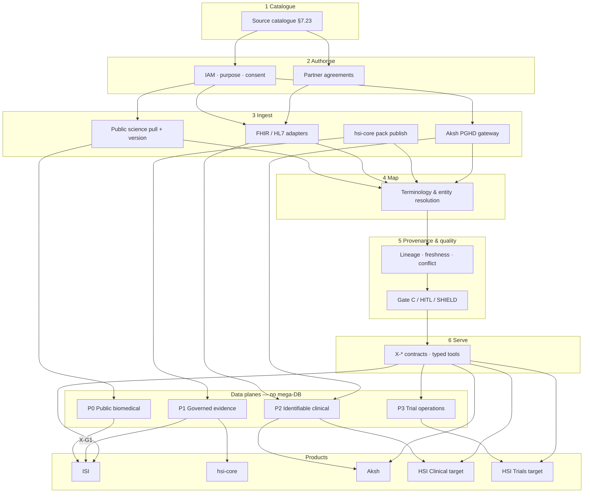

# HSI Interoperability Architecture (§7.2–7.3)

**Document status:** Definitive logical interoperability architecture (§7)  
**Adopted:** 2 November 2026  
**Binding:** [`HSI_TARGET_ARCHITECTURE.md`](./HSI_TARGET_ARCHITECTURE.md) planes · [`HSI_FOUR_PRODUCT_ECOSYSTEM.md`](./HSI_FOUR_PRODUCT_ECOSYSTEM.md) X-* APIs · [`HSI_MASTER_VISION.md`](./HSI_MASTER_VISION.md)  
**Non-goal:** Unrestricted central database of all patient + research records.

---

## 7.2 Six stages of interoperability

Every integration (public science or clinical partner) progresses through these stages. Skipping stages is an architectural defect.

| Stage | Name | Purpose | Typical artifacts |
|-------|------|---------|-------------------|
| **1** | Catalogue & classify | Know what the source is, licence, plane, priority | Catalogue row (§7.23); honesty + maturity |
| **2** | Authorise & connect | Legal basis, credentials, scopes, purpose codes | Agreements; OAuth/SMART; neon/host asserts |
| **3** | Ingest & normalise | Pull/push into versioned schemas; refuse silent scrape | Snapshots; FHIR Bundle fixtures; pack JSON |
| **4** | Map terminology | Codes → HSI/ISI concepts; flag ambiguity | Mapping layer; LOINC/SNOMED/MONDO/… |
| **5** | Prove quality & provenance | Lineage, freshness, conflicts, claimTypes | Provenance fields; stale badges; Gate C/HITL |
| **6** | Serve by contract | Products consume via versioned X-* / tools — not raw DB | OpenAPI; honesty fields; audit ids |

**Research-first shortcut (allowed):** Stages 1→3→5→6 for public literature and packs (already strongest path).  
**Clinical shortcut (forbidden):** Jumping to Stage 6 with live PHI without Stages 2 and 5.

---

## 7.3 Logical architecture (mermaid)

Solid product edges today: **X-G1** (packs → ISI). Clinical and Trials edges remain **Proposed**.

---

## 1. Data planes (P0–P3) — binding

| Plane | Contents | Current stores | Cross-plane rule |
|-------|----------|----------------|------------------|
| **P0** | Public biomedical, open ontologies, public papers | ISI `kg.json`, public APIs, xrefs | Wide read; still provenance |
| **P1** | Graded edges, Gate C, partner packs | hsi-core Neon **red-wave** | Export to ISI after Approve |
| **P2** | Identifiable clinical + PGHD | Aksh (+ future HSI Clinical) | **Never** on red-wave / autumn-snow research DB |
| **P3** | Screening decisions, trial ops | Future Trials service | Human final; no auto-eligibility |

Violation of P2 → P0/P1 without de-identification + ethics = **architectural defect** (also [`HSI_CLINICAL_SAFETY_AND_GOVERNANCE.md`](./HSI_CLINICAL_SAFETY_AND_GOVERNANCE.md)).

---

## 2. Integration patterns (binding)

1. **Pull + version** for public science (PubMed metadata, registry dumps, ontology releases).  
2. **Partner push / FHIR** for clinical with contracts — synthetic/authorised first.  
3. **Export consume** (existing) for hsi-core → ISI (**X-G1**).  
4. **Gateway** for Aksh → Clinical/research (de-id summaries, scopes) — **Proposed** Exchange A / X-H2.  
5. **No shared evidence DB** between HSI Neon and ISI Neon.  
6. **No unrestricted central patient DB** spanning all hospitals.

---

## 3. Shared Core services (logical — not one warehouse)

Aligned with Four-Product Shared Intelligence Core:

| Service | Interop role | Status |
|---------|--------------|--------|
| Identity & Access | Stage 2 | Split today (Neon Auth ISI; Aksh auth) — unified **Proposed** |
| Clinical Data Interoperability | Stages 3–4 clinical | Aksh BRIDGE **Partial**; federation **Missing** |
| LHK-G | Concept backbone | ISI + packs **Partial** |
| Biomedical Evidence | Packs + Gate C | **Verified** patterns |
| Orchestration | Tool plans over sources | §5 **Partial**/Proposed |
| Terminology & Entity Resolution | Stage 4 | Thin LOINC + xrefs **Partial** |
| Temporal Intelligence | Freshness + timelines | **Proposed** Cap 20 / Workflow B |
| Governance & Safety | Stage 5 | Gate C / HITL / neonGuard **Verified** pieces |

---

## 4. Failure & honesty principles

- Unavailable source → explicit insufficient / unavailable — never invent records.  
- Stale registry/clinical feed → badge + fail closed for eligibility / live care claims.  
- Synthetic fixtures must carry `syntheticOnly` / `realPatientData:false` equivalents end-to-end.  
- Ambiguous terminology maps → flag; do not silently coerce.

---

## 5. Relation to other packs

| Pack | Role |
|------|------|
| §3 Four-Product | Ownership + X-* catalogue |
| §4 LHK-G | What concepts exist across planes |
| §5 Intelligence Engine | Tools that call integrations |
| §6 Cross-Domain Reasoning | When to select which sources |
| §7 (this pack) | How sources connect without a mega-DB |

**Stop.** Architecture docs only — no adapter implementation in this pack.
