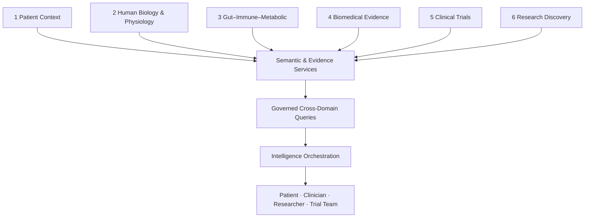

# HSI Living Health Knowledge Graph (LHK-G)

**Document status:** Definitive graph strategy specification (§4)  
**Adopted:** 2 November 2026  
**Instruction:** Architecture, ontology, evidence model, queries, evaluation, roadmap — **no graph infrastructure changes** until founder approval.  
**Vision binding:** [`HSI_MASTER_VISION.md`](./HSI_MASTER_VISION.md) §2.7 · Product binding: [`HSI_FOUR_PRODUCT_ECOSYSTEM.md`](./HSI_FOUR_PRODUCT_ECOSYSTEM.md) · **CDR (§6):** [`HSI_CROSS_DOMAIN_REASONING_ARCHITECTURE.md`](./HSI_CROSS_DOMAIN_REASONING_ARCHITECTURE.md) maps Q1–Q10 to twelve reasoning capabilities.

---

## 4.1 Mission and philosophy (binding)

The LHK-G is the **computable representation of relationships** between human health, disease biology, clinical evidence and scientific discovery — not a decorative network or a single physical database.

**Federated logical architecture:** stable identifiers + semantic relationships + interoperable services + controlled queries across separately governed domains.

**Never collapse:**

1. Patient-specific clinical facts  
2. Patient-generated observations  
3. General physiological knowledge  
4. Published biomedical associations  
5. Experimentally supported mechanisms  
6. Statistical / computational predictions  
7. Unvalidated research hypotheses  

**Central objective:** observation → phenotype → physiology → pathway → research → target → trial — as **evidence-linked investigation**, not proof the whole mechanism is active in that patient.

---

# DELIVERABLE 1 — Existing ISI Graph Audit

**Repo:** `~/Desktop/immune-city` (immunecity) @ audited 2026-11-02  
**Primary artifact:** `src/data/kg.json` v0.3  
**Runtime:** `src/lib/immune/engine.ts` (import JSON, merge drafts, index `REL-*`)  
**Draft layer:** `src/data/extensions.ts` (`draft: true`) · snapshot `graphRelease.ts`

### Storage model (Fact)

| Question | Answer | Class |
|----------|--------|-------|
| Graph DB (Neo4j/RDF/etc.)? | **No** — browser-owned JSON file | Verified |
| Persistent edges? | Yes, in `kg.json` (+ draft merge) | Verified |
| Dynamic generation? | No generative KG; static curated + draft extensions | Verified |
| Neon as second graph? | **No** — Neon holds evidence/cites on `relationship_id` | Verified by design |
| Versioning | File version `0.3` + extensions version; not full temporal KG | Partial |
| Contradictions coexist? | Possible as separate edges; no first-class CONTRADICTS model | Partial / Missing |
| Multi-hop | Engine paths/neighbours | Verified (tests) |
| Visualisation | Atlas/Graph D3 (lazy ClientOnly) | Verified working UI path |
| Ingestion pipelines | Manual curation + HSI pack bridge → REL suggestions | Partial |
| Integrity tests | `engine.test.tsx`, `graph-connectivity.test.ts`, `phase-b-scientific-graph.test.ts`, evidence filters | Verified |
| Ontology IDs on nodes | **No `external_ids` on `kg.json` nodes** (0/260) | Gap |
| Cross-ref resolver | `src/data/xrefs.ts` (HGNC, UniProt, OLS4 CL/GO/MONDO, MeSH RDF, ChEMBL) | **Extend** — wire into canonical `externalIds`, not a second identity system |
| Citations | `source_refs` often `TO_BE_CURATED`; Neon `claim_support` for approved | Partial |

### Schema snapshot (Fact)

- **Nodes:** 260 core (+ ~70 draft at runtime)  
- **Relationships:** 395 core (+ ~200 draft)  
- **Node types:** CELL, MOLECULE, RECEPTOR, PATHWAY, COMPARTMENT, DISEASE, INTERVENTION, PATHOGEN, BIOMARKER, TRIAL, DATA, AI_METHOD, DISCOVERY  
- **Relations:** 91 predicates in `relation_semantics` (sign +/−); top: produces, contributes_to, activates, evaluates, treats, targets…  
- **Evidence statuses (ISI):** ESTABLISHED, EVIDENCE-SUPPORTED, EMERGING, HYPOTHESIS, EXPERIMENTAL  
- **IDs:** Node ids (e.g. `C001`); edge ids `REL001` **and** runtime `REL-${subject}-${relation}-${object}` via `relId()`  
- **Spine:** 15-step TRIGGER→…→DISCOVERY  
- **Stats:** `stats.nodes_by_type` in kg.json; `isolated: []`

### Preserve / Extend / Refactor / Replace / Deprecate

| Asset | Action | Rationale |
|-------|--------|-----------|
| `kg.json` + engine + REL-* | **Preserve** | Strategic scientific seed; Atlas/`/atlas/$id` scheme |
| `relation_semantics` signs | **Preserve** | Causal UX |
| Draft `extensions.ts` | **Preserve** + review | Close coverage without polluting core |
| Evidence statuses | **Extend** — map to HSI grades + claimTypes | Align with hsi-core without silent rename |
| `TO_BE_CURATED` refs | **Extend** — Gate C / cite path | Integrity |
| External ontology IDs | **Extend** | Entity resolution across products |
| Contradiction / L6 objects | **Extend** | Discovery graph |
| Patient/clinical nodes in public KG | **Deprecate as clinical SoT** | PATIENT spine step is conceptual — real L1 stays P2 |
| Migration to Neo4j/Neptune now | **Reject (Replace)** | No performance evidence forcing it; ADR required later |
| Duplicate biology graph in Trials | **Deprecate idea** | Consume ISI via API |

**hsi-core relation:** Packs + grades are parallel L4 authority; ISI maps via `isiRelSuggestions` / consume — `autoApproveIntoKg=false`.

---

# DELIVERABLE 2 — HSI Graph Architecture (six domains)

| Domain | Purpose | Plane | Near-term store |
|--------|---------|-------|-----------------|
| **1 Patient Context** | Longitudinal encounters, observations, meds, outcomes | P2 | Aksh / future HSI Clinical |
| **2 Human Biology & Physiology** | Organs→cells→processes→disease | P0 | Extend ISI + packs |
| **3 Gut–Immune–Metabolic** | Microbiome↔host↔immune↔metabolic | P0/P1 | Thin gut packs → expand |
| **4 Biomedical Evidence** | Publications, findings, evidence statements | P0/P1 | **hsi-core + ISI cites** |
| **5 Clinical Trials** | Trials, criteria, sites, recruitment | P0/P3 | Trials service + ISI TRIAL nodes seed |
| **6 Research Discovery** | Gaps, contradictions, hypotheses, validation | P1 draft | New objects; Ask informal today |

**Shared semantic & evidence services** mediate governed queries. Patient subgraph **never** replicated into general biomedical graph without authorised design.

Service interfaces: entity resolve, neighbourhood, evidence retrieve, temporal query, trial query, clinical-context query (authz first). See Deliverable 8.

---

# DELIVERABLE 3 — Ontology Specification

## Canonical entity (all domains)

| Field | Required |
|-------|----------|
| `id` (stable internal) | Yes |
| `entityType` | Yes |
| `preferredLabel` | Yes |
| `altLabels[]` | Recommended |
| `externalIds[]` `{system, code}` | Where available |
| `source`, `version` | Yes |
| `createdAt`, `updatedAt` | Yes |
| `reviewStatus` | Yes |

Identity ≠ display label. Synonyms map to one id.

## Candidate terminologies (evaluate licence before embed)

| Domain | Candidates |
|--------|------------|
| Clinical | SNOMED CT, LOINC, ICD, FHIR TS, RxNorm/dm+d |
| Disease/phenotype | MONDO, HPO, DO |
| Biology | GO, CL, Uberon, UniProt, HGNC, Ensembl, ChEBI |
| Relations | RO + HSI predicates; ISI `relation_semantics` |
| Microbiome | NCBI Taxonomy + functional annotation systems |
| Trials | NCT/ISRCTN + condition/intervention maps |

**Near-term mapping policy:** Keep ISI string ids; add `externalIds` incrementally; hsi-core already has **8 claim→LOINC** links — extend pattern. SNOMED: licence gate before product embed.

## Conceptual relationship families (final names TBD vs standards)

Patient: `HAS_ENCOUNTER`, `DOCUMENTED`, `RECORDED`, `ASSOCIATED_WITH`, `MEASURES`, `MAPS_TO`  
Biology: `CONTAINS`, `PARTICIPATES_IN`, `ENCODES`, `CONTRIBUTES_TO`, `AFFECTS`  
GIM: `HAS_FUNCTION`, `PRODUCES`, `INTERACTS_WITH`, `ASSOCIATED_WITH` (association ≠ causation)  
Evidence: `SUPPORTS`, `CONTRADICTS`, `REPORTS` via EvidenceStatement  
Trials: `INVESTIGATES`, `STUDIES`, `TARGETS`, `HAS_CRITERION`, `HAS_SITE`  
Discovery: `INVESTIGATES`, `CONCERNS`, `PROPOSES`, `REQUIRES`, `ASSESSES`

---

# DELIVERABLE 4 — Temporal Model

| Domain | Time fields |
|--------|-------------|
| Clinical | eventTime, effectiveTime, recordedTime, importTime, correctionTime, start/stop, encounterPeriod |
| Scientific | publicationDate, datasetRelease, extractionDate, graphUpdate, reviewDate, supersededAt |
| Trials | registeredAt, recruitmentStatusChangedAt, studyStart/Complete, registryRetrievedAt |

**Queries:** state-as-of encounter; exposures before lab change; knowledge available at date; superseded assertions.  
**Rule:** Sequence ≠ causality.

ISI today: `temporal_phase` on some edges (qualitative) — **Partial**; full bi-temporal model **Missing**.

---

# DELIVERABLE 5 — Evidence Model

## Evidence statement (L4 core)

Subject · Predicate · Object · source · studyId · evidenceType · experimentalContext · population/species · tissue/cell · method · stats · effectDirection · limitations · reviewStatus · version.

## Evidence categories

Guidelines · systematic reviews · RCTs · observational human · human experimental · animal · in-vitro · computational · expert hypothesis.  
**No single universal ranking** for every claim type.

## Review states

`imported` → `parsed` → `mapped` → `awaiting_review` → `reviewed` → `approved_for_use` → `superseded` | `rejected`

Align with Gate C + ISI curation; AI extract ≠ approved.

## Confidence / uncertainty

Avoid arbitrary %. Prefer: source verified · evidence reviewed · conflicting · limited · computationally inferred · unvalidated hypothesis.  
Surfaces: missing data, conflict, sample size, bias, measurement error, mapping ambiguity, stale evidence.

## hsi-core ↔ ISI status bridge (proposed)

| ISI `evidence_status` | HSI grade / claimType (approx) |
|-----------------------|--------------------------------|
| ESTABLISHED | established (if curation approved) |
| EVIDENCE-SUPPORTED | uncertain / established pending review |
| EMERGING | uncertain |
| EXPERIMENTAL | association / experimental |
| HYPOTHESIS | hypothesis |

Exact mapping ADR before automated sync.

## Contradictions

Retain parallel edges + meta `CONTRADICTS`; never delete by majority LLM vote.

---

# DELIVERABLE 6 — Ingestion & Curation Strategy

Pipeline: source register → licence check → retrieve → schema validate → entity extract → terminology map → relationship extract → evidence attach → quality validate → human review → versioned publish → monitor.

**Quality gates:** duplicates, invalid ids, unsupported preds, missing cites, contradictions, ontology inconsistency, broken refs, stale data, unit errors, unreviewed claims.

**Paths today:**

| Path | Status |
|------|--------|
| Manual ISI KG edit | Primary |
| Draft extensions | Primary for coverage |
| HSI pack publish → consume → Gate C → cite | **Verified contract** |
| LLM extract → approved graph | **Forbidden without validation** |

---

# DELIVERABLE 7 — Ten Reference Queries (catalogue)

**Status:** Spec only — **not claimed working** end-to-end.

| # | Question | Domains | Entities / path | Authz | Method | Expected output | Failure | Validation |
|---|----------|---------|-----------------|-------|--------|-----------------|---------|------------|
| Q1 | Events/labs between two encounters | 1 | Patient→Encounter→Observation | Clinical role | Temporal clinical query | Timeline + sources | Missing records ≠ no disease | Synthetic FHIR fixtures |
| Q2 | Med changes before lab trend | 1 | MedicationEvent→time→Observation | Clinical | Temporal join | Ordered events + discrepancies | Conflict lists | Gold charts |
| Q3 | Immune pathways linked to disease | 2,4 | Disease→Pathway + EvidenceStatement | Research/public | Multi-hop + evidence filter | Pathways + cites + status | Empty corpus | Expert sample |
| Q4 | Cell states ↔ treatment response | 2,4,6 | Cell→ASSOCIATED_WITH→Response | Research | Evidence-filtered traversal | Associations + study design | Overclaim causality | Curator review |
| Q5 | Microbial metabolites ↔ inflammation ↔ metabolic | 3,4 | Taxon→Function→Metabolite→HostPathway | Research | GIM + evidence | Evidence map + confounders | Individual causality | SME |
| Q6 | Biomarkers for mechanism | 2,4 | Biomarker↔Mechanism | Research | Neighbourhood + cites | List + evidence type | Missing LOINC map | LOINC pack tests |
| Q7 | Conflicting findings | 4,6 | Finding CONTRADICTS Finding | Research | Contradiction index | Paired studies + context | Silent merge | Gold pairs |
| Q8 | Interventions targeting pathway proteins | 2,4,5 | Pathway→Protein←TARGETS←Intervention | Research | Multi-hop | Drugs/targets + evidence | Invented edges | Drug-target gold |
| Q9 | Trials for disease mechanism | 5,2,4 | Mechanism→Target→Intervention→Trial | Research/clinical abstract | Trial graph + registry | Trials + criterion stubs | Stale recruitment | Registry pin date |
| Q10 | Mechanisms with limited human validation | 6,4 | CandidateMechanism + evidence scope | Research | Gap analytics | Gaps + search scope note | “Not in KG” ≠ “not in literature” | Documented strategy |

Data sources: clinical fixtures (Q1–2); ISI kg + hsi packs + pubs (Q3–8,10); registries (Q9).

---

# DELIVERABLE 8 — Graph API / Tool Specification

Agents and products call **typed tools**, never raw DB.

| Tool | Input | Output | Authz |
|------|-------|--------|-------|
| `resolveEntity` | text/code/system | canonical id + externals | Public/research or clinical scope |
| `lookupEntity` | id | node card | Domain ACL |
| `traverseNeighbourhood` | id, depth, filters | subgraph slice | Caps on depth/size |
| `retrieveEvidence` | edge/entity id | evidence statements | Review-status filter |
| `compareRelationships` | entity pair / predicate | supporting vs contradicting | Research |
| `temporalQuery` | subject, window | events as-of | Clinical ACL |
| `exploreMechanism` | disease/pathway | mechanism tree + cites | Research |
| `retrieveTrials` | condition/target | trials + freshness | Public registry + |
| `registerHypothesis` | structured hypothesis | id + state=proposed | Researcher role |
| `inspectProvenance` | edge id | lineage | Same as edge ACL |

Each tool: typed I/O, authz, query limits, audit, errors, latency metrics.  
**LLM must not invent edges or citations** — only narrate tool results.

Orchestrator example (RA treatment resistance): resolve → mechanisms → relationships → publications → compare → contradictions → limits → cited brief → gaps. Aligns with Workflow A / M1.

---

# DELIVERABLE 9 — Graph UX Specification

**Principle:** Investigation over spectacle; progressive expansion; never dump millions of nodes.

**Interactions:** search · select · expand · filter domain/evidence · citations · temporal · compare · related trials · save investigation · generate brief.

**Node card:** preferred name, type, description, external ids, related concepts, evidence, uncertainties, actions.  
**Edge card:** meaning, source, evidence context, supporting/contradicting studies, review status, limitations.

**Product homes:** ISI Atlas/Graph/Ask (research); Clinical timeline (L1, separate UX); Trials screening (criteria, not full graph zoo); hsi-core Discovery MAP (pack grades, not SoT KG).

---

# DELIVERABLE 10 — Evaluation Framework

| Axis | Metrics |
|------|---------|
| Structural | Valid types, preds, ids, duplicates, ontology consistency, referential integrity |
| Scientific | Relationship validity, evidence completeness, citation accuracy, context, contradictions, review status |
| Clinical | Linkage, timing, source attribution, ACL, conflict handling |
| Retrieval | Entity resolution, relevance, P/R, coverage, unsupported-claim rate |
| Operational | Latency, availability, ingest reliability, freshness, storage, monitoring |

**Baselines before targets.** Use golden questions (Q1–Q10), curator spot checks, Gate C reject rates. ISI tests + hsi-core 150 tests are starting harnesses — extend, don’t abandon.

---

# DELIVERABLE 11 — Expansion Roadmap

| Phase | Focus | Acceptance (examples) | Depends |
|-------|-------|----------------------|---------|
| **0** | ISI audit | This document | Done |
| **1** | Semantic foundation | claimType + provenance fields agreed; externalId plan; status bridge ADR | Founder D3 |
| **2** | Biomedical enhancement | Controlled physiology/metabolic/GIM extensions; draft review queue | Phase 1 |
| **3** | Evidence & discovery | Contradiction objects; gap queries Q7/Q10 on corpus; hypothesis lifecycle | Phase 2 / M1 |
| **4** | Clinical context | Q1–Q2 on synthetic FHIR; concept link to ISI via X-B1 | HSI Clinical foundation |
| **5** | Trials | Q9 + five criterion states | Trials product |
| **6** | Cross-domain | Approved Clinical↔ISI↔Trials journeys | Contracts |
| **7** | Expert evaluation | SME + partner reports | Real MoU |

Aligns with product roadmap Phases 1–6; **do not** replace ISI storage in Phase 0–2.

---

# DELIVERABLE 12 — Architecture Decision Records (proposed)

| ADR | Decision | Recommendation | Status |
|-----|----------|----------------|--------|
| **ADR-G1** | Physical graph DB | Keep JSON+Postgres evidence near-term; revisit when multi-hop SLOs fail | Proposed |
| **ADR-G2** | ISI kg.json fate | Preserve as Domain 2/3/4/5 seed | Proposed (D3) |
| **ADR-G3** | Patient data in biomedical graph | Forbidden by default; Clinical plane only | Proposed |
| **ADR-G4** | Evidence authority | hsi-core grades + Gate C for promotion; ISI curation for public cites | Proposed |
| **ADR-G5** | Agent graph access | Typed tools only; no unrestricted DB | Proposed |
| **ADR-G6** | Confidence scores | Qualitative states first; quantitative only with validated method | Proposed |
| **ADR-G7** | Ontology licensing | Document before embedding SNOMED; prefer open IDs first | Proposed |

Founder approval required before ADR-G1 flip or any Replace of ISI storage.

---

## Domain detail quick reference (§4.5–4.10)

**L1 Patient:** Patient, Org, Encounter, Condition, Symptom, Observation, Medication*, Procedure, TreatmentEpisode, Outcome — full clinical provenance; absence ≠ negation.  
**L2 Physiology:** organ systems (endocrine, CV, renal, GI, neuro, immune, haematology) + biomarkers/diseases — association ≠ causation.  
**L3 GIM:** taxa/functions/metabolites/host pathways — confounders mandatory; no individual causality from population association.  
**L4 Evidence:** EvidenceStatement model; categories; contradictions retained.  
**L5 Trials:** criterion statuses Satisfied / Not / Unknown / Ambiguous / Investigator; disease–trial edge ≠ patient eligibility.  
**L6 Discovery:** hypothesis lifecycle Proposed→…→Superseded; gaps need documented search scope.

---

## Final directive (accepted)

Correct identity · meaningful relationships · time · provenance · evidence quality · access control · reproducible queries · cross-domain reasoning · human interpretability · continuous validation.

**Demonstrate (before infra change):** how Q1–Q10 would be answered; ISI assets preserved; patient vs biomedical boundaries held.

**Stop.** Await founder approval before modifying graph infrastructure.
