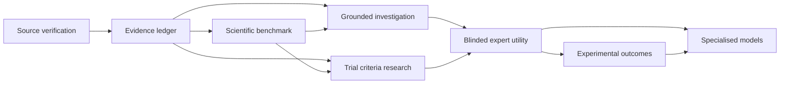

# HSI next build phases

**Date:** 6 November 2026. **Audited baseline:** `e79f79b`.

This is the next delivery plan, numbered **N1–N8** to preserve the existing A–H and architecture histories. The plan is not an implementation or scientific-approval receipt. It incorporates the two supplied research reports and assessment without treating their embedded recommendations as authority to change product scope, data rights or review permissions.

## Product outcome and first programme

A researcher investigating **gut microbial metabolites → immune signalling → insulin resistance in type 2 diabetes** can inspect verified evidence, compare conflicting contexts, identify missing links and produce a reproducible brief for independent review.

Maintain a separate T1D comparison track for islet autoimmunity, disease stage and beta-cell outcomes. Preserve the existing RA/SSc corpus and workbench. The reports' suggested SSc commercial focus remains a proposal; the active gut–immune–diabetes priority is unchanged.

Success means an expert finds the resulting brief more useful, traceable and efficient to check than their current workflow. Node count, agent count and software-test count do not establish scientific success.

## Existing foundation to extend

- Working cross-domain graph, source inspector, model filters, gap questions and JSON/Markdown briefs.
- Original exact-passage RA/SSc corpus and independently permissioned investigation/review contracts.
- Scientific-evaluation and annotation scaffolding, correction-feed separation and bounded orchestration contracts.
- Synthetic cohort filters and bounded public ClinicalTrials.gov JSON import.
- Current graph: 153 concepts, 131 relationships and 75 source records; 12 references await bibliographic retrieval. These remain source candidates, not approved facts.
- Last recorded local QA: 815 core tests and 186 browser checks. No expert-labelled scientific benchmark or prospective biological validation is established by those counts.

## Build sequence

| Phase | Deliverable | Engineering completion evidence | Scientific or operational dependency |
| --- | --- | --- | --- |
| **N1 — Verify and ingest sources** | Public literature adapters, an import/review queue for the 12 candidate references, correction checks, source versions and permitted passage capture. | Reproducible imports; DOI/PMID/title mismatch rejection; bounded retries; metadata-only handling; source hashes and timestamps; no invented or unlicensed text. | Recheck source API access. Source identity, reuse rights and scientific support are separate checks. |
| **N2 — Complete the evidence ledger** | Versioned assertion/context records that distinguish reported findings, predictions, hypotheses and experimental observations. | Backward-compatible archive handling; evidence → passage → source → method lineage; explicit missing dose/assay/context; invalid combinations fail closed. | Qualified review is required for entailment, context and any scientific approval. |
| **N3 — Establish the scientific benchmark** | Annotation guidelines, calibration packets, study-family split manifests, frozen labels and an evaluation runner using existing scaffolding. | Replayable evaluation; no train/test overlap; no fabricated labels; incomplete labels produce an explicit blocked result. | Start with about 20–50 calibration items, then a 100–200-item pilot. Expand toward 500–1,000 only after reviewer agreement and resources are established. |
| **N4 — Ground the research answer** | A bounded retrieval-and-reasoning path connected to the saved investigation and brief. | Relevant sources and passages remain inspectable; every generated assertion has a support assessment; wrong-context, unsupported and injected content trigger appropriate abstention; runs pin all inputs and methods. | Scientific performance must be measured against N3 and a deterministic baseline. Existing source/review eligibility rules remain authoritative. |
| **N5 — Deepen cohort and trial research** | Timestamped public registry snapshots, explicit criterion parsing and criterion-level source/context inspection over validation cohorts. | Reuse the existing five criterion states; preserve AND/OR, negation, units and temporal constraints; missing/ambiguous facts remain unresolved. | This remains research validation. Full patient eligibility, enrolment and live clinical intake are not enabled by this phase. |
| **N6 — Demonstrate expert usefulness** | A blinded comparison of HSI briefs, the deterministic baseline and conventional research. | Frozen evaluation protocol, complete run manifests, correction logs, claim-level results and total checking time. | Actual independent experts, a pre-specified analysis and agreed acceptance thresholds. No automated usefulness score substitutes for expert assessment. |
| **N7 — Record experimental outcomes** | A research-safe experiment ledger linking a pre-result prediction to protocol, raw artifacts, processing, QC and measured outcomes. | Distinct supported, negative/null, inconclusive and technical-failure records; immutable prediction/result lineage; review candidates cannot publish graph facts or edit frozen evaluation data. | Real observations require authorised public data or an actual laboratory/data agreement. Fixture results remain validation data. |
| **N8 — Evaluate specialised models and modalities** | One bounded external-model or multimodal research adapter with an independent benchmark and clear intended use. | Versioned model/data/configuration manifests, reproducible execution, meaningful baseline comparison and visible uncertainty. | Compatible licences, appropriate research data, demonstrated N6 usefulness and suitable held-out evaluation. Prospective lab execution requires a separately approved protocol and resources. |

### Dependency map

Engineering for annotation packets and experiment schemas can proceed before people/data are available. Scientific completion remains blocked until the corresponding real evidence is supplied. N5 can be evaluated separately from the initial mechanism brief so trial scope does not delay the first scientific proof point.

## First build: N1

### Scope

Verify the current 12 bibliographic candidates and establish the reusable path for future public literature. Retain every failed, mismatched, inaccessible, rights-restricted or ambiguous lookup as an explicit queue outcome.

### Work packages

1. **Source queue and capability check.** Materialise the existing candidate IDs into a reviewable queue. Recheck PubMed/Europe PMC availability; the last observed Europe PMC attempt returned a proxy HTTP 403. Record capability availability without attempting to bypass network policy.
2. **Bounded metadata adapters.** Reuse appropriate helpers from `src/evidence/europePmcSscDiscovery.ts` and source-registry contracts. Add a general biomedical adapter without silently widening the existing SSc-specific authority. Record provider, query, DOI/PMID, returned title, retrieval time and immutable response identity.
3. **Identity and study-family checks.** Match the requested source to returned metadata. Reject conflicting DOI/PMID/title combinations and group preprint/publication or repeated study records. Multiple papers do not automatically count as independent studies.
4. **Permitted passage ingestion.** Capture exact text and a precise locator only when permitted. Keep restricted or inaccessible records metadata-only, with rights and missing-text states visible. Never fill a missing quote from model memory.
5. **Context and correction queue.** Prepare model/species, tissue, population, assay, dose/unit, timepoint, intervention, outcome and correction/retraction fields for review. Unknown fields remain unknown. Metadata correction checks do not adjudicate scientific truth.
6. **Graph integration and exports.** Attach import receipts to a new working snapshot; preserve old immutable snapshots and the retired-adapter restriction. The inspector must distinguish source identity, passage availability, support assessment and scientific review.
7. **Verification and delivery.** Test happy and failure paths, repeat the import from frozen fixtures, run affected regression checks, document live results separately, and commit/push the reviewed implementation.

### N1 acceptance checklist

- Every initial candidate has an explicit outcome; a failed lookup is not reported as a verified source.
- A locator cannot substitute for exact supporting text, and bibliographic verification cannot substitute for claim entailment.
- Restricted text is not committed or served publicly without an appropriate permitted-use basis.
- Human donor material in a mouse model cannot become human participant evidence.
- Animal, human cell-line, ex-vivo, mixed-model and human participant contexts remain distinct.
- Corrections, duplicates, mismatched identities, timeouts, rate limits and partial responses are handled explicitly.
- Import/review receipts and graph versions are reproducible; old records remain auditable.
- No scientific-review role, supported status or graph-publication approval is created by the import adapter.
- If API access remains unavailable, the adapter and offline tests can be delivered, but **live N1 acceptance remains blocked**.

### Likely implementation locations

Reuse `src/sourceRegistry.ts`, `src/evidence/researchEvidenceCorpus.ts`, the existing discovery helpers, `src/knowledgeGraph/domainGraph.ts`, `scripts/build-domain-graph.ts` and the graph inspector. A general verification adapter and its receipts may be added under `src/evidence/` and `research/domain-graph/`; those are planned extensions, not existing completed modules. Avoid broadening a legacy parser in place when that would invalidate archived schemas or change trust semantics.

## N2–N4 detail: trustworthy research outcomes

Extend existing schemas and evaluation modules rather than starting a second evidence system. Keep these axes separate:

- What was measured or reported, and the specific context.
- Whether the exact source supports, challenges or fails to address the assertion.
- Measurement/statistical uncertainty and unavailable study details.
- Model uncertainty and calibration, when actually measured.
- Independent human review and publication authority.

N3 must freeze study/source-family groups, dates, task definitions and labels before evaluation. Related preprints, papers, experiments, cohorts and protocol amendments stay in the same partition. Record expert disagreement and insufficient context. Do not use held-out labels to tune the model and then report the same set as an independent evaluation.

For N4, begin with a deterministic lexical-and-graph retrieval baseline. Add semantic retrieval or a model adapter only where measured benefit justifies it. Pin source sets, graph version, model/prompt/configuration, tool results, code identity and final brief. Enforce bounds, cancellation, retries, permissions and prompt-injection checks. Missing eligible evidence must produce an inspectable insufficiency result rather than an invented answer.

## N5 detail: cohort and trial research

Reuse `src/knowledgeGraph/cohortTrials.ts`, `src/trialsCriteriaMvp.ts` and the public-registry snapshot contracts. Preserve the existing states:

- `satisfied`
- `not_satisfied`
- `unknown`
- `ambiguous`
- `requires_investigator_review`

Add explicit source spans and structured rules only where the protocol supports them. Keep condition aliases narrow, distinguish T1D and T2D, and preserve disease stage, autoantibody/C-peptide context, medication timing and missing data. A recorded age match is not a complete criterion assessment. A list of satisfied criteria is not confirmed eligibility.

## N6 detail: the proof point

Before recruiting reviewers, define the question set, source cut-off, baselines, scoring rubric and major-error taxonomy. Use independently reviewed briefs with concealed system identity where feasible. Measure:

- Relevant and opposing evidence coverage.
- Citation/source entailment and context correctness.
- Unsupported substantive claims and appropriate abstention.
- Useful, falsifiable research directions.
- Total research, checking and correction time.
- Reproducibility and reviewer disagreement.

Report denominators, uncertainty intervals and model/species coverage. Thresholds quoted in the uploaded reports are proposed targets requiring agreement; they are not measured HSI performance or universal safety standards. A scientific evaluation cannot be replaced by a count of passing software tests.

## N7–N8 detail: the learning loop

Freeze a prediction before an experiment's outcome is known. Preserve protocol, compound identity, dose/units, tissue/cell state, controls, timing, batch, raw-data pointer/hash, processing version, calibration/QC and deviations.

Distinguish a valid negative/null result, an inconclusive result, an inactive assay and a technical failure. Failed QC does not refute biology; non-significance does not establish no effect. Experimental records enter a review-candidate flow. They cannot silently become approved graph knowledge or contaminate frozen evaluation data.

External-model adapters must declare their supported task and inputs, version, permitted use, limitations and benchmark evidence. Multimodal and organoid/perturbation proposals remain proposals until evaluated on suitable independent data. No laboratory submission, partnership or prospective result is assumed.

## Inputs and owners needed

| Input | Needed for | Status at planning |
| --- | --- | --- |
| Public scientific API access | Live N1 acceptance | Recheck; last observed Europe PMC access was blocked. |
| Source-specific text reuse basis | Exact-text ingestion | Must be established for each source. |
| Qualified independent reviewers and adjudication | N2/N3 scientific acceptance and N6 | Not supplied by this plan; no invented reviewers or labels. |
| A scoped question/source set and agreed rubric | N3/N6 | Initial gut–immune–T2D question is defined; formal protocol still needed. |
| Protected staging access, separate researcher/reviewer identities | Live authenticated workflow acceptance | Follow the existing operational prerequisite; this plan does not unpause it or change production. |
| Public experimental-data permissions or partner agreement | Real N7 observations and prospective N8 | Not assumed. |
| A bounded model use case, compatible licence and suitable data | N8 | Select after evaluated usefulness is demonstrated. |

Use engineering, evidence-curation, scientific-review and product-research owner roles when assigning tasks. Named people, staffing capacity and delivery dates are not invented here.

## Sequencing and release discipline

**First delivery:** N1 source queue, bounded adapters, receipts, failure handling and inspector integration. Prepare N3 annotation guidelines alongside it. Then complete N2 and the pilot benchmark before claiming a grounded scientific-answer capability.

Each engineering phase ends with a concrete diff, relevant tests, an audit receipt and a commit/push. Record engineering verification, live integration acceptance and scientific review separately. Source, reviewer and operational dependencies can block a phase's acceptance while unaffected engineering proceeds.

A detailed calendar estimate should follow the N1 access check and reviewer availability. The uploaded reports' 90-day plans, dataset volumes and staffing/budget figures are planning proposals; they are not commitments made by this document.

## Persistent boundaries

- Human Super Intelligence remains the product/technology name.
- Aksh and ISI retain their interfaces, databases and access controls.
- No shared patient database, live PHI, PHI-to-LLM, clinical decision support or EHR write-back is introduced in HSI Core.
- No autonomous scientific approval or bypass of Gate C.
- No fabricated source text, reviewer labels, licences, partnerships, patient eligibility or experimental outcomes.
- Existing annotation, evidence, graph, review and correction infrastructure is extended rather than duplicated.

## Scope of this planning change

This document adds the next implementation plan. It does not implement N1–N8, enable a provider, import a dataset, run a scientific evaluation, change a database or modify a deployed product flow.
