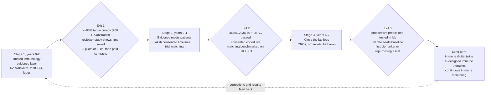

# HSI Roadmap: Owning the Trusted-Evidence Loop

**Status:** Founder-shared roadmap (filed 2026-11-03). Strategy digest — **not** a claim of current benchmark performance, MoU, Gate C auto-approve, or live CDS/PHI.  
**Source:** Downloads `HSI_ROADMAP.md` v1.0 (3 Nov 2026). Companion canvas competitor Page cited in source; cleaned landscape: [HSI_AKSH_ISI_COMPETITOR_ANALYSIS.md](./HSI_AKSH_ISI_COMPETITOR_ANALYSIS.md).  
**Merge note:** This is the **multi-year trusted-evidence loop** narrative. Near-term engineering truth remains [`../BUILD_STATUS_AND_NEXT.md`](../BUILD_STATUS_AND_NEXT.md). Dependency phases remain [HSI_PRODUCT_ROADMAP.md](./HSI_PRODUCT_ROADMAP.md). Immunology wedge reshape: [HSI_IMMUNOLOGY_SI_BUILD_PATH.md](./HSI_IMMUNOLOGY_SI_BUILD_PATH.md).  
**Brand:** Source uses **Human Super Intelligence** for the reasoning layer joining ISI evidence to Aksh timelines — matches tip site brand; do not treat older “Health Super Intelligence” pack wording as a rename ticket here.

Status key (preserved from source):

- **[V]** verified on the source’s own site on 3 Nov 2026  
- **[K]** well-established public resource; terms not re-read that session — recheck before relying  
- **[A]** assumption or plan, not a fact  

---

## Honesty stamps (read first)

| Source claim | Stamp |
| ------------ | ----- |
| Own the trusted-evidence loop; four visible tags on every claim | **Adopt as product doctrine** — deepen tagging; not every edge is expert-reviewed today |
| ≥85% tag accuracy on 200 RA abstracts; 40% time save; 3 pilots/LOIs | **Exit / eval targets**, not measured current performance |
| First paid pilot by month 9; 5–8 paying teams by month 24 | **[A]** revenue planning only |
| “Every stage pays for itself” | **[A]** governance preference — do not block Stage 1 engineering honesty work |
| Stage 1 = years 0–2 greenfield evidence layer | **Reshape** — Stage 1 backbone + ISI KG/Ask/investigation already exist ([BUILD_STATUS](../BUILD_STATUS_AND_NEXT.md)); compress into checker benchmark + Gate C review push, not rebuild |
| Owkin-style hospital network / BioNeMo / CRO partnerships | **Proposed** — no invent MoU |
| DCB0129/0160, DTAC, DSPT, MHRA SaMD as Stage 2 moat | **Adopt as future Aksh/clinical path** — not done; not an HSI substrate claim today |
| Immune digital twins / AI-designed therapies / continuous monitoring | **Long-term [A]** — partner-led; MHRA-grade; out of near-term build |
| Live patient timelines / trial matching influencing care | **Stage 2+**; clinician-in-loop; **forbidden** as live CDS/PHI in HSI now ([../CDS_PHI_BOUNDARY.md](../CDS_PHI_BOUNDARY.md)) |
| Source companion `HSI_BUILD_SPEC.md` | Not filed in this pass — roadmap stands alone with BUILD_STATUS + immunology build path |

---

## Verdict vs existing strategy

**Aligns strongly:** ISI-first evidence layer; honesty by design; research tool ≠ medical device in Stage 1; partner rather than build everything; RA synovium as narrow wedge; human correction loop feeds eval; regulation before scale for patient data; Aksh as consented timeline owner later.

**Conflicts / reshape:**

1. **“Years 0–2 Stage 1” vs shipped Stage 1** — treat source Stage 1 as the *market* stage (trusted immunology evidence product), not a greenfield repo reboot.  
2. **RA synovium checker vs melanoma Explorer** — dual-track: RA context-mismatch is the **90-day competitive wedge**; melanoma remains ISI **signature research demo** (see immunology build path). Do not reopen exclusive OR.  
3. **Four-product pack vs three-product source** — source folds Trials into Stage 2 HSI/Aksh; pack keeps HSI Trials as a product experience. Keep pack IA; sequence Trials after evidence trust + consent.  
4. **Investigation backends just landed** — checker/API should extend Ask / M1 brief / Gate C / Discovery consume, not a second stack.

**Adopt now:** four-tag claim surface (species, sample, setting, review status); open RA context benchmark plan; design-partner-first GTM; Europe PMC OA full-text path; correction logging as training/eval data; Stage 2 consent + criterion states (met / not met / unknown) already in Trials honesty doctrine.

**Defer:** wet-lab loop, organoid CROs, UK Biobank/CPRD spend, digital twins — until Stage 1 exit criteria are real, not aspirational.

---

## 1. Core identity

We own the trusted-evidence loop: predict, test, learn, repeat. Every claim the system shows carries four visible tags: **species** (human / mouse / other), **sample** (tissue, blood or cell line), **study setting** (in vivo, ex vivo, in vitro) and **review status** (expert-reviewed or not). When an expert corrects a tag or a verdict, the correction is stored with its author, reason and date, and becomes training and evaluation data for the next release. Trust is the product; scale follows trust.

Three products share this loop (source framing):

- **ISI (Immune Super Intelligence):** evidence layer for translational immunology; starts as the context-mismatch checker.  
- **Aksh Health:** consented UK diabetes-care workflow → longitudinal patient timelines (labs, CGM, medicines, later microbiome).  
- **HSI (Human Super Intelligence):** reasoning layer that joins ISI evidence to Aksh timelines and, later, to lab results.

---

## 2. Principles

1. **Honesty by design.** No answer without a source; uncertainty shown; “we do not know” is valid. Benchmarks published with failure cases.  
2. **Partner rather than build everything.** Data partners (Owkin-style hospital networks — Proposed), model infrastructure (NVIDIA BioNeMo / open models), wet-lab and organoid CROs, biobanks. We build the evidence graph, context tagging and correction loop; we rent the rest.  
3. **Regulation as a moat.** DCB0129 / DCB0160, DTAC, DSPT, DPIAs, and where needed MHRA SaMD (UKCA). Early and proper — barriers fast movers skip. (**Stage 2+ clinical path; not claimed done.**)  
4. **UK strengths.** NHS / SDEs, UK Biobank, Genomics England, Our Future Health, NIHR BioResource, university immunology (e.g. QMUL synovial biopsy).  
5. **Every stage pays for itself.** No stage starts until the previous has paying customers or funded pilots covering run-rate. **[A]** for revenue figures.

---

## 3. Timeline

Exit metrics are **targets [A/V mix]** until measured and partner-agreed.

---

## 4. Stage 1 (years 0–2): most trusted immunology evidence layer

**Goal.** Translational immunologist trusts: “this finding is from human synovium, this from mouse, this from cell line” in seconds — start RA synovium, then IBD and lupus.

**Products.**

- Context-mismatch checker (web + API): question + target context → claim, tags, verdict (match / partial / mismatch), plain-language reason, links.  
- Evidence cards → slides / target dossiers.  
- Correction interface: reviewers fix tags; every fix logged and versioned.  
- Open RA context benchmark (200 labelled abstracts, later expanded) + public leaderboard. **[A]**

**Customers / revenue [A].** Pharma I&I translational / target-validation (seats + project fees); academic groups (free/low-cost for corrections + co-authorship); later consultancies. Working target: first paid pilot by month 9; 5–8 paying teams by month 24.

**Milestones / exit (targets).**

- Days 0–90 (competitor-Page wedge): ≥85% tag accuracy (species, sample, setting) on 200 expert-labelled RA abstracts; inter-annotator agreement reported; timed reviewer study (≥6 reviewers, checker vs manual PubMed triage, target ~40% less time, no accuracy loss); 3 pilots or LOIs.  
- Months 4–12: Europe PMC OA full text; validate “human synovial” claims vs AMP RA / PEAC; first paid pilot.  
- Months 12–24: IBD + lupus packs at same bar; ≥2,000 logged expert corrections; ≥3 paying customers; ISO 27001 or Cyber Essentials Plus in progress.  
- Exit to Stage 2: accuracy held across three indications; revenue covers core team; ≥1 customer asks to link evidence to patient data.

**Team (plan).** Founder; 1–2 ML/NLP; 1 full-stack; part-time immunologist/rheumatologist; paid annotator panel. Caps: biomedical NLP, ontology mapping (CL, Uberon, MONDO, NCBI Taxonomy), evaluation design.

**Partnerships (Proposed).** One UK academic rheumatology group; Europe PMC / NCBI upstream; one pharma design partner — **no invent MoU**.

**Regulatory.** Research tool, not a medical device. UK GDPR for accounts only; no patient data. Intended-use excludes clinical decisions. Publisher text-mining: OA full text only.

**Risks.** Incumbents add a context filter; labelling slow/inconsistent; buyers see “a feature.” Mitigation: published accuracy in a narrow area; double labelling; attach to budgeted dossier workflow.

**Build remap:** Implement checker + benchmark against existing ISI Ask / investigation backends / Gate C / hsi-core packs — see BUILD_STATUS — not a parallel repo.

---

## 5. Stage 2 (years 2–4): connect evidence to real patients

**Goal.** Join ISI evidence to consented Aksh timelines; check hypotheses on real people (aggregate); match patients to trials with clinician sign-off.

**Products.**

- Aksh consented timelines: FHIR R4 HbA1c, lipids, eGFR, CRP, CGM, Rx, later microbiome — each with consent scope.  
- HSI hypothesis checks: claim in → cohort summary out (aggregate; small-number suppression).  
- Trial matching: CT.gov / ISRCTN / Be Part of Research; every criterion **met / not met / unknown**; clinician sign-off before patient contact.

**Customers / revenue [A].** NHS diabetes / PCN (Aksh subscription); pharma/CRO feasibility under consent; research groups (governed access).

**Exit targets.** DCB0129/0160 + DTAC + DSPT Standards Met + DPIA; ≥1,000 patients with explicit research consent **[A]**; TREC CT 2021–2023 beat BM25 on NDCG@10 then UK clinician sample; ≥3 Stage-1 hypotheses tested including negatives; ≥2 paying research customers; MHRA position decided for any care-influencing feature.

**Regulatory.** UK GDPR Art. 9 + explicit research consent; HRA/REC; MHRA SaMD if risk-scoring/matching influences care.

**Binding:** No live CDS/PHI in HSI substrate; Aksh owns clinic PHI plane.

---

## 6. Stage 3 (years 4–7): close the lab loop

**Goal.** Evidence + patient signals → pre-registered predictions tested in lab; results feed the graph (“tested by us”).

**Products.** Prediction registry; experiment designer → CRO/organoid; results ingester.

**Exit targets.** ≥20 pre-registered predictions; hit rate vs literature-only baseline; ≥1 biomarker/repurposing candidate with independent validation; ≥1 co-development/licensing deal. **[A]**

**Partnerships [A].** HUB Organoids, Charles River, Crown Bioscience, biobanks, BioNeMo-class compute — Proposed / quote-only.

---

## 7. Long term (year 7+)

- Immune digital twins (trial simulation first, not individual care).  
- AI-designed immune therapies with partners.  
- Continuous immune monitoring (wearable / home sampling).  

All three require MHRA-grade validation and are strictly partner-led. **[A]**

---

## 8. Data to test hypotheses (abridged)

Full source tables (costs, licences, Synapse IDs, UKB tiers, CPRD fees, organoid CROs) are preserved in Downloads `HSI_ROADMAP.md`. Below: stage hypotheses + start-now posture. Recheck **[K]** licences before contracting.

### Stage 1 hypotheses

- **H1** Context tags extractable at ≥85% from abstracts.  
- **H2** Showing context reduces triage time without accuracy loss.  
- **H3** “Human synovium” claims agree more with real synovial data than mouse/cell-line.  
- **H4** Method transfers to IBD and lupus at same accuracy.

**Near-term open sources (same-day / free tiers):** PubMed E-utilities, Europe PMC REST + Annotations, PubTator3, MeSH, OpenAlex/S2 **[K]**, Reactome / OLS (CL, Uberon, MONDO), IEDB later; S800 / LINNAEUS / BioRED / BC5CDR baselines; PEAC E-MTAB-6141, R4RA E-MTAB-11611, CELLxGENE / HCA; AMP RA registered via Synapse/ARK (controlled DAR for individual-level).

### Stage 2 hypotheses

- **H5–H8** Consented timelines reproduce known associations; inflammation/CGM/microbiome value; trial matching precision acceptable to clinicians.  
**Sources:** Aksh consented data; UK Biobank / Our Future Health / Genomics England / CPRD / OpenSAFELY / HDRS **[V/K mix — intake windows change]**; Tidepool / OpenAPS / OhioT1DM for CGM methods; Synthea + NHS artificial data for engineering only; CT.gov / ISRCTN / Be Part of Research; TREC CT topics/qrels.

### Stage 3 hypotheses

- **H9–H11** Tissue-context predictions beat literature frequency in organoids; repurposing + genetics; subgroup replication.  
**Sources:** Open Targets, ChEMBL, DrugBank (licence gates), DepMap, LINCS/CMap, HPA/GTEx, UKB proteomics, Generation Scotland, HUB/CRO quotes.

---

## 9. First 30 days data plan (source) — remap

**This week (open):** Pull RA abstracts + Europe PMC/PubTator baselines; score species tagger on S800/LINNAEUS; download PEAC/R4RA/CELLxGENE synovium + Gut Cell Atlas; Synapse account + AMP RA registered files; ImmPort SDY998 register; TREC CT download for later; write labelling guideline; sample 200 abstracts; recruit 3–4 expert annotators.

**Start now (months):** AMP controlled DAR + academic collaborator; UK Biobank org/researcher AMS (intake paused → late 2026); CPRD org approval; UK IBD BioResource DAC note; Our Future Health account; OpenSAFELY interest; Tidepool/OpenAPS/OhioT1DM DUAs; Generation Scotland reopening check.

**Honesty remap:** Prefer work that feeds the **RA context benchmark + Gate C review push** and existing packs over parallel downloads that never enter eval. Do not invent institutional approvals.

---

## 10. Assumptions and unverified points (preserved)

- Revenue targets, patient counts, annotator rates, approval timelines marked **[A]** are planning assumptions.  
- **[K]** resources: recheck licence/rate limits before contracting or publishing.  
- UK Biobank, Generation Scotland, OpenSAFELY intake windows change — recheck monthly.  
- HDRS pricing/timelines unpublished at writing.  
- Organoid CRO prices quote-only; Crown Bioscience immunology fit needs scoping.  
- IBD Plexus requires eligible academic PI — access depends on partner.  

---

## Cross-links

| Doc | Role |
| --- | ---- |
| [HSI_AKSH_ISI_COMPETITOR_ANALYSIS.md](./HSI_AKSH_ISI_COMPETITOR_ANALYSIS.md) | 90-day wedge + competitor matrices |
| [HSI_COMPETITOR_ANALYSIS_2026-11.md](./HSI_COMPETITOR_ANALYSIS_2026-11.md) | Prior platform-level competitor pack |
| [HSI_IMMUNOLOGY_SI_BUILD_PATH.md](./HSI_IMMUNOLOGY_SI_BUILD_PATH.md) | Melanoma + RA dual-track reshape |
| [HSI_PRODUCT_ROADMAP.md](./HSI_PRODUCT_ROADMAP.md) | Dependency phases 0–6 |
| [../BUILD_STATUS_AND_NEXT.md](../BUILD_STATUS_AND_NEXT.md) | What is actually shipped |
| [../CDS_PHI_BOUNDARY.md](../CDS_PHI_BOUNDARY.md) | No live CDS/PHI in HSI |
