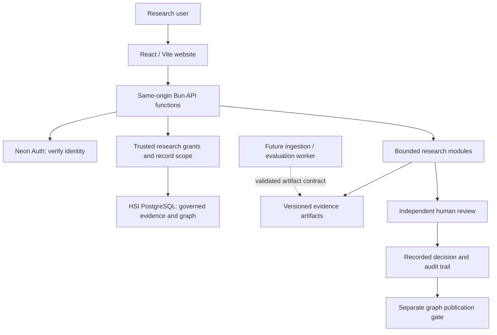

# Human Super Intelligence — technology stack and deployment profile

**Date:** 5 November 2026. **Status:** Implementation baseline aligned to the existing research codebase; enterprise additions remain proposed. This document does not certify a live production, clinical or multi-tenant deployment.

[Founder technology proposal](HSI_TECHNOLOGY_STACK_PROPOSAL.md) · [Product direction](HSI_PRODUCT_DIRECTION.md) · [Implementation crosswalk](HSI_PRODUCT_DIRECTION_IMPLEMENTATION.md) · [Architecture Document 02](HSI_ARCHITECTURE_AND_DATA.md) · [Four-product ownership](HSI_FOUR_PRODUCT_ECOSYSTEM.md)

## 1. Deployment decision

Build HSI as a modular research platform using the existing React/Vite frontend, Bun/TypeScript services, PostgreSQL research substrate and Neon Auth identity integration. Vercel hosts the existing frontend and bounded API functions. Separate module contracts before creating separate deployable services.

The founder proposal is a useful capability catalogue. Implementing Next.js, FastAPI, Neo4j, a vector database, Redis, Kafka and Kubernetes together is not required to complete the first research journey. Add a component when a measured workload, data-control requirement or accepted product need justifies its operational cost.

HSI is **Human Super Intelligence**. Health/biomedical intelligence is the present application domain. A modular SaaS direction does not establish current tenant isolation, deployment reliability, regulatory readiness or scientific validity.

## 2. Stack choices and addition gates

| Layer | MVP baseline / existing foundation | Addition or change gate |
| --- | --- | --- |
| Web application | React + TypeScript + Vite, existing routes and design system (`site/package.json`) | Adopt Next.js only for a documented requirement that the current frontend cannot reasonably meet; do not rewrite to match an option list. |
| UI and visualisation | Existing ivory/teal/coral styles, accessible labelled controls and current science graph components | Add a focused graph/chart/component library after interaction, accessibility, bundle-size and licence assessment. Avoid installing several alternatives for the same task. |
| Domain APIs | Bun/TypeScript modules and `site/api` Web-handler entrypoints | Split a module into a separate service when independent scaling, security boundaries, deployment cadence or runtime libraries require it. FastAPI/NestJS remain options. |
| Identity | Existing Neon Better Auth gateway; secure HttpOnly cookies and server-side verification | Replacing or federating identity requires a migration/rollback and session/role acceptance plan. Auth0/Cognito/Keycloak are alternatives, not simultaneous MVP dependencies. |
| Permissions | Trusted researcher/reviewer grants, scoped stores and governed graph contracts | Prove every protected read/write is scoped with independent-account and cross-tenant negative tests. A schema name or UI role label alone is not isolation. |
| Operational/research store | HSI-owned PostgreSQL with existing ownership, review, graph and audit contracts | Reuse permitted HSI schemas. Aksh and ISI keep separate product databases. No cross-product patient tables. |
| Graph queries | Existing PostgreSQL-backed governed graph and typed source-linked projections | Consider Neo4j or another graph engine only after representative traversal/query benchmarks, provenance/permission parity, migration and rollback design. Verify any required managed-provider extension support before selecting Apache AGE. |
| Semantic retrieval | Current source-linked retrieval foundations; a vector index remains an explicit addition | Prefer evaluating pgvector alongside the existing store first; select Qdrant only for demonstrated requirements. Pin passage/model/index versions and test tenant/data-class filtering before exposure. |
| Bounded investigations | Existing TypeScript question, evidence, mechanism, checkpoint and review contracts | Add model calls only through server-controlled tools with budget, timeout, provenance and review boundaries. A second model is not independent scientific validation. |
| Scientific extraction/evaluation | Existing Python evidence tooling where appropriate; typed interchange with TypeScript | Add Python workers for required scientific libraries or extraction workloads. A new web API framework is not a prerequisite for offline evaluation. |
| Ingestion and long jobs | Separate workers when the task exceeds bounded-request limits; durable checkpoint foundations are in the repo | Choose one queue/workflow mechanism with idempotency, bounded retries, cancellation, dead-letter handling and recovery acceptance. Existing checkpoint code is not proof that a queue or worker fleet is running. |
| Documents/artifacts | Versioned manifests and current research artifacts; controlled object storage is a future extension when needed | Approve one region/provider, access policy, retention, hashing, backup and export lifecycle. Never serve licensed/private material from the public static directory. |
| Cache | Omit until a specific measured need | Redis requires a bounded TTL/invalidation strategy that respects revocation and evidence versions. Do not cache authorization or research facts indefinitely. |
| Time-series/warehouse | Keep out of the initial research deployment | Evaluate PostgreSQL-compatible or dedicated stores only for a permitted, measured workload. Wearable and patient pipelines do not become HSI inputs through this decision. |
| Operations | Existing GitHub Actions, Vercel builds and safe health/session checks | Prove operational logging, alerting, backup/restore and service objectives before making availability or compliance commitments. |

## 3. Implementation topology

This is the code-defined topology, not a claim that each live connection has passed acceptance.



The code currently configures `api/**/*.ts` with `maxDuration: 30` in `site/vercel.json`. Recheck provider limits before sizing workloads. Long extraction, bulk embedding, batch ingestion or lengthy investigations belong in an explicitly deployed worker with durable execution; they must not depend on a browser request remaining open.

Short API handlers enforce request origin, authenticated identity and current grants. Worker credentials must be scoped to their approved sources, data classes and output operations. Workers cannot supply a reviewer identity, approve their own generated claim or bypass a release gate.

## 4. Environment and data isolation

Environment, product ownership and data class are separate controls.

| Environment | Intended data/workflow | Release evidence |
| --- | --- | --- |
| Local development | Synthetic fixtures and permitted non-sensitive public evidence | Repeatable install, type checks, tests and clearly labelled fixtures |
| Disposable testing | Negative permission, schema/recovery and fixture tests on an explicitly confirmed non-production target | Controlled teardown, reproducible fixtures, no production fallback |
| Staging | End-to-end integration with approved test inputs and separate identities | Same-target Auth/database checks, scoped access, provenance and review acceptance |
| Demo/sandbox | Clearly identified synthetic examples and permitted public material | No synthetic record accepted as scientific support or promoted into the evidence graph |
| Research production | Permitted public/licensed research inputs under validated access and operational controls | Required release checks and intended-use acceptance; no PHI or live CDS in `hsi-core` |

Separate environment bindings, credentials, roles and retention/access controls at minimum. The existing HSI Neon project has named production, staging and disposable branches; that is not evidence of separate cloud accounts or dedicated enterprise deployments. Stronger account/project/network/key isolation is a customer/data-risk decision requiring explicit implementation and validation.

For each app deployment, its Auth provider and intended research database must use the same approved HSI branch. A Vercel environment called **Production** identifies the website deployment configuration; it does not automatically select the correct Neon branch. Schema separation alone is not a tenant boundary.

**Operational status:** the last supplied session diagnostic showed staging Auth (`ep-sweet-hill-zasb0lni`) and a production database (`ep-restless-dew-zas989pv`). That configuration task is paused at the founder's request. This document does not change credentials or claim the session is fixed.

## 5. Separate product and clinical planes

| Plane | Ownership and permitted exchange |
| --- | --- |
| Shared research technology | HSI owns its evidence contracts, governed graph, investigation engines and review/audit patterns. |
| Immune research experience | ISI retains its own product interface and database; consume validated, versioned artifacts or authenticated APIs with explicit provenance and permission. |
| Personal/clinical context | Aksh and any future clinical product retain their own patient identity, records, consent/legal-basis enforcement and clinical engines. |
| Trial operations | A separately approved product workflow; trial registry relevance does not establish participant eligibility. |

The clinical pipeline in the source proposal describes a future separately governed product plane. For any such work, verify identity, consent/legal basis, purpose and source scope **before** retrieval, then minimise and classify the export. Pseudonymisation alone does not make clinical or genomic data anonymous or acceptable to the research plane. An on-premise connector must not automatically forward notes, reports or model prompts to an HSI cloud model.

No live patient FHIR ingestion, clinical OMOP store, EHR write-back, patient-specific inference or PHI-to-LLM path is introduced by this deployment profile. FHIR/OMOP/LOINC/UCUM and biomedical ontology alignment remain standards choices whose mappings, terminology permissions and intended use need validation.

## 6. From modular application to additional deployment models

| Model | Current decision | Evidence needed before offering it |
| --- | --- | --- |
| Research SaaS | Working delivery direction on existing hosted foundations | Tenant/record isolation, licence/data-class filtering, load/restore tests, scoped grants and operator procedures |
| Embedded API/SDK | Versioned contracts and artifact exports can inform a later product package | Stable API/schema versions, authentication, revocation, quotas, tenant scope, error contracts and backward-compatibility tests |
| Private cloud/VPC | Proposed customer deployment option | Dedicated infrastructure specification, residency/keys/network design, support model, reproducible install, backup/upgrade/rollback and acceptance |
| On-premise/hybrid | Proposed customer deployment option | Signed/verified artifacts, offline dependency/model licences, local processing boundaries, outbound controls and a tested upgrade/recovery process |
| Kubernetes | Conditional runtime choice for workloads that justify it | SRE ownership, measured scheduling/scaling/isolation need, network policy, secret delivery, restore/upgrade/rollback exercises and cost review |

Do not ship Helm charts simply to make the architecture diagram look enterprise-ready. Containers or managed workers may meet an accepted workload before a cluster is warranted. A managed database can remain managed even if workers later run on Kubernetes.

## 7. Interoperability and evidence contracts

- Preserve source identity/version, legal basis or licence, data class, ingestion time, quality status and immutable content/integrity metadata.
- Preserve assay identity, units, reference interval, observation time and context when permitted research lab data is introduced. Do not infer an hs-CRP assay from an unspecified CRP measurement.
- Terminology mapping is a reviewed assertion, not evidence that two clinical or biological concepts are interchangeable. Keep unresolved/ambiguous mappings explicit.
- Public evidence intake validates source identity, permitted retrieval/storage and passage locators before a claim becomes reviewable. Ingestion, embeddings and model agreement never constitute approval.
- A research brief pins inputs, graph/release version, included evidence, method and review state. Unmeasured biology and absent longitudinal observations remain unknown.
- Synthetic fixtures retain their labels and are excluded from scientific promotion. Public evidence and licensed inputs must not inherit permissions from a shared cache/index entry.

## 8. Identity, observability and compliance acceptance

Use the existing same-origin Neon gateway and independently verified backend grants. Secret values, cookies, passwords, one-time codes and connection strings must never enter browser bundles, repository files, error text, logs or telemetry. Diagnostic endpoints may reveal only the explicitly permitted self-scoped checks.

Record correlation ID, service/version, deployment environment, operation, duration, safe outcome, data class and source/release version as appropriate. Tenant/actor identifiers require minimisation and access controls. Do not log source passages, patient content or full model prompts by default.

Measure API/worker latency, failure/retry rates, queue age, ingestion failures, retrieval quality, review throughput, cost and authorization failures. A “hallucination rate” needs a defined task, denominator, labelled evaluation set and expert method; it is not a generic telemetry field.

Required operational evidence includes encrypted backup and tested restore, retention/deletion behaviour, incident response ownership, artifact/prompt/model versioning and licence controls. Provider encryption/compliance claims do not establish end-to-end HSI compliance. UK/EU/US/India residency and regulated deployment options remain proposed until provider, contractual, data-transfer and application controls are confirmed for that use.

## 9. CI/CD and release acceptance

Existing foundations: `.github/workflows/research-foundation.yml` installs/builds the site separately from root dependencies; `site/package.json` runs API type checking before Vite. These checks help detect deployment issues but do not prove branch protection, a production approval workflow or live database readiness.

Target release sequence:

```text
Versioned change
→ contract/type/unit/negative permission checks
→ site-only dependency and API build checks
→ scientific/evidence regression evaluation where applicable
→ approved staging deployment
→ authenticated multi-account integration and browser checks
→ backward-compatible schema/rollback review if schema changes are proposed
→ explicit production release gate
→ monitored rollout and recovery verification
```

Database changes require their own reviewed target, migration and rollback plan; routine build/startup must not run migrations. A frontend rollback does not undo an incompatible database or model/artifact change. Deploying a Vercel function is separate from verifying access, email delivery, researcher authority and record availability.

| Gate | Minimum acceptance |
| --- | --- |
| Authentication | Same intended Auth/database target; valid session; email verification; logout, expiry, ban/impersonation handling |
| Authorization | Trusted grants; record/tenant scope; no browser role trust; revoked-user and cross-tenant negative tests |
| Evidence | Source/version/locator integrity; synthetic exclusion; unsupported claims remain drafts |
| Review | Independent reviewer; author self-review rejected; recorded decision does not auto-publish graph facts |
| Operations | Bounded jobs; redacted diagnostics; feature flags; provider limits; staging smoke; restore/recovery evidence |
| Product experience | Connected question-to-dossier-to-brief flow; accessible controls; clear unavailable/pending/failure states |

Code gates, operational readiness and scientific acceptance are separate results. Do not collapse them into “production ready”.

## 10. Next implementation package

Continue the [connected research investigation package](HSI_PRODUCT_DIRECTION_IMPLEMENTATION.md#3-the-next-work-package-one-complete-research-investigation). Inventory the existing SSc/RA and mechanism workbench features before adding a second implementation. Close concrete evidence, brief, review and interaction gaps using the current stack.

Keep any independent worker, object store or semantic index addition as a small, testable change with its own acceptance evidence. Leave the paused database configuration task paused; do not provision infrastructure, migrate databases, change identities or start third-party services as a side effect of accepting this document.
